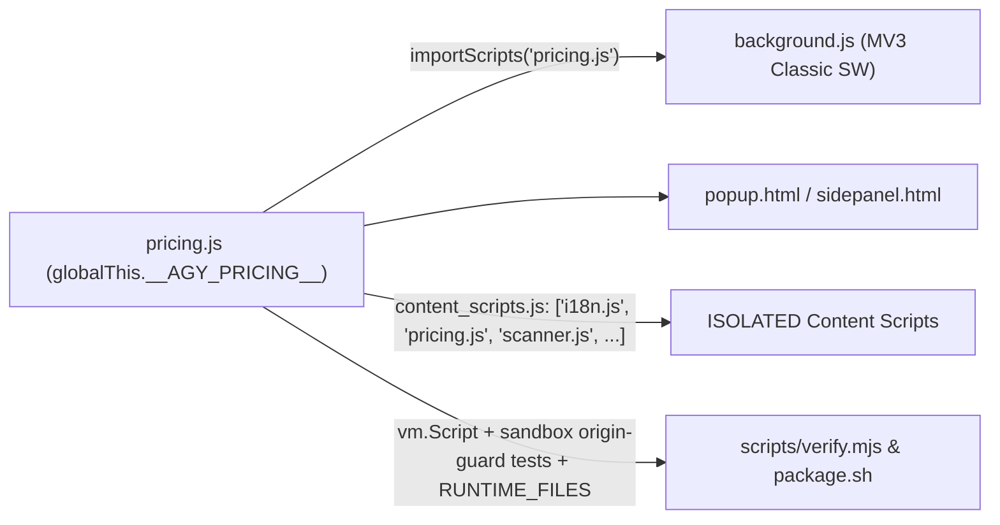

# P1 Technical Specification — Persistent Deduplicated Token Ledger, Offline Pricing Engine & Progressive-Disclosure Analytics Drawer

> **Status:** Implementation-Ready Specification (P1 Scope Only — builds directly on the P0 working tree)
> **References:** [AGENTS.md](../AGENTS.md) · [PRIVACY.md](../PRIVACY.md) · [docs/magpie-token-telemetry-research.md](magpie-token-telemetry-research.md) · [docs/p0-token-telemetry-plan.md](p0-token-telemetry-plan.md)
> **Target Runtime:** Chromium 120+ (Manifest V3)

---

## 1. Scope Boundaries & Non-Goals

### 1.1 In-Scope (P1 Deliverables)

1. **Shared Offline Pricing & Ledger Utility Module (`pricing.js`)**
   - Universal, zero-dependency, strict-CSP-compliant module exposing `globalThis.__AGY_PRICING__` across the MV3 Service Worker (`importScripts('pricing.js')`), Extension Popup & Side Panel (`<script src="pricing.js">`), and `ISOLATED` content scripts (`manifest.json` + dynamic localhost registration in `background.js`).
   - Includes the same `0.01ms` non-Antigravity origin/ancestor guard used by `i18n.js` so `pricing.js` exits immediately on non-Antigravity frames.
2. **High-Watermark Deduplicated Usage Ledger (`agyUsageLedgerV1` in `chrome.storage.local`)**
   - Persistent on-device ledger (`version: 1`) with `watermarks` capped at `300` LRU conversations, `daily["YYYY-MM-DD"]` buckets (local calendar date) containing `totals`, 24-bucket `hourlyTokens`, `byModel`, and `byProject`, automatic `90`-day rolling retention, and a hard `< 250 KB` (`240 KB` ceiling) serialized byte budget.
   - Step-level delta ingestion pipeline (`page-bridge.js` -> `scanner.js` -> `content.js` / `frame-detector.js` -> `background.js`) gated strictly on exact `modelUsage` (`precision === 'exact'` per-step equivalent), integrated with P0's `MAX_STEPS_PER_CONV = 240` (`evictedSessionAcc`), `absIndex`, `reasoningInOutput` deduplication, debounced + `visibilitychange`/`pagehide`/`GET_STATUS` flushes, reload/multi-tab/fork idempotency, serialized async write locking in `background.js`, storage quota error recovery, and privacy-clean `Clear History` reset without re-ingesting already-seen steps on open tabs.
3. **Offline Model Pricing, Currency & Cache-Savings Engine (`pricing.js` + `agyPricingConfigV1` in `chrome.storage.local`)**
   - 100% static, read-only USD `/ 1M tokens` pricing catalog with alias normalization for Antigravity internal `MODEL_PLACEHOLDER_M*` IDs and Gemini / Anthropic Claude / OpenAI GPT labels.
   - Tiered `cacheWrite5m` and `cacheWrite1h` billing with untiered `cacheWrite` fallback; `reasoningTokens` billed at `output` rate strictly when `!reasoningInOutput`; unknown/experimental models yield `null` cost rendered as `'--'`.
   - `USD` / `CNY` currency toggle (default `usdToCnyRate = 7.25`, user-editable in `[0.5, 50]`) and per-model custom rate overrides stored on-device in `chrome.storage.local["agyPricingConfigV1"]`.
4. **Progressive-Disclosure Analytics Drawer & Tooltip Enrichment (`popup.html`, `sidepanel.html`, `popup.css`, `popup.js`, `scanner.js`)**
   - Default-collapsed `<details id="usageDrawer" class="card usage-drawer">` matching `.advanced-panel` (`details::details-content`), with a live collapsed summary pill (`Today 184k · ~$0.42`) and responsive layout across Popup (`360–380px`) and Side Panel (`@container panel` 2-column grids).
   - Controls & visualizations: `Today | 7d | 30d` segmented range switch, `USD | CNY` segmented currency switch, 4-card KPI grid, `24h` / `7d` / `30d` pure-SVG trend bar chart + 28-day CSS-Grid activity heatmap, Top Models & Top Projects ranked bars, nested custom rate & FX override subpanel, `Export JSON` / `Export CSV` (with CWE-1236 CSV formula-injection neutralization and `URL.revokeObjectURL` cleanup), and 2-step inline `Clear History` confirmation (zero `window.confirm`).
   - Enrich per-chat row hover `title` (`popup.js`) and opt-in Shadow DOM composer capsule tooltip (`scanner.js`) with session equivalent API value and prompt-cache savings.
5. **10-Locale i18n Parity, Privacy Policy & Build/Verify Tooling (`i18n.js`, `PRIVACY.md`, `scripts/verify.mjs`, `scripts/package.sh`)**
   - Add **54** canonical i18n keys across all 10 locales (`186 -> 240` keys) with 100% `{placeholder}` parity and static call-site coverage.
   - Update [PRIVACY.md](../PRIVACY.md) to document `chrome.storage.local["agyUsageLedgerV1"]` and `chrome.storage.local["agyPricingConfigV1"]`.
   - Update `scripts/verify.mjs` and `scripts/package.sh` to validate and package `pricing.js`, enforce the `240`-key count, verify HTML/content-script ordering, and enforce scoped `URL.createObjectURL` + `URL.revokeObjectURL` safety.

### 1.2 Explicit Non-Goals & Hard Prohibitions (Excluded / Deferred to P2)

- **Zero Permission or Host Expansion in `manifest.json`:**
  - `permissions` MUST remain strictly `["storage", "sidePanel", "scripting"]` (no `notifications`, `alarms`, `downloads`, `tabs`, or `<all_urls>`).
  - `host_permissions` and `optional_host_permissions` MUST remain byte-for-byte unchanged (`manifest.json` changes in P1 are limited strictly to adding `"pricing.js"` to the two `ISOLATED` `content_scripts[].js` arrays after `"i18n.js"`).
- **Zero External Network Calls:**
  - Never fetch `models.dev`, currency FX endpoints, telemetry endpoints, or any remote URL. All pricing and currency math runs 100% offline.
- **Zero P2 Features:**
  - No `optional_permissions: ["notifications"]` or desktop quota alerts (unused pre-reset notification / allowance-back notification).
  - No 5-minute prompt-cache `coldAfter` countdown timer in capsules or rows.
  - No localhost Magpie `/v1/magpie/usage` or `/v1/magpie/quotas` HTTP polling.
- **Zero `chrome.storage.sync` Schema Mutation:**
  - Preserve the canonical 11-key `chrome.storage.sync` schema in [AGENTS.md](../AGENTS.md) §4.2 untouched.

---

## 2. File-by-File Architecture & Module Loading Plan

### 2.1 Affected Files Overview

| File | World / Surface | P1 Role & Changes |
| :--- | :--- | :--- |
| **`pricing.js`** *(new)* | Service Worker, Popup, Side Panel, `ISOLATED` (Top & Child) | Universal IIFE attaching `globalThis.__AGY_PRICING__`. Hosts non-Antigravity origin guard, model alias normalizer, static USD `/ 1M` pricing catalog, custom rate & FX config sanitizer, exact `computeUsageCost()`, local-date/hour helpers, pure ledger ingestion/pruning/aggregation functions, and RFC 4180 + CWE-1236 CSV serializer. |
| `manifest.json` | Extension Manifest (MV3) | Insert `"pricing.js"` immediately after `"i18n.js"` in the two `ISOLATED` `content_scripts` entries (`["i18n.js", "pricing.js", "scanner.js", "content.js"]` and `["i18n.js", "pricing.js", "scanner.js", "frame-detector.js"]`). **Zero** changes to `permissions`, `host_permissions`, or `optional_host_permissions`. |
| `page-bridge.js` | `MAIN` (`all_frames: true`) | Maintain bounded per-conversation `pricedStepLog` (up to `512` exact main-model steps with `absIndex`, `modelId`, `modelLabel`, disjoint `out`/`rs`, `cw`/`cw5m`/`cw1h`, `ts`, `durMs`, `ttftMs`, `forkedFrom`, `observedLive`) + `evictedPricedCheckpoint` across `MAX_STEPS_PER_CONV = 240` splices, and expose synchronous `__AGY_BRIDGE_LEDGER_REQ__` (`data-agy-ledger-in` -> `data-agy-ledger-out`) for cursor-filtered step harvesting without bloating 500ms `__AGY_BRIDGE_REQ__` payloads. |
| `scanner.js` | `ISOLATED` (Top & Child) | 1) Add `harvestLedgerDeltas(cursorMap, projects)` bridging `__AGY_BRIDGE_LEDGER_REQ__` and resolving project basenames.<br>2) Enrich `syncInPageCapsules(enabled, telemetry, pricingConfig)` Shadow DOM tooltip (`#agy-cap-tip`) with `Est. API Value` and `Cache Saved` via `window.__AGY_PRICING__`. |
| `content.js` | `ISOLATED` (Top) | 1) Load/watch `chrome.storage.local["agyPricingConfigV1"]` and pass to `syncInPageCapsules`.<br>2) Track `topLedgerCursors` (`Map<convId, { maxIdx, sig }>`), debounce `INGEST_USAGE_DELTAS` flushes (`5000ms`, `15000ms` max wait), flush immediately on `GET_STATUS`, `visibilitychange` (`hidden`), and `pagehide`, and handle `LEDGER_HISTORY_CLEARED` baseline fast-forward. |
| `frame-detector.js` | `ISOLATED` (Child) | 1) Load/watch `chrome.storage.local["agyPricingConfigV1"]` and pass to `syncInPageCapsules`.<br>2) Track `childLedgerCursors`, debounce/flush `INGEST_USAGE_DELTAS` (`5000ms` / `15000ms` max / `SYNC_NOW_IN_FRAME` / `visibilitychange` / `pagehide`), and handle `LEDGER_HISTORY_CLEARED` baseline fast-forward. |
| `background.js` | Extension Service Worker | 1) Load `pricing.js` synchronously at top-level via `if (typeof importScripts === 'function') importScripts('pricing.js');`.<br>2) Include `'pricing.js'` after `'i18n.js'` in `syncLocalhostContentScripts()` and `injectLocalhostOpenTabs()`.<br>3) Add serialized `ledgerWriteLock` + `enqueueLedgerOp()` handling `INGEST_USAGE_DELTAS` and `CLEAR_USAGE_HISTORY` against `chrome.storage.local["agyUsageLedgerV1"]` with quota-error recovery and `LEDGER_HISTORY_CLEARED` tab broadcast. |
| `popup.html` / `sidepanel.html` | Extension UI HTML | 1) Add `<details id="usageDrawer" class="card usage-drawer">` between `#projectsSection` and `<details class="card advanced-panel">`.<br>2) Load `<script src="pricing.js"></script>` after `i18n.js` and before `popup.js`. |
| `popup.css` | Extension UI Styles | Style `.usage-drawer`, `.usage-summary-pill`, `.usage-toolbar`, `.usage-kpi-grid`, `.usage-viz-grid` (SVG trend bars + 28-day `.heatmap-grid`), `.usage-rank-grid`, `.usage-rates-subpanel`, and 2-step `.clear-confirm-wrap` inside `@layer components` using `light-dark()`, `color-mix(in oklab, ...)`, `@container panel`, `@media (forced-colors: active)`, and `@media (prefers-reduced-motion: reduce)`. Update Side Panel `:has()` height rule. |
| `popup.js` | Extension UI Controller | 1) Preserve `modelId` & `modelLabel` in `_resolvedTel` and enrich `buildTaskHoverTitle()` with session cost & cache savings.<br>2) Read/subscribe to `agyUsageLedgerV1` & `agyPricingConfigV1` in `chrome.storage.local`; render collapsed `#usageSummaryPill` and expanded `#usageDrawer` (`Today | 7d | 30d`, `USD | CNY`, KPIs, SVG trend chart, 28d heatmap, Top Models/Projects, custom rate overrides, JSON/CSV Blob export with `URL.revokeObjectURL`, and 2-step `Clear History`). |
| `i18n.js` | `ISOLATED` & Extension UI | Add **54** new canonical keys across all 10 locales (`186 -> 240` keys per locale). |
| `PRIVACY.md` | Documentation | Document on-device `chrome.storage.local["agyUsageLedgerV1"]` and `chrome.storage.local["agyPricingConfigV1"]` (aggregated counts & non-sensitive metadata only, zero text, 90-day auto-prune, export & 1-click clear). |
| `scripts/verify.mjs` | Automated Verification | Add `'pricing.js'` to `JS_FILES`, verify `pricing.js` sandbox & origin-guard matrix, assert `['i18n.js', 'pricing.js', ...]` script ordering in `manifest.json` and `[i18n.js, pricing.js, popup.js]` in HTML, update expected i18n key count `186 -> 240`, and scope `URL.createObjectURL` rule to allow `popup.js` export paired with `URL.revokeObjectURL`. |
| `scripts/package.sh` | Release Packager | Add `pricing.js` to `RUNTIME_FILES` (`19` total archived runtime files). |

### 2.2 Cross-Context Module Loading & Strict CSP Contract for `pricing.js`



1. **Global Attachment & Guard (`pricing.js`):**
   - Wrap in a strict IIFE `(() => { 'use strict'; ... })()` using `globalThis` (never `window`-only, because `window` is `undefined` inside `background.js` Service Worker!).
   - Idempotency guard: `if (globalThis.__AGY_PRICING__) return;`.
   - **Non-Antigravity Origin Guard (identical to `i18n.js` lines 10–34):**
     When `typeof globalThis.location === 'object' && globalThis.location !== null` and `typeof globalThis.window !== 'undefined'` (i.e., running in a DOM window rather than the Service Worker, where `self.location.protocol === 'chrome-extension:'`):
     - Allow immediately if `protocol.endsWith('-extension:')`.
     - Otherwise require `AGY_HOST_RE` (`antigravity.google` / `antigravity.google.com` or subdomains), `http://localhost` / `http://127.0.0.1`, OR an `ancestorOrigins` entry matching `AGY_ORIGIN_RE` or `LOCAL_ORIGIN_RE`. If none match, `return` immediately in `0.01ms` without defining `globalThis.__AGY_PRICING__`.
2. **MV3 Service Worker (`background.js`):**
   - `manifest.json` declares `"background": { "service_worker": "background.js" }` (classic Service Worker).
   - At line 1 of executable code in `background.js`:
     ```js
     if (typeof importScripts === 'function') {
       importScripts('pricing.js');
     }
     ```
   - Complies 100% with MV3 `script-src 'self'` CSP, executes synchronously before top-level `chrome.runtime.onMessage` registration, and allows `new vm.Script(code)` in `scripts/verify.mjs` as well as Node test harnesses that pre-load `pricing.js` into the VM context.
3. **Extension Pages (`popup.html` & `sidepanel.html`):**
   - Exact script tags at end of `<body>`:
     ```html
     <script src="i18n.js"></script>
     <script src="pricing.js"></script>
     <script src="popup.js"></script>
     ```
   - Preserves [AGENTS.md](../AGENTS.md) Script Ordering Rule (`i18n.js` loads first).
4. **Static & Dynamic `ISOLATED` Content Scripts (`manifest.json` & `background.js`):**
   - `manifest.json` top-frame entry: `["i18n.js", "pricing.js", "scanner.js", "content.js"]`.
   - `manifest.json` child-frame entry: `["i18n.js", "pricing.js", "scanner.js", "frame-detector.js"]`.
   - `background.js` `syncLocalhostContentScripts()` (`agy-local-top`, `agy-local-child`) and `injectLocalhostOpenTabs()` MUST mirror the exact same arrays (`['i18n.js', 'pricing.js', 'scanner.js', 'content.js']` and `['i18n.js', 'pricing.js', 'scanner.js', 'frame-detector.js']`), bumping `onInstalled` `syncLocalhostContentScripts({ force: true })` (already present at `background.js` line 299) so upgraded installations re-register cleanly.

---

## 3. Specification A — High-Watermark Deduplicated Usage Ledger (`agyUsageLedgerV1`)

### 3.1 Canonical Schema in `chrome.storage.local["agyUsageLedgerV1"]`

```jsonc
{
  "version": 1,
  "clearedAt": 0,              // Unix ms when user last clicked Clear History (0 if never)
  "updatedAt": 1795100000000,  // Unix ms of last write
  "watermarks": {
    // Capped at MAX_LEDGER_WATERMARKS = 300 conversations (LRU-evicted by updatedAt asc)
    "<convId>": {
      "maxStepIndex": 42,
      "lastTotals": {
        "in": 12000,
        "cr": 480000,
        "cw": 15000,
        "out": 8400,
        "rs": 6200
      },
      // Bounded to at most MAX_RECENT_STEPS_PER_CONV = 4 tail priced indices (absIndex >= maxStepIndex - 3)
      // Tuple order: [in, cr, cw, cw5m, cw1h, out, rs]
      "recentSteps": {
        "41": [600, 24000, 0, 0, 0, 420, 300],
        "42": [750, 25200, 1200, 1200, 0, 510, 410]
      },
      // Deterministic signature of earliest observed priced step for fork/clone prefix deduplication
      "firstSig": "claude-sonnet-4-5:1:1200:0:15000:480:200:1795090000000",
      // Sanitized workspace folder basename (max 80 chars, '' if unassigned)
      "project": "AntigravityTabStatus",
      "updatedAt": 1795100000000
    }
  },
  "daily": {
    // Local calendar date "YYYY-MM-DD", rolling retention MAX_LEDGER_DAYS = 90
    "2026-11-20": {
      "totals": {
        "in": 45000,
        "cr": 1820000,
        "cw": 64000,
        "cw5m": 40000,
        "cw1h": 24000,
        "out": 31000,      // Strictly disjoint from "rs" (reasoningInOutput already subtracted)
        "rs": 18500,
        "calls": 64,       // Count of distinct exact main-model priced steps
        "durMs": 184200,   // Sum of observed step durationMs (> 0 only)
        "durSteps": 52,    // Steps contributing to durMs
        "genToks": 41200,  // (out + rs) of steps with observed durationMs > 0 (for true avg tok/s)
        "ttftMs": 31400,   // Sum of observed step ttftMs (> 0 only)
        "ttftSteps": 44    // Steps contributing to ttftMs
      },
      // Fixed 24-element non-negative integer array (index 0..23 = local hour 00:00..23:59)
      // Each bucket stores total tokens = in + cr + cw + out + rs for that local hour
      "hourlyTokens": [
        0, 0, 0, 0, 0, 0, 0, 0, 0, 142000, 380000, 210000,
        0, 95000, 410000, 520000, 221500, 0, 0, 0, 0, 0, 0, 0
      ],
      "byModel": {
        // Keyed by canonicalModelKey (or sanitized raw modelId when unknown); capped at 16 keys/day
        "claude-sonnet-4-5": {
          "label": "Claude Sonnet 4.5",
          "in": 20000,
          "cr": 1200000,
          "cw": 40000,
          "cw5m": 40000,
          "cw1h": 0,
          "out": 15000,
          "rs": 8000,
          "calls": 32
        }
      },
      "byProject": {
        // Keyed by sanitized project basename or "__unassigned__"; capped at 20 keys/day
        "AntigravityTabStatus": {
          "total": 1480000,
          "in": 28000,
          "cr": 1360000,
          "cw": 48000,
          "cw5m": 32000,
          "cw1h": 16000,
          "out": 26000,
          "rs": 18000,
          "equivUsd": 1.2415,  // Accumulated per-step USD cost (null if 0 priced calls on known models)
          "savedUsd": 3.672,   // Accumulated per-step USD cache savings
          "pricedCalls": 48,
          "calls": 48
        }
      }
    }
  }
}
```

### 3.2 Retention, Cap Constants & `< 250 KB` Byte-Budget Proof

```js
const LEDGER_STORAGE_KEY = 'agyUsageLedgerV1';
const PRICING_CONFIG_STORAGE_KEY = 'agyPricingConfigV1';
const LEDGER_SCHEMA_VERSION = 1;
const MAX_LEDGER_WATERMARKS = 300;
const MAX_RECENT_STEPS_PER_CONV = 4;
const MAX_LEDGER_DAYS = 90;
const MIN_PROTECTED_DAYS = 30;
const MAX_MODELS_PER_DAY = 16;
const MAX_PROJECTS_PER_DAY = 20;
const MAX_LEDGER_BYTES = 245_760; // Hard 240 KB ceiling (< 250 KB budget)
```

- **Typical 90-Day Heavy-Usage Footprint:**
  - `300` watermarks × `~280 B` = `~84 KB`.
  - `90` days × (`~160 B` `totals` + `~150 B` `hourlyTokens` + `4` models × `~145 B` + `3` projects × `~160 B`) = `90 × ~1,370 B` = `~123 KB`.
  - **Combined footprint:** `~207 KB` (`< 250 KB`, and `~2.0%` of `chrome.storage.local`'s 10 MB quota).
- **Deterministic Hard-Ceiling Enforcement (`pruneLedgerBeforeWrite(ledger, nowMs)` in `pricing.js`):**
  1. Compute `cutoffDateKey = formatLocalDateKey(nowMs - (MAX_LEDGER_DAYS - 1) * 86_400_000)` (via local calendar `setDate(d.getDate() - 89)` so DST transitions never skip or duplicate a day) and delete every `daily[k]` where `k < cutoffDateKey`.
  2. Sort `Object.entries(ledger.watermarks)` by `updatedAt` descending; keep at most `MAX_LEDGER_WATERMARKS` (`300`), and trim each watermark's `recentSteps` to indices `>= maxStepIndex - (MAX_RECENT_STEPS_PER_CONV - 1)`.
  3. Measure UTF-8 byte length (`new TextEncoder().encode(JSON.stringify(ledger)).byteLength`). While `byteLength > MAX_LEDGER_BYTES` (`245,760` B):
     - Drop the oldest `daily` date key while `Object.keys(ledger.daily).length > MIN_PROTECTED_DAYS` (`30`),
     - Else drop the oldest `watermarks` entries (down to `120` minimum).

---

### 3.3 Step-Level Delta Ingestion Contract (`page-bridge.js` -> `scanner.js` -> `content.js` / `frame-detector.js` -> `background.js`)

#### 3.3.1 Source Recording in `page-bridge.js` (Interaction with `MAX_STEPS_PER_CONV = 240` & `reasoningInOutput`)

1. **Eligibility & Exactness Gate (`precision === 'exact'` per-step equivalent):**
   - A conversation is eligible iff `convId` is a non-empty string (`6 <= convId.length <= 160`), `!convId.startsWith('composer-panel-')`, and `!GENERIC_CONTAINER_KEY_RE.test(convId)`.
   - A step `s` at `absIndex = effOffset + i` is recorded as a priced ledger step iff:
     - `s.modelUsage` (`mu`) is a non-null object.
     - `!(mu.model && isShadowModel(mu.model))` (consistent with P0 `foldStepIntoAccumulator`: `SHADOW_MODEL_RE` steps such as `M50`/`M21`/`FLASH_LITE`/`IMAGE`/`BANANA` never pollute main-model ledger counts or `calls`).
     - **Disjoint Token Extraction (`reasoningInOutput` guard):**
       ```js
       const inTok = toNonNegInt(mu.inputTokens);
       const crTok = toNonNegInt(mu.cacheReadTokens);
       const cw5mTok = toNonNegInt(mu.cacheWrite5mTokens);
       const cw1hTok = toNonNegInt(mu.cacheWrite1hTokens);
       const cwTok = Math.max(toNonNegInt(mu.cacheCreationTokens), cw5mTok + cw1hTok);
       const rawOutTok = toNonNegInt(mu.outputTokens);
       const rsTok = toNonNegInt(mu.reasoningTokens);
       const effOutTok = mu.reasoningInOutput ? Math.max(0, rawOutTok - rsTok) : rawOutTok;
       const stepTotal = inTok + crTok + cwTok + effOutTok + rsTok;
       ```
     - Require `stepTotal > 0`! Estimated steps (`!mu` or `estTokens`-only steps where `stepTotal === 0`) are **strictly rejected** — estimated context counts NEVER enter `agyUsageLedgerV1`.
2. **Fork Origin Detection at Step Level (`forkedFrom`):**
   - In `summarizeStep(step)`, inspect `srcCascadeId = String(step.metadata?.sourceTrajectoryStepInfo?.cascadeId || '').trim()`. Save `sourceCascadeId: srcCascadeId` on the summarized step.
   - In `upsertConvSteps`, when `s.sourceCascadeId && s.sourceCascadeId !== convId`, set `forkedFrom: true` on the priced step record.
3. **Bounded `entry.pricedStepLog` & `MAX_STEPS_PER_CONV = 240` Eviction Independence:**
   - Why not iterate `entry.steps` (`<= 240` raw steps) directly? Because in a tool-heavy trajectory where 250 steps arrive or splice before a background tab flushes, `entry.steps.splice(0, drop)` evicts steps `< entry.stepOffsetBase` into `entry.evictedSessionAcc`.
   - On `getOrCreateConvTelemetry(convId)`, add `pricedStepLog: new Map()` (`Map<absIndex, PricedStepRecord>`, bounded to `MAX_PRICED_STEP_LOG = 512` priced main-model steps — covering ~1,500–2,000 raw trajectory steps in `< 50 KB` RAM) and `minLoggedPricedIdx: 0`:
     - Whenever `upsertConvSteps` processes step `i` at `absIndex = effOffset + i` that passes the exactness gate above:
       - Resolve `rawModelId = String(mu.model || entry.modelId || '').trim()` and `resolvedModelId = netModelIdByNumValue.get(rawModelId) || rawModelId`.
       - Resolve `modelLabel = findModelMeta(resolvedModelId, entry.modelLabel)?.label || entry.modelLabel || ''`.
       - Determine `observedLive = Boolean(entry.liveStepTimings?.has(absIndex) || isStepStatusRunning(rawSteps[i]))`.
       - Upsert into `entry.pricedStepLog.set(absIndex, { idx: absIndex, m: resolvedModelId, ml: modelLabel, in: inTok, cr: crTok, cw: cwTok, cw5m: cw5mTok, cw1h: cw1hTok, out: effOutTok, rs: rsTok, ts: next.finishedGeneratingAt ?? next.createdAt ?? null, dur: next.durationMs ?? null, ttft: next.ttftMs ?? null, fork: Boolean(s.sourceCascadeId && s.sourceCascadeId !== convId), live: observedLive })`.
       - Note: `effOutTok` is ALREADY normalized for `reasoningInOutput`, so `rInOut` is `false` on the emitted record (and `pricing.js` still accepts an optional `reasoningInOutput` flag for raw callers).
       - If `entry.pricedStepLog.size > 512`, delete the lowest `absIndex` key (`oldestIdx`) and set `entry.minLoggedPricedIdx = oldestIdx + 1`.
     - If `upsertConvSteps` performs a non-incremental reset from `effOffset === 0` where `summarized.length < entry.stepOffsetBase`, rebuild `entry.pricedStepLog` from the incoming authoritative array so rewound/truncated trajectories stay consistent.
4. **Zero-Overhead Cross-World Harvest Protocol (`__AGY_BRIDGE_LEDGER_REQ__`):**
   - Normal `500ms` `__AGY_BRIDGE_REQ__` (`scanWorkspace`) payloads remain **100% unchanged** in size — zero step arrays serialized during UI status polling!
   - Add listener `window.addEventListener('__AGY_BRIDGE_LEDGER_REQ__', () => { ... })` inside `initBridge()` in `page-bridge.js`:
     - Reads `rawIn = rootEl.getAttribute('data-agy-ledger-in') || '{}'` where `cursors = JSON.parse(rawIn)` maps `{ [convId]: minAbsIndexToInclude }`.
     - Iterates `convTelemetryById.entries()`:
       - Skip synthetic `composer-panel-*` IDs or conversations with `entry.pricedStepLog.size === 0`.
       - Let `minIdx = typeof cursors[convId] === 'number' ? Math.max(0, cursors[convId] - 3) : 0` (re-sending up to `3` tail steps around `cursor` so in-place streaming completion deltas on `maxStepIndex` are captured accurately!).
       - Collect steps in `entry.pricedStepLog` with `step.idx >= minIdx` sorted by `idx` ascending.
       - Look up `netRec = netConvsById.get('id::' + convId)` to attach `projectName = netRec?.projectName || netRec?.workspaceNames?.[0] || ''`.
       - Look up earliest priced step in `entry.pricedStepLog` (lowest `idx`) to attach `firstSig = "${ canonOrRawModel }:${s0.idx}:${s0.in}:${s0.cr}:${s0.cw}:${s0.out}:${s0.rs}:${s0.ts || 0}"`.
     - Writes `{ ok: true, batches: [...] }` to `data-agy-ledger-out`.
   - In `scanner.js`, `harvestLedgerDeltas(cursorMap, projects)`:
     - Writes `data-agy-ledger-in`, dispatches `new Event('__AGY_BRIDGE_LEDGER_REQ__')`, parses `data-agy-ledger-out`, **immediately calls `removeAttribute('data-agy-ledger-in')` and `removeAttribute('data-agy-ledger-out')`**, and backfills any empty `batch.projectName` from `projects` (`proj.tasks` matching `task.convId === batch.convId`).

#### 3.3.2 Debounce & Lifecycle Flush Timing (`content.js` & `frame-detector.js`)

Both `content.js` (top frame) and `frame-detector.js` (child workspace iframe) run identical lightweight flush coordination:
- Maintain `frameLedgerMeta = new Map()` (`convId -> { maxIdx: number, sessionTotal: number, pricedCount: number }`).
- On each `evaluateAllProjects()` (`content.js`) or `dispatchSnapshot()` (`frame-detector.js`):
  - Compare `telemetry?.conversations` against `frameLedgerMeta`: if any `conv` with `precision === 'exact' && sessionStepPricedCount > 0` has `sessionStepPricedCount !== prev.pricedCount || sessionTotalTokens !== prev.sessionTotal`, mark `ledgerDirty = true`.
  - Also in `content.js`, maintain `convProjectHints` (`convId -> projectName` from `mergedProjects`) so even if a child frame lacked sidebar DOM, `content.js` supplies project attribution.
- **Flush Triggers:**
  1. **Trailing + Max-Wait Debounce:** `LEDGER_FLUSH_DEBOUNCE_MS = 5000` (`5s` quiet period after last step change), with `LEDGER_FLUSH_MAX_WAIT_MS = 15000` (`15s` ceiling during continuous long streaming) scheduled via `startUnthrottledTimeout` / `setTimeout`.
  2. **Panel Open / Manual Sync Immediate Flush:** Inside `GET_STATUS` (`content.js`) and `SYNC_NOW_IN_FRAME` (`frame-detector.js`), if `ledgerDirty` is `true`, invoke `void flushLedgerDeltasNow()` immediately so opening Popup or Side Panel reflects up-to-the-second totals.
  3. **Tab Hide & Unload Immediate Flush:** Listen to `document.addEventListener('visibilitychange', ...)` (when `document.hidden === true`) and `window.addEventListener('pagehide', ...)` -> synchronously harvest from `window.__AGY_SCANNER__.harvestLedgerDeltas(...)` and fire `chrome.runtime.sendMessage({ type: 'INGEST_USAGE_DELTAS', batches, projectHints })`.
  4. **Advance Local Cursor Only on Confirmed Ack (Except Unload):** Advance `frameLedgerCursor[convId] = batchMaxIdx` inside the `sendMessage` callback when `resp?.ok === true` so transient Service Worker restarts retry automatically on the next cycle without dropping steps.

---

### 3.4 Idempotency, Fork Deduplication, Serialized Write Queue & Clear-History Semantics (`background.js` + `pricing.js`)

#### 3.4.1 Serialized Async Write Queue (`background.js`)
Because multiple Antigravity tabs and child workspace iframes can emit `INGEST_USAGE_DELTAS` concurrently while the ephemeral MV3 Service Worker wakes from idle, `background.js` MUST serialize all ledger reads/mutations/writes through a promise mutex (mirroring `badgeSyncLock` in `background.js` lines 249–294):

```js
let memoryLedgerFallback = null;
let ledgerWriteLock = Promise.resolve();

async function enqueueLedgerOp(mutatorFn) {
  const prev = ledgerWriteLock;
  let release;
  ledgerWriteLock = new Promise((resolve) => {
    release = resolve;
  });
  try {
    await prev;
    const rawStore = await chrome.storage.local.get([
      LEDGER_STORAGE_KEY,
      PRICING_CONFIG_STORAGE_KEY
    ]);
    const ledger = globalThis.__AGY_PRICING__.normalizeLedger(
      rawStore?.[LEDGER_STORAGE_KEY] ?? memoryLedgerFallback
    );
    const pricingCfg = globalThis.__AGY_PRICING__.normalizePricingConfig(
      rawStore?.[PRICING_CONFIG_STORAGE_KEY]
    );
    const result = await mutatorFn(ledger, pricingCfg);
    if (result?.dirty) {
      globalThis.__AGY_PRICING__.pruneLedgerBeforeWrite(ledger, Date.now());
      memoryLedgerFallback = ledger;
      await writeLedgerWithQuotaFallback(ledger);
    }
    return result;
  } finally {
    release();
  }
}
```
- **Quota / Storage Failure Recovery (`writeLedgerWithQuotaFallback`):**
  1. Attempt `await chrome.storage.local.set({ [LEDGER_STORAGE_KEY]: ledger })`.
  2. If `chrome.storage.local.set` throws (e.g., `QUOTA_BYTES` disk/profile pressure), run `globalThis.__AGY_PRICING__.emergencyTrimLedger(ledger, { maxDays: 30, maxWatermarks: 100 })` and retry `chrome.storage.local.set` once; if still failing, retain in `memoryLedgerFallback` and return `{ ok: false, error: 'storage_quota' }` without crashing the Service Worker.

#### 3.4.2 Exact Step Deduplication, Reload, Multi-Tab & Fork Rules (`ingestLedgerBatches` in `pricing.js`)

For each incoming conversation batch `{ convId, projectName, firstSig, steps }` at `nowMs`:
1. **Project Attribution Stickiness:**
   - Sanitize `cleanProj = sanitizeProjectName(projectName)`.
   - If `wm = ledger.watermarks[convId]` already exists and `cleanProj` is non-empty, update `wm.project = cleanProj`; if `cleanProj` is empty, inherit `wm?.project || ''`.
2. **Fork / Clone Prefix Detection (New Conversation `!ledger.watermarks[convId]`):**
   - If `!ledger.watermarks[convId]` and `firstSig` is non-empty, search existing `[otherId, otherWm]` in `ledger.watermarks` where `otherId !== convId && otherWm.firstSig === firstSig`:
     - If matched (selecting the `otherWm` with highest `maxStepIndex`), record `forkParentMaxIdx = otherWm.maxStepIndex` and `forkParentUpdatedAt = otherWm.updatedAt`.
3. **Per-Step Processing (`steps` sorted by `idx` ascending):**
   For each step `s`:
   - **Rule A — Inherited Fork Prefix Skip:**
     If `s.fork === true` (Protobuf `sourceTrajectoryStepInfo.cascadeId !== convId`) OR (`forkParentMaxIdx !== null && s.idx <= forkParentMaxIdx && (s.ts ? s.ts <= forkParentUpdatedAt : true)`):
     - Advance `wm.maxStepIndex = Math.max(wm.maxStepIndex, s.idx)` and record `wm.recentSteps[s.idx] = [s.in, s.cr, s.cw, s.cw5m, s.cw1h, s.out, s.rs]` (so re-polls stay idempotent), **adding `0` tokens and `0` calls to `daily`**!
   - **Rule B — Post-Clear Baseline Skip (`ledger.clearedAt > 0`):**
     If `ledger.clearedAt > 0`:
     - If `(typeof s.ts === 'number' && s.ts > 0 && s.ts <= ledger.clearedAt)` OR `(s.ts === null && !s.live)`:
       - Advance `wm.maxStepIndex = Math.max(wm.maxStepIndex, s.idx)` and record `wm.recentSteps[s.idx]`, **adding `0` tokens and `0` calls to `daily`**!
   - **Rule C — High-Watermark & Tail In-Place Completion Delta:**
     - Let `prevTuple = wm.recentSteps[String(s.idx)]` (`[pIn, pCr, pCw, pCw5m, pCw1h, pOut, pRs]`).
     - **Case 1 (`s.idx > wm.maxStepIndex`):**
       - New priced step! `dIn = s.in`, `dCr = s.cr`, `dCw = s.cw`, `dCw5m = s.cw5m`, `dCw1h = s.cw1h`, `dOut = s.out`, `dRs = s.rs`, `dCalls = 1`.
       - Update `wm.maxStepIndex = s.idx` and `wm.recentSteps[String(s.idx)] = [s.in, s.cr, s.cw, s.cw5m, s.cw1h, s.out, s.rs]`.
     - **Case 2 (`s.idx <= wm.maxStepIndex` and `prevTuple` exists):**
       - Same tail step (e.g., streaming finalized with higher token counts, or second tab reporting the same step):
       - Compute component-wise positive delta: `dIn = Math.max(0, s.in - pIn)`, `dCr = Math.max(0, s.cr - pCr)`, `dCw = Math.max(0, s.cw - pCw)`, `dCw5m = Math.max(0, s.cw5m - pCw5m)`, `dCw1h = Math.max(0, s.cw1h - pCw1h)`, `dOut = Math.max(0, s.out - pOut)`, `dRs = Math.max(0, s.rs - pRs)`, `dCalls = 0`.
       - If `dIn + dCr + dCw + dOut + dRs === 0`: **skip (`0` delta — reload / multi-tab duplicate)!**
       - Otherwise update `wm.recentSteps[String(s.idx)]` with `Math.max` per component.
     - **Case 3 (`s.idx <= wm.maxStepIndex` and `!prevTuple`):**
       - Historical step older than the 4-step tail window: **skip (`0` delta — reload / historical pagination)!**
   - **Rule D — Date/Hour Attribution & 90-Day Cutoff:**
     - Determine `effectiveTs = (typeof s.ts === 'number' && s.ts > 946684800000 && s.ts <= nowMs + 300_000) ? s.ts : nowMs`.
     - Compute `dateKey = formatLocalDateKey(effectiveTs)` and `hourIdx = getLocalHour(effectiveTs)` (`0..23`).
     - Only fold into `ledger.daily[dateKey]` when `dateKey >= cutoffDateKey90d` (so opening a 6-month-old chat advances `wm.maxStepIndex` cleanly without creating stale >90d buckets or polluting Today's stats!).
     - Fold `{ dIn, dCr, dCw, dCw5m, dCw1h, dOut, dRs, dCalls }` into `daily[dateKey].totals`, `daily[dateKey].hourlyTokens[hourIdx]`, `daily[dateKey].byModel[modelKey]`, and `daily[dateKey].byProject[projKey]` (computing step USD cost/savings via `computeUsageCost` with active `pricingCfg`), and update `wm.lastTotals` + `wm.updatedAt = nowMs`.
     - Record `durMs` / `ttftMs` on `daily[dateKey].totals` strictly once when `dCalls === 1` (or when `s.dur` transitions from unset to `> 0` on the tail step via a boolean flag `prevTuple[7]` = `durBooked`).

#### 3.4.3 Clear Local Usage History Without Re-Ingesting Open Tabs (`CLEAR_USAGE_HISTORY`)
1. When user confirms **Clear History** in Popup or Side Panel, `popup.js` sends `{ type: 'CLEAR_USAGE_HISTORY' }` to `background.js`.
2. Inside `enqueueLedgerOp`:
   - Set `clearedAt = Date.now()`.
   - Replace `ledger` with `{ version: 1, clearedAt, updatedAt: clearedAt, watermarks: {}, daily: {} }` and write immediately to `chrome.storage.local["agyUsageLedgerV1"]` — **100% of stored daily buckets, models, project names, and old conversation watermarks are erased from disk**.
3. Broadcast `{ type: 'LEDGER_HISTORY_CLEARED', clearedAt }` to all open Antigravity tabs (`chrome.tabs.query({})` filtered by `isAntigravityUrl`, sending to all frames).
4. **Dual Anti-Reingestion Guarantee:**
   - **In open tabs (`content.js` & `frame-detector.js`):** Upon receiving `LEDGER_HISTORY_CLEARED`, each frame immediately snapshots current `maxIdx` of all currently loaded conversations into `frameLedgerCursor` so already-loaded steps are not re-transmitted; only new steps (`idx > snapshotMaxIdx`) or newly generated live steps are sent afterward.
   - **In `background.js` (`Rule B` above):** Even if a tab missed the broadcast, was discarded, or is reloaded 5 minutes later, every pre-existing step carries `s.ts <= clearedAt` (or `s.ts === null && !s.live`), so `background.js` advances `wm.maxStepIndex` silently and writes **zero** tokens into `daily`, while any genuinely new prompt sent at `t > clearedAt` has `s.ts > clearedAt` (or `s.live === true` & `idx > snapshotMaxIdx`) and records normally!

---

## 4. Specification B — Offline Model Pricing & Cache-Savings Engine (`pricing.js`)

### 4.1 Static Read-Only USD `/ 1M Tokens` Catalog & Alias Normalization

All built-in prices are immutable (`Object.freeze`) in **USD per `1,000,000` tokens** (`100%` offline, zero network calls):

| Canonical Key | Display Label | `in` | `cacheRead` | `cacheWrite` *(untiered)* | `cacheWrite5m` | `cacheWrite1h` | `out` *(incl. disjoint reasoning)* | Alias / Placeholder Match Rules |
| :--- | :--- | :---: | :---: | :---: | :---: | :---: | :---: | :--- |
| `gemini-2.5-pro` | `Gemini 2.5 Pro` | `1.25` | `0.3125` | `1.25` | `1.25` | `1.25` | `10.00` | `/gemini[\s_-]*2\.5[\s_-]*pro/i`, `MODEL_PLACEHOLDER_M36` |
| `gemini-3-pro` | `Gemini 3 Pro` | `2.00` | `0.50` | `2.00` | `2.00` | `2.00` | `12.00` | `/gemini[\s_-]*3(?:\.\d+)?[\s_-]*pro/i`, `MODEL_PLACEHOLDER_M37` |
| `gemini-2.5-flash` | `Gemini 2.5 Flash` | `0.30` | `0.075` | `0.30` | `0.30` | `0.30` | `2.50` | `/gemini[\s_-]*2\.5[\s_-]*flash(?!.*lite)/i`, `MODEL_PLACEHOLDER_M18` |
| `gemini-3-flash` | `Gemini 3 Flash` | `0.50` | `0.125` | `0.50` | `0.50` | `0.50` | `3.00` | `/gemini[\s_-]*3(?:\.\d+)?[\s_-]*flash(?!.*lite)/i`, `MODEL_PLACEHOLDER_M47` |
| `claude-sonnet-4-5` | `Claude Sonnet 4.5` | `3.00` | `0.30` | `3.75` | `3.75` | `6.00` | `15.00` | `/claude.*sonnet[\s_-]*4|claude[\s_-]*4[\s._-]*\d*[\s_-]*sonnet|claude[\s_-]*3[\s._-]*(?:5|7)[\s_-]*sonnet/i`, `MODEL_PLACEHOLDER_M35` |
| `claude-opus-4-5` | `Claude Opus 4.5` | `5.00` | `0.50` | `6.25` | `6.25` | `10.00` | `25.00` | `/claude.*opus[\s_-]*4[\s._-]*(?:5|6)|claude[\s_-]*4[\s._-]*(?:5|6)[\s_-]*opus/i`, `MODEL_PLACEHOLDER_M26` |
| `claude-opus-4` | `Claude Opus 4` | `15.00` | `1.50` | `18.75` | `18.75` | `30.00` | `75.00` | `/claude.*opus[\s_-]*4(?:[\s._-]*(?:0|1))?(?!\d)|claude[\s_-]*3[\s_-]*opus/i` |
| `claude-haiku-4-5` | `Claude Haiku 4.5` | `1.00` | `0.10` | `1.25` | `1.25` | `2.00` | `5.00` | `/claude.*haiku[\s_-]*(?:4|3[\s._-]*5)/i` |
| `gpt-5` | `GPT-5` | `1.25` | `0.125` | `1.25` | `1.25` | `1.25` | `10.00` | `/\bgpt[\s_-]*5(?!\s*[-_]?(?:mini|nano))\b/i` |
| `gpt-5-mini` | `GPT-5 Mini` | `0.25` | `0.025` | `0.25` | `0.25` | `0.25` | `2.00` | `/\bgpt[\s_-]*5[\s_-]*mini\b/i` |
| `gpt-4.1` | `GPT-4.1` | `2.00` | `0.50` | `2.00` | `2.00` | `2.00` | `8.00` | `/\bgpt[\s_-]*(?:4\.1|4o)(?!\s*[-_]?(?:mini|nano))\b/i` |
| `o3` | `OpenAI o3` | `2.00` | `0.50` | `2.00` | `2.00` | `2.00` | `8.00` | `/(?:^|[\s/_-])o3(?:$|[\s/_-])/i` |
| `o4-mini` | `OpenAI o4-mini` | `1.10` | `0.275` | `1.10` | `1.10` | `1.10` | `4.40` | `/\bo4[\s_-]*mini\b/i` |
| `gpt-oss-120b` | `GPT-OSS 120B` | `0.15` | `0.075` | `0.15` | `0.15` | `0.15` | `0.60` | `/gpt[\s_-]*oss|120b/i`, `MODEL_PLACEHOLDER_M12` |

#### 4.1.1 Resolution Order (`resolveModelPricing(modelId, modelLabel, pricingConfig)`)
1. Normalize candidate strings `rawId = String(modelId || '').trim()`, `rawLabel = String(modelLabel || '').trim()`.
2. **Exact Custom Override Match (Raw ID):** If `pricingConfig.overrides[rawId.toLowerCase()]` exists, return that custom rate object.
3. **Human Label / Model Family Match:** Test `${rawLabel} ${rawId}` against the regex rules above **before** bare `MODEL_PLACEHOLDER_M*` lookup so that if Antigravity remaps a placeholder enum in a future release while `clientModelConfigs` provides the live human `label` (e.g., `"Claude Opus 4.6"`), the human label wins!
4. **Placeholder Fallback:** If unmatched by label regex, check `PLACEHOLDER_TO_CANONICAL[rawId.toUpperCase()]` (`MODEL_PLACEHOLDER_M18`, `M36`, `M37`, `M47`, `M35`, `M26`, `M12`).
5. **Canonical Custom Override Overlay:** If step 3 or 4 resolved `canonicalKey`:
   - If `pricingConfig.overrides[canonicalKey]` exists, return the user's overridden rate object (with `canonicalKey`, `label`, `isCustom: true`); otherwise return `STATIC_CATALOG[canonicalKey]`.
6. **Unknown Model Honesty Fallback:** Return `null`. Callers MUST treat `null` pricing as unknown (`actualCost = null`, `cacheSaved = null`, displayed as `'--'`, never `$0.00`).

---

### 4.2 Currency & Custom Rate Override Storage Schema (`chrome.storage.local` vs. `chrome.storage.sync`)

#### 4.2.1 Storage Area Selection & Byte-Budget Reasoning
We store P1 pricing preferences and per-model overrides in **`chrome.storage.local["agyPricingConfigV1"]`** (rather than `chrome.storage.sync`) for four concrete engineering reasons:
1. **`QUOTA_BYTES_PER_ITEM` Safety:** `chrome.storage.sync` enforces a strict `8,192`-byte limit per item and `120` writes/min (`MAX_WRITE_OPERATIONS_PER_MINUTE`). A map of `40–50` custom/enterprise model IDs with 5 numeric fields easily approaches `6–8 KB` and risks throwing `QUOTA_BYTES_PER_ITEM quota exceeded` on save. `chrome.storage.local` provides `10 MB` with zero sync write-rate throttling.
2. **Single-Read Co-Location in Ephemeral SW:** `background.js` already reads `chrome.storage.local` inside `enqueueLedgerOp`; reading `[LEDGER_STORAGE_KEY, PRICING_CONFIG_STORAGE_KEY]` in one `chrome.storage.local.get` call avoids cross-area IPC round-trips on every delta flush.
3. **On-Device Privacy:** Custom model IDs (e.g., internal or fine-tuned endpoints) remain 100% on-device and are never uploaded to Chrome Sync servers.
4. **Preserves Canonical `chrome.storage.sync` Schema:** Leaves the 11-key `chrome.storage.sync` contract in [AGENTS.md](../AGENTS.md) §4.2 untouched.

#### 4.2.2 `agyPricingConfigV1` Schema (`< 8 KB` Bounded)
```jsonc
// Key in chrome.storage.local: "agyPricingConfigV1"
{
  "version": 1,
  "currency": "USD",        // "USD" | "CNY" (default "USD")
  "usdToCnyRate": 7.25,     // Finite number clamped to [0.5, 50], default 7.25
  "overrides": {
    // Lowercase canonicalKey or custom modelId; capped at MAX_CUSTOM_OVERRIDES = 50 (< 8 KB)
    "claude-sonnet-4-5": {
      "in": 3.0,
      "cacheRead": 0.3,
      "cacheWrite": 3.75,
      "cacheWrite5m": 3.75,
      "cacheWrite1h": 6.0,
      "out": 15.0
    }
  }
}
```
- Validation rules in `normalizePricingConfig(raw)`:
  - `currency`: `'CNY'` iff `raw?.currency === 'CNY'`, else `'USD'`.
  - `usdToCnyRate`: finite number in `[0.5, 50]` rounded to 4 decimals, else `7.25` (`DEFAULT_USD_TO_CNY_RATE`).
  - Each override rate field (`in`, `cacheRead`, `cacheWrite`, `cacheWrite5m`, `cacheWrite1h`, `out`): finite number in `[0, 10000]`; if `cacheWrite` is omitted when saving UI inputs (`in`, `cr`, `cw5m`, `cw1h`, `out`), default `cacheWrite = cw5m`.

---

### 4.3 Exact Cost, Cache-Savings & Cache-Hit Formulas

Given a token usage bag `u = { in, cr, cw, cw5m = 0, cw1h = 0, out, rs = 0, reasoningInOutput = false }`, resolved `rate` (`USD / 1M` or `null`), and `fx = currency === 'CNY' ? usdToCnyRate : 1`:

1. **Cache Creation Disjoint Split (preserving P0 roll-up invariant `cw >= cw5m + cw1h`):**
   $$\text{cw}_{5m} = \max(0, \text{u.cw5m}), \quad \text{cw}_{1h} = \max(0, \text{u.cw1h})$$
   $$\text{cw}_{\text{total}} = \max(\max(0, \text{u.cw}),\; \text{cw}_{5m} + \text{cw}_{1h})$$
   $$\text{cw}_{\text{untiered}} = \max(0,\; \text{cw}_{\text{total}} - (\text{cw}_{5m} + \text{cw}_{1h}))$$
2. **Reasoning Deduplication Gate:**
   $$\text{out}_{\text{eff}} = \begin{cases} \max(0, \text{u.out} - \text{u.rs}) & \text{if } \text{u.reasoningInOutput} = \text{true} \\ \max(0, \text{u.out}) & \text{otherwise} \end{cases}$$
   $$\text{out}_{\text{billable}} = \text{out}_{\text{eff}} + \max(0, \text{u.rs})$$
   *(When `u.reasoningInOutput === true`, `out_billable` equals `u.out` — reasoning tokens are **never** billed twice. When `!u.reasoningInOutput`, disjoint `reasoningTokens` are billed at `rate.out`.)*
3. **Cache Hit Rate (`0..100` integer `%`):**
   $$\text{inputSide} = \text{u.in} + \text{u.cr} + \text{cw}_{\text{total}}$$
   $$\text{cacheHitRate} = \begin{cases} \operatorname{round}\!\left(\dfrac{\text{u.cr}}{\text{inputSide}} \times 100\right) & \text{if } \text{inputSide} > 0 \\ 0 & \text{otherwise} \end{cases}$$
4. **Equivalent API Cost & Prompt-Cache Savings (when `rate !== null`; else `null`):**
   $$\text{actualCostUsd} = \frac{\text{u.in} \cdot r_{\text{in}} + \text{u.cr} \cdot r_{\text{cacheRead}} + \text{cw}_{5m} \cdot r_{\text{cacheWrite5m}} + \text{cw}_{1h} \cdot r_{\text{cacheWrite1h}} + \text{cw}_{\text{untiered}} \cdot r_{\text{cacheWrite}} + \text{out}_{\text{billable}} \cdot r_{\text{out}}}{10^6}$$
   $$\text{cacheSavedUsd} = \max\!\left(0,\; \frac{\text{u.cr} \cdot (r_{\text{in}} - r_{\text{cacheRead}})}{10^6}\right)$$
   $$\text{actualCost} = \text{actualCostUsd} \times \text{fx}, \quad \text{cacheSaved} = \text{cacheSavedUsd} \times \text{fx}$$
5. **Display Currency Formatting (`formatCostValue(amount, currency, { approx = false } = {})`):**
   - If `amount === null || !Number.isFinite(amount)` -> `'--'`.
   - Prefix `sym = currency === 'CNY' ? '¥' : '$'`, `tilde = approx && amount > 0 ? '~' : ''`.
   - Precision:
     - `amount === 0` -> `${sym}0.00`
     - `amount > 0 && amount < 0.01` -> `${tilde}<${sym}0.01` (or 4 decimals in tooltips/exports; use `<$0.01` / `<¥0.01` only when `< 0.005` and `${sym}${amount.toFixed(3)}` for `0.005..0.0099`, or simpler: `amount < 0.01 ? ${tilde}${sym}${amount.toFixed(4)} : amount < 100 ? ${tilde}${sym}${amount.toFixed(2)} : ${tilde}${sym}${Math.round(amount).toLocaleString('en-US')}` so even small 1-step chats show exact `~$0.0042` instead of hiding variations!). Specify:
       - `amount === 0`: `${sym}0.00`
       - `0 < amount < 0.01`: `${tilde}${sym}${amount.toFixed(4).replace(/0+$/, '').replace(/\.$/, '.00')}` (minimum 2 decimals, up to 4 decimals, e.g. `~$0.0042`)
       - `0.01 <= amount < 1000`: `${tilde}${sym}${amount.toFixed(2)}`
       - `amount >= 1000`: `${tilde}${sym}${amount.toFixed(0)}`
6. **Multi-Model Period Aggregation Honesty (`aggregateLedgerPeriod` in `pricing.js`):**
   - Recomputes model costs dynamically from `daily[d].byModel` using the **currently active `pricingCfg`** so toggling `USD | CNY`, changing `usdToCnyRate`, or saving a custom model override updates `Today | 7d | 30d` KPI cards and Top Models **retroactively and instantaneously**!
   - If `totalCalls === 0`: `periodCost = 0`, `periodSaved = 0` (`$0.00`).
   - If `totalCalls > 0 && pricedCalls === 0` (all calls in period were on unknown models without overrides): `periodCost = null`, `periodSaved = null` (`'--'`).
   - If `pricedCalls > 0`: sum known-model costs (`approx = true`).

---

## 5. Specification C — Progressive-Disclosure UI & Tooltip Enrichment

### 5.1 HTML Markup (`popup.html` & `sidepanel.html`)

Insert `<details id="usageDrawer" class="card usage-drawer">` inside `<main class="main-content">` immediately after `</section>` (`#projectsSection`) and before `<details class="card advanced-panel">` in **both** `popup.html` and `sidepanel.html` (keeping `popup.html` and `sidepanel.html` markup 100% synchronized except `data-surface`):

```html
      <!-- Token usage & equivalent API cost analytics drawer (default collapsed) -->
      <details id="usageDrawer" class="card usage-drawer">
        <summary class="advanced-summary usage-summary">
          <span class="summary-text" data-i18n="usageDrawerSummary">Token Usage &amp; Cost</span>
          <span id="usageSummaryPill" class="usage-summary-pill">--</span>
        </summary>
        <div class="usage-body">
          <div class="usage-toolbar">
            <div class="segmented mini" id="usagePeriodGroup" role="group" data-i18n-aria-label="usagePeriodAria" aria-label="Usage time range">
              <button type="button" class="seg-btn active" data-period="today" aria-pressed="true" data-i18n="usagePeriodToday">Today</button>
              <button type="button" class="seg-btn" data-period="7d" aria-pressed="false" data-i18n="usagePeriod7d">7d</button>
              <button type="button" class="seg-btn" data-period="30d" aria-pressed="false" data-i18n="usagePeriod30d">30d</button>
            </div>
            <div class="segmented mini" id="usageCurrencyGroup" role="group" data-i18n-aria-label="usageCurrencyAria" aria-label="Display currency">
              <button type="button" class="seg-btn active" data-currency="USD" aria-pressed="true">USD</button>
              <button type="button" class="seg-btn" data-currency="CNY" aria-pressed="false">CNY</button>
            </div>
          </div>

          <div id="usageKpiGrid" class="usage-kpi-grid">
            <div class="usage-kpi-card">
              <span class="usage-kpi-label" data-i18n="usageKpiTokensLabel">Total Tokens</span>
              <strong id="kpiTokensVal" class="usage-kpi-val">0</strong>
              <span id="kpiTokensSub" class="usage-kpi-sub">--</span>
            </div>
            <div class="usage-kpi-card">
              <span class="usage-kpi-label" data-i18n="usageKpiCostLabel">Equiv. API Cost</span>
              <strong id="kpiCostVal" class="usage-kpi-val">$0.00</strong>
              <span id="kpiCostSub" class="usage-kpi-sub">--</span>
            </div>
            <div class="usage-kpi-card">
              <span class="usage-kpi-label" data-i18n="usageKpiCacheLabel">Cache Hit Rate</span>
              <strong id="kpiCacheVal" class="usage-kpi-val">0%</strong>
              <span id="kpiCacheSub" class="usage-kpi-sub">--</span>
            </div>
            <div class="usage-kpi-card">
              <span class="usage-kpi-label" data-i18n="usageKpiSpeedLabel">Throughput</span>
              <strong id="kpiSpeedVal" class="usage-kpi-val">--</strong>
              <span id="kpiSpeedSub" class="usage-kpi-sub">--</span>
            </div>
          </div>

          <div class="usage-viz-grid">
            <div class="usage-viz-box">
              <div class="usage-subhead">
                <span id="usageTrendTitle" class="usage-subtitle">24h Hourly Trend</span>
                <span id="usageTrendPeak" class="usage-submeta"></span>
              </div>
              <div id="usageTrendWrap" class="usage-trend-wrap"></div>
            </div>
            <div class="usage-viz-box">
              <div class="usage-subhead">
                <span class="usage-subtitle" data-i18n="usageHeatmapTitle">28-Day Activity</span>
                <span id="usageHeatmapMeta" class="usage-submeta"></span>
              </div>
              <div id="usageHeatmapGrid" class="usage-heatmap-grid" role="img" data-i18n-aria-label="usageHeatmapAria" aria-label="28-day token activity heatmap"></div>
            </div>
          </div>

          <div id="usageEmptyNote" class="usage-empty-note hidden"></div>

          <div id="usageRankGrid" class="usage-rank-grid">
            <div class="usage-rank-col">
              <h3 class="usage-subtitle" data-i18n="usageTopModelsTitle">Top Models</h3>
              <ul id="usageTopModelsList" class="usage-rank-list" role="list"></ul>
            </div>
            <div class="usage-rank-col">
              <h3 class="usage-subtitle" data-i18n="usageTopProjectsTitle">Top Projects</h3>
              <ul id="usageTopProjectsList" class="usage-rank-list" role="list"></ul>
            </div>
          </div>

          <details id="usageRatesPanel" class="usage-rates-subpanel">
            <summary class="usage-rates-summary">
              <span data-i18n="usageRatesSummary">Custom Rates &amp; FX (Offline)</span>
            </summary>
            <div class="usage-rates-body">
              <div class="compact-row">
                <label for="usdToCnyInput" class="row-label" data-i18n="usageFxLabel">USD → CNY rate</label>
                <input type="number" id="usdToCnyInput" class="rate-num-input fx-input" min="0.5" max="50" step="0.01" value="7.25" />
              </div>
              <div class="field-group">
                <label for="rateModelSelect" data-i18n="usageRateModelLabel">Model pricing override (USD / 1M)</label>
                <select id="rateModelSelect" class="rate-select"></select>
                <input type="text" id="rateCustomModelInput" class="rate-custom-input hidden" data-i18n-placeholder="usageRateCustomPlaceholder" placeholder="e.g. claude-sonnet-4-6" spellcheck="false" />
              </div>
              <div class="rate-fields-grid">
                <div class="rate-field">
                  <label for="rateInInput" data-i18n="usageRateInLabel">Input</label>
                  <input type="number" id="rateInInput" class="rate-num-input" min="0" max="10000" step="0.001" />
                </div>
                <div class="rate-field">
                  <label for="rateCrInput" data-i18n="usageRateCrLabel">Cache Read</label>
                  <input type="number" id="rateCrInput" class="rate-num-input" min="0" max="10000" step="0.001" />
                </div>
                <div class="rate-field">
                  <label for="rateCw5mInput" data-i18n="usageRateCw5mLabel">Write 5m</label>
                  <input type="number" id="rateCw5mInput" class="rate-num-input" min="0" max="10000" step="0.001" />
                </div>
                <div class="rate-field">
                  <label for="rateCw1hInput" data-i18n="usageRateCw1hLabel">Write 1h</label>
                  <input type="number" id="rateCw1hInput" class="rate-num-input" min="0" max="10000" step="0.001" />
                </div>
                <div class="rate-field">
                  <label for="rateOutInput" data-i18n="usageRateOutLabel">Output</label>
                  <input type="number" id="rateOutInput" class="rate-num-input" min="0" max="10000" step="0.001" />
                </div>
              </div>
              <div id="activeOverridesList" class="override-chips hidden"></div>
              <div class="save-row">
                <button type="button" id="resetRateOverrideBtn" class="ghost-btn hidden" data-i18n="usageRateResetBtn">Reset Model</button>
                <div class="save-right">
                  <button type="button" id="saveRateOverrideBtn" class="secondary-btn" data-i18n="usageRateSaveBtn">Save Rates</button>
                </div>
              </div>
            </div>
          </details>

          <div class="usage-actions-row">
            <div class="usage-export-group">
              <button type="button" id="exportJsonBtn" class="ghost-btn" data-i18n="usageExportJsonBtn">Export JSON</button>
              <button type="button" id="exportCsvBtn" class="ghost-btn" data-i18n="usageExportCsvBtn">Export CSV</button>
            </div>
            <div class="usage-clear-area">
              <span id="usageFeedback" class="save-feedback" role="status" aria-live="polite"></span>
              <button type="button" id="clearUsageBtn" class="ghost-btn danger-ghost-btn" data-i18n="usageClearBtn">Clear History</button>
              <div id="clearUsageConfirmWrap" class="clear-confirm-wrap hidden">
                <span class="clear-confirm-text" data-i18n="usageClearConfirmPrompt">Clear local usage?</span>
                <button type="button" id="clearUsageConfirmBtn" class="danger-btn" data-i18n="usageClearConfirmYes">Confirm</button>
                <button type="button" id="clearUsageCancelBtn" class="ghost-btn" data-i18n="usageClearConfirmCancel">Cancel</button>
              </div>
            </div>
          </div>
        </div>
      </details>
```
And update the bottom `<script>` block in **both** `popup.html` and `sidepanel.html`:
```html
  <script src="i18n.js"></script>
  <script src="pricing.js"></script>
  <script src="popup.js"></script>
```

---

### 5.2 Modern CSS & Accessibility Rules (`popup.css`)

1. **Reset & Form Inheritance (`@layer reset`):**
   - Update `button, input { font: inherit; color: inherit; }` to `button, input, select { font: inherit; color: inherit; }`.
2. **Native Disclosure Styling (`details::details-content`):**
   - Share `.advanced-panel` disclosure rules with `.usage-drawer` (`.usage-drawer, .advanced-panel { padding: 0.5625rem 0.75rem; }`, `::details-content`, `:not([open])::details-content { block-size: 0; }`, `@media (prefers-reduced-motion: no-preference)` discrete `block-size` transition, and `.usage-drawer[open] > .usage-summary::before { rotate: 0deg; }`).
   - Update Side Panel height rule (`popup.css` line 346):
     ```css
     [data-surface="sidepanel"] .main-content:has(.usage-drawer[open], .advanced-panel[open]) .projects-list {
       max-block-size: 42dvh;
     }
     ```
3. **Responsive Container Queries (`@container panel`):**
   - **Popup (`~360px` default):**
     - `.usage-kpi-grid`: `grid-template-columns: repeat(2, minmax(0, 1fr)); gap: 0.375rem;`
     - `.usage-viz-grid`: `grid-template-columns: minmax(0, 1fr); gap: 0.4375rem;`
     - `.usage-rank-grid`: `grid-template-columns: minmax(0, 1fr); gap: 0.5rem;`
     - `.usage-heatmap-grid`: `grid-template-columns: repeat(14, minmax(0, 1fr)); gap: 3px;` (2 compact rows of 14 days = 28 days, `~26px` block-size!)
     - `.rate-fields-grid`: `grid-template-columns: repeat(3, minmax(0, 1fr)); gap: 0.3125rem;`
   - **Wide Side Panel (`@container panel (inline-size >= 460px)`):**
     - `.usage-viz-grid`: `grid-template-columns: repeat(2, minmax(0, 1fr));`
     - `.usage-rank-grid`: `grid-template-columns: repeat(2, minmax(0, 1fr));`
   - **Extra-Wide Side Panel (`@container panel (inline-size >= 540px)`):**
     - `.usage-kpi-grid`: `grid-template-columns: repeat(4, minmax(0, 1fr));`
     - `.rate-fields-grid`: `grid-template-columns: repeat(5, minmax(0, 1fr));`
   - **Ultra-Narrow Container (`@container panel (inline-size < 330px)`):**
     - `.usage-kpi-grid`: `grid-template-columns: minmax(0, 1fr);`
     - `.rate-fields-grid`: `grid-template-columns: repeat(2, minmax(0, 1fr));`
4. **Color System, High Contrast & Reduced Motion:**
   - Use Morandi 3A tokens (`--health-ok`, `--health-ok-text`, `--health-warn`, `--health-danger`) + `light-dark()` + `color-mix(in oklab, ...)` exclusively.
   - Heatmap cell intensity (`data-level="0"`..`"4"`):
     - `0`: `background: var(--card-sub); border: 1px solid var(--card-border);`
     - `1`: `background: color-mix(in oklab, var(--health-ok) 24%, var(--card-sub));`
     - `2`: `background: color-mix(in oklab, var(--health-ok) 46%, var(--card-sub));`
     - `3`: `background: color-mix(in oklab, var(--health-ok) 70%, var(--card-sub));`
     - `4`: `background: var(--health-ok);`
   - **`@media (forced-colors: active)`:**
     - `.usage-kpi-card`, `.usage-viz-box`, `.usage-rates-subpanel`: `background: Canvas; color: CanvasText; border-color: CanvasText;`.
     - SVG `.trend-bar`: `fill: Highlight;` (empty bar `fill: Canvas; stroke: GrayText;`).
     - `.heatmap-cell`: `forced-color-adjust: none; background: Canvas; border: 1px solid GrayText;`, and `.heatmap-cell:not([data-level="0"])`: `background: Highlight; border-color: CanvasText;`.
     - `.rank-bar-track`: `background: Canvas; border: 1px solid CanvasText;`, `.rank-bar-fill`: `forced-color-adjust: none; background: Highlight;`.
     - `.danger-btn`: `background: Highlight; color: HighlightText; border-color: Highlight;`.
   - **`@media (prefers-reduced-motion: reduce)`:** Disable transitions on `.rank-bar-fill`, `.usage-drawer::details-content`, and `.usage-summary::before`.

---

### 5.3 Pure DOM / SVG Rendering, Export & 2-Step Clear Controller (`popup.js`)

1. **Strict Zero-`innerHTML` Rendering:**
   - **Collapsed Summary Pill (`#usageSummaryPill`):** Always updated even when `#usageDrawer.open === false`! Shows `t('usageSummaryPillVal', { tokens, cost })` when Today's cost is known (`e.g. Today 184k · ~$0.42` or `Today 0 · $0.00`), or `t('usageSummaryPillTokensOnly', { tokens })` when Today's calls are all on unpriced models.
   - **Lazy Body Rendering Optimization:** When `#usageDrawer.open === false`, update `#usageSummaryPill` in `O(1)` and mark `usageDrawerBodyDirty = true`; render the full SVG/DOM body immediately when `#usageDrawer` fires its `toggle` event (`open === true`) or when already open!
   - **SVG Trend Chart (`renderUsageTrendSvg`):**
     - Built strictly with `document.createElementNS('http://www.w3.org/2000/svg', 'svg' | 'rect' | 'title')`.
     - `viewBox="0 0 240 52"`, `role="img"`, `aria-label = t('usageTrendChartAria', { period: periodLabel, tokens: totalStr, cost: costStr })`.
     - Buckets:
       - `today`: `24` hourly buckets (`00:00`..`23:00` of local Today).
       - `7d`: `7` daily buckets (oldest -> Today).
       - `30d`: `30` daily buckets (oldest -> Today).
     - Each bar `<rect class="trend-bar">` gets minimum `1.5px` baseline height when `tokens === 0` (`class="trend-bar is-empty"`) and proportional height `4..48px` when `tokens > 0`, plus a child `<title>` element reading `t('usageBucketTip', { label, tokens, cost, calls })`.
   - **28-Day Activity Heatmap (`renderUsageHeatmap`):**
     - Renders `28` `<span class="heatmap-cell">` elements covering `Today - 27d .. Today` in chronological order.
     - Computes `maxDayTokens` across the 28 days; maps `0 -> level 0`, `(0, 0.25] -> 1`, `(0.25, 0.5] -> 2`, `(0.5, 0.75] -> 3`, `(0.75, 1] -> 4`.
     - Each cell sets `title` and `aria-label` to `t('usageBucketTip', { label: dateKey, tokens, cost, calls })`.
   - **Top Models & Top Projects Ranked Bars (`renderUsageRankList`):**
     - Top `5` models and top `5` projects for the selected period (`today` / `7d` / `30d`).
     - Project key `'__unassigned__'` renders with localized label `t('usageUnassignedProject')`.
     - When `periodAgg.totalTokens === 0`, hide `#usageRankGrid` and show `#usageEmptyNote` (`t('usageEmptyPeriod')`).

2. **Export JSON & Export CSV (Formula-Injection Safe + `URL.revokeObjectURL`):**
   - **JSON Export (`antigravity-usage-YYYY-MM-DD.json`):**
     - Exports sanitized `{ exportedAt: new Date().toISOString(), schemaVersion: 1, currency, usdToCnyRate, periodSummary, daily: ledger.daily }` (**excluding** raw conversation UUID `watermarks` so exported analytics reports contain zero session IDs!).
   - **CSV Export (`antigravity-usage-YYYY-MM-DD.csv`):**
     - Columns: `date,dimension,name,calls,input_tokens,cache_read_tokens,cache_write_tokens,cache_write_5m_tokens,cache_write_1h_tokens,output_tokens,reasoning_tokens,total_tokens,equiv_cost_usd,cache_saved_usd,display_currency,equiv_cost_display,cache_saved_display`.
     - Emits sorted daily rows (`dimension = "daily_total" | "model" | "project"`).
     - **CWE-1236 CSV Formula-Injection Neutralization (`sanitizeCsvCell` in `pricing.js`):**
       ```js
       function sanitizeCsvCell(val) {
         if (val === null || val === undefined) return '';
         if (typeof val === 'number') return Number.isFinite(val) ? String(val) : '';
         let str = String(val).replace(/\r\n/g, '\n').replace(/\r/g, '\n');
         const trimmed = str.trimStart();
         if (trimmed && /^[=+\-@]/.test(trimmed)) {
           str = `'${str}`;
         } else if (/^[\t\r\n]/.test(str)) {
           str = `'${str}`;
         }
         if (/[",\n']/.test(str)) {
           return `"${str.replace(/"/g, '""')}"`;
         }
         return str;
       }
       ```
   - **Blob Download & Cleanup (`popup.js`):**
     - Track `activeExportBlobUrls = new Set()`. Create `blobUrl = URL.createObjectURL(blob)`, trigger `<a download="..." rel="noopener">`, remove `<a>` in `finally`, revoke via `setTimeout(() => { URL.revokeObjectURL(blobUrl); activeExportBlobUrls.delete(blobUrl); }, 1000)`, AND register `window.addEventListener('pagehide', ...)` to immediately revoke all remaining URLs in `activeExportBlobUrls` if the Popup closes early.

3. **2-Step Clear Local Usage History (Zero `window.confirm`):**
   - Clicking `#clearUsageBtn` hides `#clearUsageBtn`, reveals `#clearUsageConfirmWrap`, focuses `#clearUsageCancelBtn` (safe default focus!), and starts a `6000ms` auto-cancel timer (`Escape` key on `#clearUsageConfirmWrap` also cancels and restores focus to `#clearUsageBtn`).
   - Clicking `#clearUsageConfirmBtn` sends `{ type: 'CLEAR_USAGE_HISTORY' }`, resets confirmation UI, re-renders `#usageDrawer` to zero state, and announces `t('usageFeedbackCleared')` in `#usageFeedback`.

---

### 5.4 Per-Chat Hover `title` (`popup.js`) & Optional Capsule Tooltip (`scanner.js`) Enrichment

1. **`popup.js` (`renderProjectsTree` & `buildTaskHoverTitle`):**
   - Add `modelId: String(convTel.modelId || '')` and `modelLabel: String(convTel.modelLabel || '')` to `_resolvedTel` in `renderProjectsTree()`.
   - Include `pricingDigest` (`currency`, `usdToCnyRate`, `Object.keys(overrides).length`, `overridesHash`) in `renderProjectsTree`'s `digest` so hover titles update immediately when currency or custom rates change.
   - In `buildTaskHoverTitle(proj, task, convTel)`:
     - Immediately after the `ctxSessionSummary` line (when `convTel && convTel.sessionTotalTokens > 0 && convTel.sessionStepPricedCount > 0`):
       - Compute `costRes = window.__AGY_PRICING__?.computeSessionCost(convTel, currentPricingConfig)`.
       - If `costRes && costRes.actualCost !== null`:
         - Format `costStr = formatCostValue(costRes.actualCost, currentPricingConfig.currency, { approx: true })`.
         - If `costRes.cacheSaved > 0`:
           `lines.push(t('ctxCostSummarySaved', { cost: costStr, saved: formatCostValue(costRes.cacheSaved, currentPricingConfig.currency, { approx: true }) }))`
         - Else:
           `lines.push(t('ctxCostSummaryOnly', { cost: costStr }))`
       - Else (unknown model pricing):
         `lines.push(t('ctxCostSummaryOnly', { cost: '--' }))`

2. **`scanner.js` (`syncInPageCapsules` Shadow DOM Tooltip):**
   - In `buildCapsuleInstance(host)`: inside `sessionWrap`, insert `costRow = createCapsuleRow()` immediately after `sessionRow.row` (`costRow.row.hidden = true` initially).
   - In `updateCapsuleState(state, convData, compEntry, telemetry, pricingConfig)`:
     - Keep inline `.capsule-btn` width and text (`speedSpan · gaugeSvg ctxSpan`) **100% unchanged**.
     - When `sessionTotalTokens > 0 && sessionStepPricedCount > 0`:
       - Compute `costRes = window.__AGY_PRICING__?.computeSessionCost(convData, pricingConfig)`.
       - Unhide `state.costRow`, set `state.costKeyEl.textContent = t('capsuleCostLabel', {}, 'Est. API Value')`, and set `state.costValEl.textContent` to:
         - `t('capsuleCostValSaved', { cost: costStr, saved: savedStr })` when `costRes?.actualCost !== null && costRes.cacheSaved > 0`,
         - `costStr` when `costRes?.actualCost !== null`,
         - `'--'` when model pricing is unknown (`costRes?.actualCost === null`).
     - Include `costStr` and `savedStr` in `state.lastDigest`.

---

## 6. 10-Locale i18n, Privacy Policy & Verification Plan

### 6.1 Exact 10-Locale i18n Catalog (`i18n.js` & `scripts/verify.mjs`)

- **P0 baseline key count:** `186`
- **New P1 keys:** `54` (`31` HTML `data-i18n*` keys + `21` `popup.js` `t('...')` keys + `2` `scanner.js` `t('...')` keys)
- **Updated canonical key count:** **`240`** across all 10 locales (`en`, `zh_CN`, `zh_TW`, `ja`, `ko`, `es`, `fr`, `de`, `pt_BR`, `ru`).
- **Static Call-Site Invariant:** Every `t('...')` call MUST pass a static string literal key so `scripts/verify.mjs` regex `/\bt\(\s*['"]([a-zA-Z0-9_]+)['"]/g` discovers all `240` keys.

#### 6.1.1 Canonical Key & Placeholder Matrix (`54` New Keys)

| # | Key | Placeholders | Surface / Call Site |
| :--- | :--- | :--- | :--- |
| 1 | `usageDrawerSummary` | *(none)* | `popup.html`, `sidepanel.html` (`data-i18n`) |
| 2 | `usageSummaryPillVal` | `{cost}`, `{tokens}` | `popup.js` (`t(...)`) |
| 3 | `usageSummaryPillTokensOnly` | `{tokens}` | `popup.js` (`t(...)`) |
| 4 | `usagePeriodAria` | *(none)* | `popup.html`, `sidepanel.html` (`data-i18n-aria-label`) |
| 5 | `usagePeriodToday` | *(none)* | `popup.html`, `sidepanel.html` (`data-i18n`) |
| 6 | `usagePeriod7d` | *(none)* | `popup.html`, `sidepanel.html` (`data-i18n`) |
| 7 | `usagePeriod30d` | *(none)* | `popup.html`, `sidepanel.html` (`data-i18n`) |
| 8 | `usageCurrencyAria` | *(none)* | `popup.html`, `sidepanel.html` (`data-i18n-aria-label`) |
| 9 | `usageKpiTokensLabel` | *(none)* | `popup.html`, `sidepanel.html` (`data-i18n`) |
| 10 | `usageKpiTokensSub` | `{cache}`, `{input}`, `{output}` | `popup.js` (`t(...)`) |
| 11 | `usageKpiCostLabel` | *(none)* | `popup.html`, `sidepanel.html` (`data-i18n`) |
| 12 | `usageKpiCallsSub` | `{calls}` | `popup.js` (`t(...)`) |
| 13 | `usageKpiCacheLabel` | *(none)* | `popup.html`, `sidepanel.html` (`data-i18n`) |
| 14 | `usageKpiCacheSavedSub` | `{saved}` | `popup.js` (`t(...)`) |
| 15 | `usageKpiSpeedLabel` | *(none)* | `popup.html`, `sidepanel.html` (`data-i18n`) |
| 16 | `usageKpiTtftSub` | `{ttft}` | `popup.js` (`t(...)`) |
| 17 | `usageTrend24hTitle` | *(none)* | `popup.js` (`t(...)`) |
| 18 | `usageTrendDailyTitle` | `{days}` | `popup.js` (`t(...)`) |
| 19 | `usageTrendChartAria` | `{cost}`, `{period}`, `{tokens}` | `popup.js` (`t(...)`) |
| 20 | `usageHeatmapTitle` | *(none)* | `popup.html`, `sidepanel.html` (`data-i18n`) |
| 21 | `usageHeatmapAria` | *(none)* | `popup.html`, `sidepanel.html` (`data-i18n-aria-label`) |
| 22 | `usageBucketTip` | `{calls}`, `{cost}`, `{label}`, `{tokens}` | `popup.js` (`t(...)`) |
| 23 | `usageTopModelsTitle` | *(none)* | `popup.html`, `sidepanel.html` (`data-i18n`) |
| 24 | `usageTopProjectsTitle` | *(none)* | `popup.html`, `sidepanel.html` (`data-i18n`) |
| 25 | `usageUnassignedProject` | *(none)* | `popup.js` (`t(...)`) |
| 26 | `usageEmptyPeriod` | *(none)* | `popup.js` (`t(...)`) |
| 27 | `usageRatesSummary` | *(none)* | `popup.html`, `sidepanel.html` (`data-i18n`) |
| 28 | `usageFxLabel` | *(none)* | `popup.html`, `sidepanel.html` (`data-i18n`) |
| 29 | `usageRateModelLabel` | *(none)* | `popup.html`, `sidepanel.html` (`data-i18n`) |
| 30 | `usageRateCustomOption` | *(none)* | `popup.js` (`t(...)`) |
| 31 | `usageRateCustomPlaceholder` | *(none)* | `popup.html`, `sidepanel.html` (`data-i18n-placeholder`) |
| 32 | `usageRateInLabel` | *(none)* | `popup.html`, `sidepanel.html` (`data-i18n`) |
| 33 | `usageRateCrLabel` | *(none)* | `popup.html`, `sidepanel.html` (`data-i18n`) |
| 34 | `usageRateCw5mLabel` | *(none)* | `popup.html`, `sidepanel.html` (`data-i18n`) |
| 35 | `usageRateCw1hLabel` | *(none)* | `popup.html`, `sidepanel.html` (`data-i18n`) |
| 36 | `usageRateOutLabel` | *(none)* | `popup.html`, `sidepanel.html` (`data-i18n`) |
| 37 | `usageRateSaveBtn` | *(none)* | `popup.html`, `sidepanel.html` (`data-i18n`) |
| 38 | `usageRateResetBtn` | *(none)* | `popup.html`, `sidepanel.html` (`data-i18n`) |
| 39 | `usageRateRemoveAria` | `{model}` | `popup.js` (`t(...)`) |
| 40 | `usageFeedbackRateSaved` | *(none)* | `popup.js` (`t(...)`) |
| 41 | `usageFeedbackRateInvalid` | *(none)* | `popup.js` (`t(...)`) |
| 42 | `usageExportJsonBtn` | *(none)* | `popup.html`, `sidepanel.html` (`data-i18n`) |
| 43 | `usageExportCsvBtn` | *(none)* | `popup.html`, `sidepanel.html` (`data-i18n`) |
| 44 | `usageClearBtn` | *(none)* | `popup.html`, `sidepanel.html` (`data-i18n`) |
| 45 | `usageClearConfirmPrompt` | *(none)* | `popup.html`, `sidepanel.html` (`data-i18n`) |
| 46 | `usageClearConfirmYes` | *(none)* | `popup.html`, `sidepanel.html` (`data-i18n`) |
| 47 | `usageClearConfirmCancel` | *(none)* | `popup.html`, `sidepanel.html` (`data-i18n`) |
| 48 | `usageFeedbackExportedJson` | *(none)* | `popup.js` (`t(...)`) |
| 49 | `usageFeedbackExportedCsv` | *(none)* | `popup.js` (`t(...)`) |
| 50 | `usageFeedbackCleared` | *(none)* | `popup.js` (`t(...)`) |
| 51 | `ctxCostSummarySaved` | `{cost}`, `{saved}` | `popup.js` (`t(...)`) |
| 52 | `ctxCostSummaryOnly` | `{cost}` | `popup.js` (`t(...)`) |
| 53 | `capsuleCostLabel` | *(none)* | `scanner.js` (`t(...)`) |
| 54 | `capsuleCostValSaved` | `{cost}`, `{saved}` | `scanner.js` (`t(...)`) |

#### 6.1.2 Exact Translations Across All 10 Locales

```js
// 1. en
usageDrawerSummary: 'Token Usage & Cost',
usageSummaryPillVal: 'Today {tokens} · {cost}',
usageSummaryPillTokensOnly: 'Today {tokens}',
usagePeriodAria: 'Usage time range',
usagePeriodToday: 'Today',
usagePeriod7d: '7d',
usagePeriod30d: '30d',
usageCurrencyAria: 'Display currency',
usageKpiTokensLabel: 'Total Tokens',
usageKpiTokensSub: 'In {input} · Cache {cache} · Out {output}',
usageKpiCostLabel: 'Equiv. API Cost',
usageKpiCallsSub: '{calls} priced calls',
usageKpiCacheLabel: 'Cache Hit Rate',
usageKpiCacheSavedSub: 'Saved {saved}',
usageKpiSpeedLabel: 'Throughput',
usageKpiTtftSub: 'Avg TTFT {ttft}',
usageTrend24hTitle: '24h Hourly Trend',
usageTrendDailyTitle: '{days}d Daily Trend',
usageTrendChartAria: '{period} usage trend: {tokens} tokens, {cost}',
usageHeatmapTitle: '28-Day Activity',
usageHeatmapAria: '28-day token activity heatmap',
usageBucketTip: '{label}: {tokens} ({cost} · {calls} calls)',
usageTopModelsTitle: 'Top Models',
usageTopProjectsTitle: 'Top Projects',
usageUnassignedProject: 'Unassigned',
usageEmptyPeriod: 'No exact token usage recorded in this period yet.',
usageRatesSummary: 'Custom Rates & FX (Offline)',
usageFxLabel: 'USD → CNY rate',
usageRateModelLabel: 'Model pricing override (USD / 1M)',
usageRateCustomOption: 'Custom model ID...',
usageRateCustomPlaceholder: 'e.g. claude-sonnet-4-6',
usageRateInLabel: 'Input',
usageRateCrLabel: 'Cache Read',
usageRateCw5mLabel: 'Write 5m',
usageRateCw1hLabel: 'Write 1h',
usageRateOutLabel: 'Output',
usageRateSaveBtn: 'Save Rates',
usageRateResetBtn: 'Reset Model',
usageRateRemoveAria: 'Remove custom rate for {model}',
usageFeedbackRateSaved: 'Pricing saved',
usageFeedbackRateInvalid: 'Enter valid non-negative rates',
usageExportJsonBtn: 'Export JSON',
usageExportCsvBtn: 'Export CSV',
usageClearBtn: 'Clear History',
usageClearConfirmPrompt: 'Clear local usage?',
usageClearConfirmYes: 'Confirm',
usageClearConfirmCancel: 'Cancel',
usageFeedbackExportedJson: 'JSON exported',
usageFeedbackExportedCsv: 'CSV exported',
usageFeedbackCleared: 'Usage history cleared',
ctxCostSummarySaved: 'Est. API value: {cost} · Cache saved {saved}',
ctxCostSummaryOnly: 'Est. API value: {cost}',
capsuleCostLabel: 'Est. API Value',
capsuleCostValSaved: '{cost} (saved {saved})',

// 2. zh_CN
usageDrawerSummary: 'Token 用量与成本统计',
usageSummaryPillVal: '今日 {tokens} · {cost}',
usageSummaryPillTokensOnly: '今日 {tokens}',
usagePeriodAria: '统计时间范围',
usagePeriodToday: '今日',
usagePeriod7d: '7天',
usagePeriod30d: '30天',
usageCurrencyAria: '计价币种',
usageKpiTokensLabel: '总消耗 Token',
usageKpiTokensSub: '输入 {input} · 缓存 {cache} · 输出 {output}',
usageKpiCostLabel: '等价 API 成本',
usageKpiCallsSub: '{calls} 次计费调用',
usageKpiCacheLabel: '缓存命中率',
usageKpiCacheSavedSub: '已省 {saved}',
usageKpiSpeedLabel: '生成吞吐',
usageKpiTtftSub: '平均首字 {ttft}',
usageTrend24hTitle: '24 小时趋势',
usageTrendDailyTitle: '近 {days} 天趋势',
usageTrendChartAria: '{period}用量趋势：{tokens} Token，{cost}',
usageHeatmapTitle: '28 天活跃热力',
usageHeatmapAria: '近 28 天 Token 活跃度热力图',
usageBucketTip: '{label}：{tokens}（{cost} · {calls} 次调用）',
usageTopModelsTitle: '热门模型',
usageTopProjectsTitle: '活跃项目',
usageUnassignedProject: '未归属项目',
usageEmptyPeriod: '该时间段暂无精确 Token 用量记录。',
usageRatesSummary: '自定义单价与汇率（离线）',
usageFxLabel: 'USD → CNY 汇率',
usageRateModelLabel: '模型百万 Token 单价覆盖 (USD)',
usageRateCustomOption: '自定义模型 ID...',
usageRateCustomPlaceholder: '例如 claude-sonnet-4-6',
usageRateInLabel: '输入',
usageRateCrLabel: '缓存读',
usageRateCw5mLabel: '写入 5m',
usageRateCw1hLabel: '写入 1h',
usageRateOutLabel: '输出',
usageRateSaveBtn: '保存费率',
usageRateResetBtn: '恢复默认',
usageRateRemoveAria: '移除 {model} 的自定义单价',
usageFeedbackRateSaved: '费率已保存',
usageFeedbackRateInvalid: '请输入有效的非负费率',
usageExportJsonBtn: '导出 JSON',
usageExportCsvBtn: '导出 CSV',
usageClearBtn: '清空统计',
usageClearConfirmPrompt: '确认清空本地统计？',
usageClearConfirmYes: '确认清空',
usageClearConfirmCancel: '取消',
usageFeedbackExportedJson: '已导出 JSON',
usageFeedbackExportedCsv: '已导出 CSV',
usageFeedbackCleared: '本地用量历史已清空',
ctxCostSummarySaved: '等价 API 价值：{cost} · 缓存已省 {saved}',
ctxCostSummaryOnly: '等价 API 价值：{cost}',
capsuleCostLabel: '等价 API 价值',
capsuleCostValSaved: '{cost}（已省 {saved}）',

// 3. zh_TW
usageDrawerSummary: 'Token 用量與成本統計',
usageSummaryPillVal: '今日 {tokens} · {cost}',
usageSummaryPillTokensOnly: '今日 {tokens}',
usagePeriodAria: '統計時間範圍',
usagePeriodToday: '今日',
usagePeriod7d: '7天',
usagePeriod30d: '30天',
usageCurrencyAria: '計價幣別',
usageKpiTokensLabel: '總消耗 Token',
usageKpiTokensSub: '輸入 {input} · 快取 {cache} · 輸出 {output}',
usageKpiCostLabel: '等價 API 成本',
usageKpiCallsSub: '{calls} 次計費呼叫',
usageKpiCacheLabel: '快取命中率',
usageKpiCacheSavedSub: '已省 {saved}',
usageKpiSpeedLabel: '生成吞吐',
usageKpiTtftSub: '平均首字 {ttft}',
usageTrend24hTitle: '24 小時趨勢',
usageTrendDailyTitle: '近 {days} 天趨勢',
usageTrendChartAria: '{period}用量趨勢：{tokens} Token，{cost}',
usageHeatmapTitle: '28 天活躍熱力',
usageHeatmapAria: '近 28 天 Token 活躍度熱力圖',
usageBucketTip: '{label}：{tokens}（{cost} · {calls} 次呼叫）',
usageTopModelsTitle: '熱門模型',
usageTopProjectsTitle: '活躍專案',
usageUnassignedProject: '未歸屬專案',
usageEmptyPeriod: '此時間段暫無精確 Token 用量記錄。',
usageRatesSummary: '自訂單價與匯率（離線）',
usageFxLabel: 'USD → CNY 匯率',
usageRateModelLabel: '模型百萬 Token 單價覆寫 (USD)',
usageRateCustomOption: '自訂模型 ID...',
usageRateCustomPlaceholder: '例如 claude-sonnet-4-6',
usageRateInLabel: '輸入',
usageRateCrLabel: '快取讀',
usageRateCw5mLabel: '寫入 5m',
usageRateCw1hLabel: '寫入 1h',
usageRateOutLabel: '輸出',
usageRateSaveBtn: '儲存費率',
usageRateResetBtn: '恢復預設',
usageRateRemoveAria: '移除 {model} 的自訂單價',
usageFeedbackRateSaved: '費率已儲存',
usageFeedbackRateInvalid: '請輸入有效的非負費率',
usageExportJsonBtn: '匯出 JSON',
usageExportCsvBtn: '匯出 CSV',
usageClearBtn: '清空統計',
usageClearConfirmPrompt: '確認清空本機統計？',
usageClearConfirmYes: '確認清空',
usageClearConfirmCancel: '取消',
usageFeedbackExportedJson: '已匯出 JSON',
usageFeedbackExportedCsv: '已匯出 CSV',
usageFeedbackCleared: '本機用量歷史已清空',
ctxCostSummarySaved: '等價 API 價值：{cost} · 快取已省 {saved}',
ctxCostSummaryOnly: '等價 API 價值：{cost}',
capsuleCostLabel: '等價 API 價值',
capsuleCostValSaved: '{cost}（已省 {saved}）',

// 4. ja
usageDrawerSummary: 'トークン使用量とコスト',
usageSummaryPillVal: '今日 {tokens} · {cost}',
usageSummaryPillTokensOnly: '今日 {tokens}',
usagePeriodAria: '集計期間',
usagePeriodToday: '今日',
usagePeriod7d: '7日',
usagePeriod30d: '30日',
usageCurrencyAria: '表示通貨',
usageKpiTokensLabel: '総トークン数',
usageKpiTokensSub: '入力 {input} · キャッシュ {cache} · 出力 {output}',
usageKpiCostLabel: 'API 換算コスト',
usageKpiCallsSub: '{calls} 回の課金対象呼出',
usageKpiCacheLabel: 'キャッシュ率',
usageKpiCacheSavedSub: '{saved} 節約',
usageKpiSpeedLabel: 'スループット',
usageKpiTtftSub: '平均 TTFT {ttft}',
usageTrend24hTitle: '24時間トレンド',
usageTrendDailyTitle: '直近 {days} 日トレンド',
usageTrendChartAria: '{period}の使用トレンド: {tokens} トークン、{cost}',
usageHeatmapTitle: '28日間アクティビティ',
usageHeatmapAria: '28日間のトークン活動ヒートマップ',
usageBucketTip: '{label}: {tokens} ({cost} · {calls} 回)',
usageTopModelsTitle: '上位モデル',
usageTopProjectsTitle: '上位プロジェクト',
usageUnassignedProject: '未分類',
usageEmptyPeriod: 'この期間の正確なトークン記録はまだありません。',
usageRatesSummary: '単価・為替カスタム設定（オフライン）',
usageFxLabel: 'USD → CNY レート',
usageRateModelLabel: 'モデル単価の上書き (USD / 1M)',
usageRateCustomOption: 'カスタムモデル ID...',
usageRateCustomPlaceholder: '例: claude-sonnet-4-6',
usageRateInLabel: '入力',
usageRateCrLabel: 'キャッシュ読取',
usageRateCw5mLabel: '書込 5m',
usageRateCw1hLabel: '書込 1h',
usageRateOutLabel: '出力',
usageRateSaveBtn: 'レート保存',
usageRateResetBtn: '初期値に戻す',
usageRateRemoveAria: '{model} のカスタム単価を削除',
usageFeedbackRateSaved: '設定を保存しました',
usageFeedbackRateInvalid: '有効な0以上の数値を入力してください',
usageExportJsonBtn: 'JSON 出力',
usageExportCsvBtn: 'CSV 出力',
usageClearBtn: '履歴を消去',
usageClearConfirmPrompt: 'ローカル履歴を消去しますか？',
usageClearConfirmYes: '消去する',
usageClearConfirmCancel: 'キャンセル',
usageFeedbackExportedJson: 'JSON を出力しました',
usageFeedbackExportedCsv: 'CSV を出力しました',
usageFeedbackCleared: '使用履歴を消去しました',
ctxCostSummarySaved: 'API 換算価値: {cost} · キャッシュ節約 {saved}',
ctxCostSummaryOnly: 'API 換算価値: {cost}',
capsuleCostLabel: 'API 換算価値',
capsuleCostValSaved: '{cost} ({saved} 節約)',

// 5. ko
usageDrawerSummary: '토큰 사용량 및 비용',
usageSummaryPillVal: '오늘 {tokens} · {cost}',
usageSummaryPillTokensOnly: '오늘 {tokens}',
usagePeriodAria: '사용량 기간',
usagePeriodToday: '오늘',
usagePeriod7d: '7일',
usagePeriod30d: '30일',
usageCurrencyAria: '표시 통화',
usageKpiTokensLabel: '총 토큰',
usageKpiTokensSub: '입력 {input} · 캐시 {cache} · 출력 {output}',
usageKpiCostLabel: 'API 환산 비용',
usageKpiCallsSub: '집계 호출 {calls}회',
usageKpiCacheLabel: '캐시 적중률',
usageKpiCacheSavedSub: '{saved} 절감',
usageKpiSpeedLabel: '처리 속도',
usageKpiTtftSub: '평균 TTFT {ttft}',
usageTrend24hTitle: '24시간 추이',
usageTrendDailyTitle: '최근 {days}일 추이',
usageTrendChartAria: '{period} 사용 추이: {tokens} 토큰, {cost}',
usageHeatmapTitle: '28일 활동 히트맵',
usageHeatmapAria: '28일 토큰 활동 히트맵',
usageBucketTip: '{label}: {tokens} ({cost} · {calls}회)',
usageTopModelsTitle: '상위 모델',
usageTopProjectsTitle: '상위 프로젝트',
usageUnassignedProject: '미지정',
usageEmptyPeriod: '이 기간에 기록된 정확한 토큰 사용량이 없습니다.',
usageRatesSummary: '사용자 단가 및 환율 (오프라인)',
usageFxLabel: 'USD → CNY 환율',
usageRateModelLabel: '모델 단가 재정의 (USD / 1M)',
usageRateCustomOption: '사용자 모델 ID...',
usageRateCustomPlaceholder: '예: claude-sonnet-4-6',
usageRateInLabel: '입력',
usageRateCrLabel: '캐시 읽기',
usageRateCw5mLabel: '쓰기 5m',
usageRateCw1hLabel: '쓰기 1h',
usageRateOutLabel: '출력',
usageRateSaveBtn: '단가 저장',
usageRateResetBtn: '기본값 복원',
usageRateRemoveAria: '{model} 사용자 단가 삭제',
usageFeedbackRateSaved: '단가가 저장됨',
usageFeedbackRateInvalid: '0 이상의 유효한 단가를 입력하세요',
usageExportJsonBtn: 'JSON 내보내기',
usageExportCsvBtn: 'CSV 내보내기',
usageClearBtn: '기록 삭제',
usageClearConfirmPrompt: '로컬 기록을 삭제할까요?',
usageClearConfirmYes: '확인',
usageClearConfirmCancel: '취소',
usageFeedbackExportedJson: 'JSON 내보냄',
usageFeedbackExportedCsv: 'CSV 내보냄',
usageFeedbackCleared: '사용 기록이 삭제됨',
ctxCostSummarySaved: 'API 환산 가치: {cost} · 캐시 절감 {saved}',
ctxCostSummaryOnly: 'API 환산 가치: {cost}',
capsuleCostLabel: 'API 환산 가치',
capsuleCostValSaved: '{cost} ({saved} 절감)',

// 6. es
usageDrawerSummary: 'Uso de tokens y costo',
usageSummaryPillVal: 'Hoy {tokens} · {cost}',
usageSummaryPillTokensOnly: 'Hoy {tokens}',
usagePeriodAria: 'Periodo de uso',
usagePeriodToday: 'Hoy',
usagePeriod7d: '7d',
usagePeriod30d: '30d',
usageCurrencyAria: 'Moneda de visualización',
usageKpiTokensLabel: 'Tokens totales',
usageKpiTokensSub: 'Ent {input} · Caché {cache} · Sal {output}',
usageKpiCostLabel: 'Costo API equiv.',
usageKpiCallsSub: '{calls} llamadas medidas',
usageKpiCacheLabel: 'Acierto de caché',
usageKpiCacheSavedSub: 'Ahorrado {saved}',
usageKpiSpeedLabel: 'Velocidad',
usageKpiTtftSub: 'TTFT prom. {ttft}',
usageTrend24hTitle: 'Tendencia 24h',
usageTrendDailyTitle: 'Tendencia {days}d',
usageTrendChartAria: 'Tendencia de uso ({period}): {tokens} tokens, {cost}',
usageHeatmapTitle: 'Actividad 28 días',
usageHeatmapAria: 'Mapa de actividad de tokens de 28 días',
usageBucketTip: '{label}: {tokens} ({cost} · {calls} llamadas)',
usageTopModelsTitle: 'Modelos principales',
usageTopProjectsTitle: 'Proyectos principales',
usageUnassignedProject: 'Sin asignar',
usageEmptyPeriod: 'Aún no hay registros exactos de tokens en este periodo.',
usageRatesSummary: 'Tarifas y cambio (Sin conexión)',
usageFxLabel: 'Tasa USD → CNY',
usageRateModelLabel: 'Tarifa por modelo (USD / 1M)',
usageRateCustomOption: 'ID de modelo personalizado...',
usageRateCustomPlaceholder: 'p. ej. claude-sonnet-4-6',
usageRateInLabel: 'Entrada',
usageRateCrLabel: 'Lect. caché',
usageRateCw5mLabel: 'Escr. 5m',
usageRateCw1hLabel: 'Escr. 1h',
usageRateOutLabel: 'Salida',
usageRateSaveBtn: 'Guardar tarifas',
usageRateResetBtn: 'Restablecer',
usageRateRemoveAria: 'Eliminar tarifa personalizada de {model}',
usageFeedbackRateSaved: 'Tarifas guardadas',
usageFeedbackRateInvalid: 'Ingrese tarifas válidas no negativas',
usageExportJsonBtn: 'Exportar JSON',
usageExportCsvBtn: 'Exportar CSV',
usageClearBtn: 'Borrar historial',
usageClearConfirmPrompt: '¿Borrar historial local?',
usageClearConfirmYes: 'Confirmar',
usageClearConfirmCancel: 'Cancelar',
usageFeedbackExportedJson: 'JSON exportado',
usageFeedbackExportedCsv: 'CSV exportado',
usageFeedbackCleared: 'Historial de uso borrado',
ctxCostSummarySaved: 'Valor API est.: {cost} · Ahorro caché {saved}',
ctxCostSummaryOnly: 'Valor API est.: {cost}',
capsuleCostLabel: 'Valor API est.',
capsuleCostValSaved: '{cost} (ahorro {saved})',

// 7. fr
usageDrawerSummary: 'Tokens et coût estimé',
usageSummaryPillVal: 'Auj. {tokens} · {cost}',
usageSummaryPillTokensOnly: 'Auj. {tokens}',
usagePeriodAria: 'Période d’utilisation',
usagePeriodToday: 'Auj.',
usagePeriod7d: '7j',
usagePeriod30d: '30j',
usageCurrencyAria: 'Devise affichée',
usageKpiTokensLabel: 'Tokens totaux',
usageKpiTokensSub: 'Ent {input} · Cache {cache} · Sort {output}',
usageKpiCostLabel: 'Coût API équiv.',
usageKpiCallsSub: '{calls} appels mesurés',
usageKpiCacheLabel: 'Taux de cache',
usageKpiCacheSavedSub: 'Économie {saved}',
usageKpiSpeedLabel: 'Débit',
usageKpiTtftSub: 'TTFT moy. {ttft}',
usageTrend24hTitle: 'Tendance 24h',
usageTrendDailyTitle: 'Tendance {days}j',
usageTrendChartAria: 'Tendance ({period}) : {tokens} tokens, {cost}',
usageHeatmapTitle: 'Activité 28 jours',
usageHeatmapAria: 'Carte d’activité des tokens sur 28 jours',
usageBucketTip: '{label} : {tokens} ({cost} · {calls} appels)',
usageTopModelsTitle: 'Principaux modèles',
usageTopProjectsTitle: 'Principaux projets',
usageUnassignedProject: 'Non attribué',
usageEmptyPeriod: 'Aucune consommation exacte enregistrée sur cette période.',
usageRatesSummary: 'Tarifs et change (Hors ligne)',
usageFxLabel: 'Taux USD → CNY',
usageRateModelLabel: 'Tarif du modèle (USD / 1M)',
usageRateCustomOption: 'ID de modèle personnalisé...',
usageRateCustomPlaceholder: 'ex. claude-sonnet-4-6',
usageRateInLabel: 'Entrée',
usageRateCrLabel: 'Lect. cache',
usageRateCw5mLabel: 'Écr. 5m',
usageRateCw1hLabel: 'Écr. 1h',
usageRateOutLabel: 'Sortie',
usageRateSaveBtn: 'Enregistrer',
usageRateResetBtn: 'Réinitialiser',
usageRateRemoveAria: 'Supprimer le tarif personnalisé de {model}',
usageFeedbackRateSaved: 'Tarifs enregistrés',
usageFeedbackRateInvalid: 'Saisissez des tarifs positifs valides',
usageExportJsonBtn: 'Exporter JSON',
usageExportCsvBtn: 'Exporter CSV',
usageClearBtn: 'Effacer l’historique',
usageClearConfirmPrompt: 'Effacer l’historique local ?',
usageClearConfirmYes: 'Confirmer',
usageClearConfirmCancel: 'Annuler',
usageFeedbackExportedJson: 'JSON exporté',
usageFeedbackExportedCsv: 'CSV exporté',
usageFeedbackCleared: 'Historique effacé',
ctxCostSummarySaved: 'Valeur API est. : {cost} · Économie cache {saved}',
ctxCostSummaryOnly: 'Valeur API est. : {cost}',
capsuleCostLabel: 'Valeur API est.',
capsuleCostValSaved: '{cost} (écon. {saved})',

// 8. de
usageDrawerSummary: 'Token-Verbrauch & Kosten',
usageSummaryPillVal: 'Heute {tokens} · {cost}',
usageSummaryPillTokensOnly: 'Heute {tokens}',
usagePeriodAria: 'Nutzungszeitraum',
usagePeriodToday: 'Heute',
usagePeriod7d: '7T',
usagePeriod30d: '30T',
usageCurrencyAria: 'Anzeigewährung',
usageKpiTokensLabel: 'Tokens gesamt',
usageKpiTokensSub: 'Ein {input} · Cache {cache} · Aus {output}',
usageKpiCostLabel: 'Äquiv. API-Kosten',
usageKpiCallsSub: '{calls} erfasste Aufrufe',
usageKpiCacheLabel: 'Cache-Trefferquote',
usageKpiCacheSavedSub: '{saved} gespart',
usageKpiSpeedLabel: 'Durchsatz',
usageKpiTtftSub: 'Ø TTFT {ttft}',
usageTrend24hTitle: '24h-Verlauf',
usageTrendDailyTitle: '{days}T-Verlauf',
usageTrendChartAria: '{period}-Verlauf: {tokens} Tokens, {cost}',
usageHeatmapTitle: '28-Tage-Aktivität',
usageHeatmapAria: '28-Tage-Token-Aktivitätskarte',
usageBucketTip: '{label}: {tokens} ({cost} · {calls} Aufrufe)',
usageTopModelsTitle: 'Top-Modelle',
usageTopProjectsTitle: 'Top-Projekte',
usageUnassignedProject: 'Nicht zugeordnet',
usageEmptyPeriod: 'Noch keine exakten Token-Daten in diesem Zeitraum.',
usageRatesSummary: 'Eigene Preise & Kurs (Offline)',
usageFxLabel: 'USD → CNY Kurs',
usageRateModelLabel: 'Modellpreis überschreiben (USD / 1M)',
usageRateCustomOption: 'Eigene Modell-ID...',
usageRateCustomPlaceholder: 'z. B. claude-sonnet-4-6',
usageRateInLabel: 'Eingabe',
usageRateCrLabel: 'Cache-Lesen',
usageRateCw5mLabel: 'Schr. 5m',
usageRateCw1hLabel: 'Schr. 1h',
usageRateOutLabel: 'Ausgabe',
usageRateSaveBtn: 'Preise speichern',
usageRateResetBtn: 'Zurücksetzen',
usageRateRemoveAria: 'Eigenen Preis für {model} entfernen',
usageFeedbackRateSaved: 'Preise gespeichert',
usageFeedbackRateInvalid: 'Gültige nichtnegative Preise eingeben',
usageExportJsonBtn: 'JSON exportieren',
usageExportCsvBtn: 'CSV exportieren',
usageClearBtn: 'Verlauf löschen',
usageClearConfirmPrompt: 'Lokalen Verlauf löschen?',
usageClearConfirmYes: 'Bestätigen',
usageClearConfirmCancel: 'Abbrechen',
usageFeedbackExportedJson: 'JSON exportiert',
usageFeedbackExportedCsv: 'CSV exportiert',
usageFeedbackCleared: 'Nutzungsverlauf gelöscht',
ctxCostSummarySaved: 'Gesch. API-Wert: {cost} · Cache-Ersparnis {saved}',
ctxCostSummaryOnly: 'Gesch. API-Wert: {cost}',
capsuleCostLabel: 'Gesch. API-Wert',
capsuleCostValSaved: '{cost} ({saved} gespart)',

// 9. pt_BR
usageDrawerSummary: 'Uso de tokens e custo',
usageSummaryPillVal: 'Hoje {tokens} · {cost}',
usageSummaryPillTokensOnly: 'Hoje {tokens}',
usagePeriodAria: 'Período de uso',
usagePeriodToday: 'Hoje',
usagePeriod7d: '7d',
usagePeriod30d: '30d',
usageCurrencyAria: 'Moeda de exibição',
usageKpiTokensLabel: 'Total de tokens',
usageKpiTokensSub: 'Ent {input} · Cache {cache} · Saí {output}',
usageKpiCostLabel: 'Custo API equiv.',
usageKpiCallsSub: '{calls} chamadas medidas',
usageKpiCacheLabel: 'Acerto de cache',
usageKpiCacheSavedSub: 'Economia {saved}',
usageKpiSpeedLabel: 'Vazão',
usageKpiTtftSub: 'TTFT méd. {ttft}',
usageTrend24hTitle: 'Tendência 24h',
usageTrendDailyTitle: 'Tendência {days}d',
usageTrendChartAria: 'Tendência ({period}): {tokens} tokens, {cost}',
usageHeatmapTitle: 'Atividade 28 dias',
usageHeatmapAria: 'Mapa de atividade de tokens de 28 dias',
usageBucketTip: '{label}: {tokens} ({cost} · {calls} chamadas)',
usageTopModelsTitle: 'Principais modelos',
usageTopProjectsTitle: 'Principais projetos',
usageUnassignedProject: 'Sem projeto',
usageEmptyPeriod: 'Nenhum uso exato de tokens registrado neste período.',
usageRatesSummary: 'Tarifas e câmbio (Offline)',
usageFxLabel: 'Taxa USD → CNY',
usageRateModelLabel: 'Tarifa do modelo (USD / 1M)',
usageRateCustomOption: 'ID de modelo personalizado...',
usageRateCustomPlaceholder: 'ex.: claude-sonnet-4-6',
usageRateInLabel: 'Entrada',
usageRateCrLabel: 'Leit. cache',
usageRateCw5mLabel: 'Grav. 5m',
usageRateCw1hLabel: 'Grav. 1h',
usageRateOutLabel: 'Saída',
usageRateSaveBtn: 'Salvar tarifas',
usageRateResetBtn: 'Redefinir',
usageRateRemoveAria: 'Remover tarifa personalizada de {model}',
usageFeedbackRateSaved: 'Tarifas salvas',
usageFeedbackRateInvalid: 'Insira tarifas não negativas válidas',
usageExportJsonBtn: 'Exportar JSON',
usageExportCsvBtn: 'Exportar CSV',
usageClearBtn: 'Limpar histórico',
usageClearConfirmPrompt: 'Limpar histórico local?',
usageClearConfirmYes: 'Confirmar',
usageClearConfirmCancel: 'Cancelar',
usageFeedbackExportedJson: 'JSON exportado',
usageFeedbackExportedCsv: 'CSV exportado',
usageFeedbackCleared: 'Histórico de uso limpo',
ctxCostSummarySaved: 'Valor API est.: {cost} · Economia cache {saved}',
ctxCostSummaryOnly: 'Valor API est.: {cost}',
capsuleCostLabel: 'Valor API est.',
capsuleCostValSaved: '{cost} (econ. {saved})',

// 10. ru
usageDrawerSummary: 'Токены и стоимость',
usageSummaryPillVal: 'Сегодня {tokens} · {cost}',
usageSummaryPillTokensOnly: 'Сегодня {tokens}',
usagePeriodAria: 'Период статистики',
usagePeriodToday: 'Сегодня',
usagePeriod7d: '7д',
usagePeriod30d: '30д',
usageCurrencyAria: 'Валюта отображения',
usageKpiTokensLabel: 'Всего токенов',
usageKpiTokensSub: 'Вх {input} · Кэш {cache} · Вых {output}',
usageKpiCostLabel: 'Экв. стоимость API',
usageKpiCallsSub: '{calls} учтённых вызовов',
usageKpiCacheLabel: 'Попадание в кэш',
usageKpiCacheSavedSub: 'Экономия {saved}',
usageKpiSpeedLabel: 'Скорость',
usageKpiTtftSub: 'Ср. TTFT {ttft}',
usageTrend24hTitle: 'Тренд за 24ч',
usageTrendDailyTitle: 'Тренд за {days}д',
usageTrendChartAria: 'Тренд ({period}): {tokens} токенов, {cost}',
usageHeatmapTitle: 'Активность за 28 дн.',
usageHeatmapAria: 'Тепловая карта активности токенов за 28 дней',
usageBucketTip: '{label}: {tokens} ({cost} · {calls} выз.)',
usageTopModelsTitle: 'Топ моделей',
usageTopProjectsTitle: 'Топ проектов',
usageUnassignedProject: 'Без проекта',
usageEmptyPeriod: 'За этот период ещё нет точных данных по токенам.',
usageRatesSummary: 'Тарифы и курс (Офлайн)',
usageFxLabel: 'Курс USD → CNY',
usageRateModelLabel: 'Тариф модели (USD / 1M)',
usageRateCustomOption: 'Свой ID модели...',
usageRateCustomPlaceholder: 'напр. claude-sonnet-4-6',
usageRateInLabel: 'Вход',
usageRateCrLabel: 'Чтение кэша',
usageRateCw5mLabel: 'Зап. 5m',
usageRateCw1hLabel: 'Зап. 1h',
usageRateOutLabel: 'Выход',
usageRateSaveBtn: 'Сохранить',
usageRateResetBtn: 'Сбросить',
usageRateRemoveAria: 'Удалить свой тариф для {model}',
usageFeedbackRateSaved: 'Тарифы сохранены',
usageFeedbackRateInvalid: 'Введите корректные неотрицательные значения',
usageExportJsonBtn: 'Экспорт JSON',
usageExportCsvBtn: 'Экспорт CSV',
usageClearBtn: 'Очистить историю',
usageClearConfirmPrompt: 'Очистить локальную историю?',
usageClearConfirmYes: 'Подтвердить',
usageClearConfirmCancel: 'Отмена',
usageFeedbackExportedJson: 'JSON экспортирован',
usageFeedbackExportedCsv: 'CSV экспортирован',
usageFeedbackCleared: 'История использования очищена',
ctxCostSummarySaved: 'Оценка API: {cost} · Экономия кэша {saved}',
ctxCostSummaryOnly: 'Оценка API: {cost}',
capsuleCostLabel: 'Оценка API',
capsuleCostValSaved: '{cost} (экон. {saved})',
```

---

### 6.2 Exact `PRIVACY.md` Updates

Update [PRIVACY.md](../PRIVACY.md) in three targeted sections so data disclosures remain 100% accurate and Chrome Web Store compliant:

1. **§2 Information Processed Locally (replace final bullet on line 22):**
   - State explicitly that **conversation prompts, assistant responses, source code, and full local directory paths are never persisted to disk (`zero localStorage` usage) and never transmitted to any external server.**
   - Clarify that user-initiated **Export JSON / Export CSV** saves a local file strictly to the user's own device, and **Copy diagnostics** copies sanitized JSON strictly to the local clipboard.
2. **Add §3.2 On-Device Token Usage Ledger & Offline Pricing Overrides (`chrome.storage.local`)** (renumbering §3 heading to `## 3. Local Browser Storage`, with `### 3.1 Synced UI Preferences (chrome.storage.sync)` and `### 3.2 On-Device Usage Ledger & Pricing Config (chrome.storage.local)`):
   - **`agyUsageLedgerV1` (`chrome.storage.local` — device-local only, never synced to Chrome Sync or remote servers):**
     - Stores **aggregated numeric counters and non-sensitive metadata only**: local calendar date keys (`YYYY-MM-DD`), 24-hour token arrays (`hourlyTokens`), canonical model IDs/labels, token sub-buckets (`in`, `cr`, `cw`, `cw5m`, `cw1h`, `out`, `rs`, `calls`, and observed step latency sums), sanitized project folder basenames (never full filesystem paths), and high-watermark deduplication cursors (`watermarks`, capped at `300` recent conversation IDs).
     - **Zero prompt/output text:** Never records user prompts, model replies, tool arguments, code snippets, or URLs.
     - **Automatic 90-day retention & `< 250 KB` cap:** Automatically prunes daily buckets older than `90` local calendar days and enforces a `< 250 KB` ceiling.
     - **User export & one-click deletion:** Users can export aggregated daily records as JSON/CSV or click **Clear History** inside the **Token Usage & Cost** drawer at any time to immediately wipe `agyUsageLedgerV1`.
   - **`agyPricingConfigV1` (`chrome.storage.local`):**
     - Stores display currency (`USD` / `CNY`), offline `usdToCnyRate`, and optional user-entered per-model `/ 1M` token rate overrides. All model pricing is computed 100% offline from a static built-in table with zero external requests.
3. **§4 Permissions & Network Access (`storage` bullet, line 45):**
   - Update to cover `chrome.storage.sync` (UI preferences), `chrome.storage.session` (ephemeral per-tab badge counts), and `chrome.storage.local` (on-device 90-day aggregated token usage ledger `agyUsageLedgerV1` and offline pricing overrides `agyPricingConfigV1`).

---

### 6.3 Tooling Updates (`scripts/verify.mjs` & `scripts/package.sh`)

1. **`scripts/verify.mjs`:**
   - Add `'pricing.js'` to `JS_FILES` (`8` scripts verified for UTF-8 BOM, LF line endings, `vm.Script` syntax, `eval()`, `new Function()`, `new Worker()`, and wildcard `postMessage`).
   - Update `manifest.json` `ISOLATED` `content_scripts` ordering check: assert `cs.js[0] === 'i18n.js' && cs.js[1] === 'pricing.js'`.
   - Update `popup.html` & `sidepanel.html` `<script>` order assertion from `['i18n.js', 'popup.js']` to `['i18n.js', 'pricing.js', 'popup.js']`.
   - Update expected i18n key count from `186` to **`240`** (comments, `assert(referencedKeys.size === 240, ...)`, and summary output).
   - Update `URL.createObjectURL` check:
     - Keep `!/URL\.createObjectURL\s*\(/.test(code)` strictly enforced on all `JS_FILES` except `popup.js`.
     - On `popup.js`, assert `[...code.matchAll(/URL\.createObjectURL\s*\(/g)].length <= 1` and, if `=== 1`, assert `/URL\.revokeObjectURL\s*\(/.test(code)` is present (while still forbidding `new Worker` across all files).
   - Add `pricing.js` sandbox & origin-guard verification (mirroring `loadI18nWithEnv`): verify `pricing.js` initializes in SW-like `globalThis` (no `window`), `chrome-extension:`, `https://antigravity.google.com`, `http://localhost`, and `usercontent.goog` under an Antigravity ancestor, while exiting with `undefined` on `https://example.com` and `usercontent.goog` under a non-Antigravity ancestor.
2. **`scripts/package.sh`:**
   - Add `pricing.js` to `RUNTIME_FILES` immediately after `i18n.js` (`19` total archived runtime files).

---

### 6.4 Deterministic Verification & Browser-Debugging Matrix

`implementer` and `reviewer` MUST verify every test case below via temporary out-of-repo Node harnesses (`/tmp/...`, cleaned up immediately afterward so zero test files remain in the repository), `node scripts/verify.mjs`, `bash scripts/package.sh`, and interactive browser UI inspection.

| ID | Category | Deterministic Input / Action | Expected Output / Invariant |
| :--- | :--- | :--- | :--- |
| **T1** | Reload & Multi-Tab Idempotency | Ingest `conv-1` steps `0..15` (`3` priced steps totaling `120k`), then re-ingest identical steps `0..15` from Tab A reload and Tab B concurrent poll | `daily[today].totals.calls === 3`, total tokens `=== 120000` (zero duplicate addition); `watermarks['conv-1'].maxStepIndex === 15`. |
| **T2** | Streaming Tail Step In-Place Growth | Step `idx: 8` first arrives with `{ in: 1000, cr: 20000, out: 150, rs: 80 }`, then finalizes at `idx: 8` with `{ in: 1000, cr: 20000, out: 620, rs: 300 }` | First write adds `21,230` tokens (`calls: 1`); second write adds only the `+690` delta (`+470` out, `+220` rs, `calls: +0`), final total `=== 21,920`, `calls === 1`. |
| **T3** | `reasoningInOutput` Disjointness | (a) OpenAI step `{ out: 900, rs: 600, reasoningInOutput: true }` on `gpt-5` (`out: $10/1M`)<br>(b) Gemini step `{ out: 300, rs: 600, reasoningInOutput: false }` on `gemini-2.5-pro` (`out: $10/1M`) | Both bill **exactly `900` output-rate tokens** (`$0.009` output cost) and record `out: 300, rs: 600` (`total = in + cr + cw + 900`, zero double-counting). |
| **T4** | `precision === 'exact'` & `SHADOW_MODEL_RE` Gate | Conversation with 2 estimated-only steps (`modelUsage: null, estTokens: 4000`) + 1 `MODEL_PLACEHOLDER_M50` shadow step (`in: 8000, out: 500`) | Zero entries added to `daily` (`calls === 0`, `totals === 0`); estimated and shadow steps never enter `agyUsageLedgerV1`. |
| **T5** | `MAX_STEPS_PER_CONV = 240` Eviction Independence | Upsert `260` steps into `page-bridge.js` before frame harvest runs | `entry.steps.length === 240`, while `entry.pricedStepLog` retains all priced steps `0..259` and `__AGY_BRIDGE_LEDGER_REQ__` harvests 100% of them without loss. |
| **T6** | Conversation Fork / Clone Deduplication | Parent `conv-A` ingests steps `0..10` (`firstSig` recorded). Fork `conv-B` arrives with copied steps `0..10` (matching `firstSig` or `sourceTrajectoryStepInfo.cascadeId === 'conv-A'`) + new step `11` (`5k` tokens) | `conv-B` skips steps `0..10` (`0` duplicate tokens/calls) and books **only** step `11` (`+5k` tokens, `+1` call). |
| **T7** | Serialized Concurrent `enqueueLedgerOp` | Fire `10` parallel `INGEST_USAGE_DELTAS` promises simultaneously in `background.js` across `5` conversations | `ledgerWriteLock` serializes all `10` operations with **zero** lost updates; final `daily[today].totals.calls` equals exact sum of distinct priced steps. |
| **T8** | `Clear History` Without Open-Tab Re-Ingestion | Open tab holds `conv-1` at `idx: 12` (`ts: T0`). User triggers `CLEAR_USAGE_HISTORY` at `T1 > T0`. Open tab polls again with `idx: 0..12`, then generates new step `idx: 13` at `T2 > T1` | After clear: `agyUsageLedgerV1` has `daily: {}` and `watermarks: {}`. Re-poll of `0..12` books **`0` tokens** into `daily` (only advances watermark baseline). New step `13` at `T2` books cleanly (`calls === 1`). |
| **T9** | 90-Day Retention, 300-LRU Watermarks & `< 250 KB` Ceiling | Seed `120` daily buckets + `350` conversation watermarks + heavy multi-model/project entries | `pruneLedgerBeforeWrite` retains `<= 90` days, `<= 300` newest watermarks, and `TextEncoder().encode(JSON.stringify(ledger)).byteLength <= 245760` (`< 250 KB`). |
| **T10** | Tiered Cache-Write, Alias Normalization, Unknown `'--'`, FX & Overrides | (a) `MODEL_PLACEHOLDER_M35` (`Claude Sonnet 4.5`): `in: 100k, cr: 1M, cw5m: 200k, cw1h: 100k, out: 50k`<br>(b) Unknown `experimental-x9`<br>(c) Switch `CNY` (`7.25`) + save custom `in: 2.0` override | (a) `actualCostUsd = (0.1*3 + 1.0*0.3 + 0.2*3.75 + 0.1*6.0 + 0.05*15) = $2.70`, `cacheSavedUsd = 1.0*(3.0 - 0.3) = $2.70`, `cacheHitRate = round(1.0 / 1.4 * 100) = 71%`.<br>(b) `actualCost === null`, UI renders `'--'`.<br>(c) Retroactively updates period totals in `CNY` (`¥`). |
| **T11** | CSV Formula-Injection Neutralization & Blob Revocation | Export CSV with project names `=1+1`, ` +cmd`, `-2*3`, `@SUM(A1)`, `"quoted,proj"` | Every dangerous string cell starts with `'` (`'=1+1`, `' +cmd`, `'-2*3`, `'@SUM(A1)`), RFC 4180 quotes escaped (`"""quoted,proj"""`), JSON export omits `watermarks`, and `URL.revokeObjectURL` executes cleanly. |
| **T12** | Build, Verify & Interactive Browser UI Checks | 1) `node scripts/verify.mjs`<br>2) `bash scripts/package.sh`<br>3) Interactive check of `popup.html` (`360px`) & `sidepanel.html` (`560px`) in light, dark, `forced-colors: active`, and `prefers-reduced-motion: reduce` | 1) `verify.mjs` passes all checks (`8` JS files, `240` i18n keys across 10 locales, zero CSP/PII leaks).<br>2) `package.sh` builds clean `.zip` (`19` runtime files).<br>3) `#usageDrawer` collapsed by default, zero horizontal overflow, zero console errors, keyboard focus + `aria-pressed` + SVG/heatmap `aria-label` verified. |
