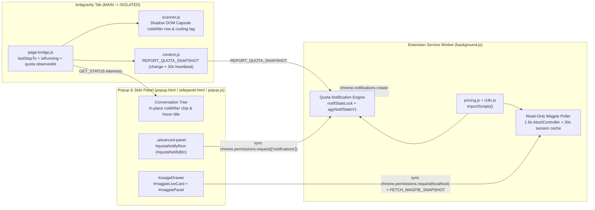

# P2 Technical Specification — Optional Desktop Quota Notifications, Prompt Cache `coldAfter` Freshness Countdown & Read-Only Local Magpie Gateway Integration

> **Status:** Implementation-Ready Specification (P2 Scope Only — builds directly on the P0 + P1 working tree)
> **References:** [AGENTS.md](../AGENTS.md) · [PRIVACY.md](../PRIVACY.md) · [docs/magpie-token-telemetry-research.md](magpie-token-telemetry-research.md) · [docs/p0-token-telemetry-plan.md](p0-token-telemetry-plan.md) · [docs/p1-token-telemetry-plan.md](p1-token-telemetry-plan.md)
> **Target Runtime:** Chromium 120+ (Manifest V3)

---

## 1. Scope Boundaries & Non-Goals

### 1.1 In-Scope (P2 Deliverables)

1. **Optional Desktop Quota Notifications (`manifest.json`, `pricing.js`, `background.js`, `page-bridge.js`, `content.js`, `popup.html`, `sidepanel.html`, `popup.js`)**
   - Declare `"optional_permissions": ["notifications"]` in [manifest.json](../manifest.json) (keeping mandatory `"permissions"` strictly `["storage", "sidePanel", "scripting"]`).
   - Request `"notifications"` strictly on explicit synchronous user click via `chrome.permissions.request({ permissions: ['notifications'] })` before any `await` in `#quotaNotifyBtn`, with clean denial fallback, explicit disable/revoke (`chrome.permissions.remove`), and out-of-band `chrome.permissions.onAdded` / `onRemoved` synchronization.
   - Persist sleep-resilient, multi-tab deduplicated notification state in `chrome.storage.local["agyNotifStateV1"]` (`< 2 KB` bounded, serialized via async mutex `notifStateLock` in [background.js](../background.js) — never relying on ephemeral MV3 Service Worker globals) for two events per 5-hour pool (`gemini`, `premium`):
     1. **Allowance Back Notification:** Fires once per reset cycle when a previously depleted 5h pool (`remainingFraction <= 0.005`) recovers (`remainingFraction >= 0.05` or deterministic scheduled `resetTimeMs + 5000ms` crossing within a 60m freshness window while backgrounded).
     2. **Unused Pre-Reset Quota Reminder:** Fires once per reset cycle when `0 < resetTimeMs - now <= 30 * 60 * 1000` (`<= 30m` left) and `remainingFraction >= 0.40` (`>= 40%` unused quota remaining).
   - Suppress notifications on initial baseline observation, when master `enabled === false` or `quotaNotifications === false`, when permission is missing/revoked, or when pool data is missing/expired; handle `chrome.notifications.onClicked` safely across cold Service Worker wakes.
2. **Prompt Cache 5-Minute / 1-Hour Freshness Countdown (`coldAfter`) (`page-bridge.js`, `pricing.js`, `scanner.js`, `popup.js`, `popup.css`)**
   - Backfill live-streamed `createdAt` / `finishedGeneratingAt` in `page-bridge.js` `applyStepLiveTiming()` and expose `isRunning` on `analyzeConversationSteps()` so `lastStepTs` is populated reliably across both historical RPC steps and live-streamed steps.
   - Implement shared pure helper `evaluateCacheFreshness(convTel, nowMs)` in [pricing.js](../pricing.js) supporting `5m` (`300,000 ms`) standard prompt-cache TTL and `1h` (`3,600,000 ms`) extended TTL (`cacheWrite1hTokens > 0 && cacheWrite5mTokens === 0`), strict exact-precision & cache-token eligibility gates, active-streaming suppression, and silent retirement of stale idle chats (`> 30m` for 5m TTL, `> 90m` for 1h TTL).
   - Define deterministic `warm` -> `cooling` (`<= 60s` for 5m TTL, `<= 5m` for 1h TTL) -> `cold` state transitions using Morandi 3A tokens (`#5E9E8E`, `#C6A265`, muted slate), honoring `@media (prefers-reduced-motion: reduce)` and `@media (forced-colors: active)`.
   - Surface in both the opt-in Shadow DOM composer capsule (`syncInPageCapsules` in [scanner.js](../scanner.js), `WeakMap`-backed, zero `innerHTML`/`localStorage`, WCAG 1.4.13 tooltip + cooling pill) and conversation rows in [popup.js](../popup.js) (hover `title`, `.cache-chip`, and focus-preserving in-place DOM countdown updates that never rebuild `#projectsList` on 1s ticks).
3. **Optional Read-Only Local `magpie` Gateway Integration (`pricing.js`, `background.js`, `popup.html`, `sidepanel.html`, `popup.css`, `popup.js`)**
   - Default **OFF** (`agyMagpieConfigV1.enabled = false`); gated on existing `optional_host_permissions` (`["http://localhost/*", "http://127.0.0.1/*"]`) with synchronous `chrome.permissions.request({ origins: LOCALHOST_ORIGINS })` before any `await` if not yet granted.
   - Enforce strict loopback-only URL validation (`validateMagpieBaseUrl` in [pricing.js](../pricing.js), defaulting to `http://127.0.0.1:3425`): `http:` scheme only, hostname strictly `127.0.0.1` or `localhost`, port `1024..65535`, empty path/query/hash, and zero credentials.
   - Perform read-only `GET` polling of `/v1/magpie/usage` and `/v1/magpie/quotas` (with `/v1/magpie/quotas/cards` 404 fallback) in [background.js](../background.js) using `credentials: 'omit'`, `redirect: 'error'`, `1800ms` `AbortController` timeout, `30s` session-cached throttle (`chrome.storage.session["agyMagpieCacheV1"]`), and silent offline degradation (`reachable: false`, zero console noise or unhandled rejections).
   - Normalize responses defensively and render in a dedicated read-only `#magpieLiveCard` inside `#usageDrawer` **without ever mutating or polluting `chrome.storage.local["agyUsageLedgerV1"]`**.
4. **Cross-Cutting MV3, CSP, Privacy, 10-Locale i18n & Verification Contract (`i18n.js`, `PRIVACY.md`, `scripts/verify.mjs`, `scripts/package.sh`)**
   - Add **42** canonical i18n keys across all 10 locales (`240 -> 282` keys) with 100% `{placeholder}` parity and static literal `t('...')` / `data-i18n*` coverage across HTML, `popup.js`, `scanner.js`, and `background.js`.
   - Update [PRIVACY.md](../PRIVACY.md), [scripts/verify.mjs](../scripts/verify.mjs), and [scripts/package.sh](../scripts/package.sh), and execute both deterministic Node VM tests and live Chrome extension browser debugging checks.

### 1.2 Explicit Non-Goals & Hard Prohibitions

- **Zero Mandatory Permission or External Host Expansion:**
  - `manifest.json` `"permissions"` MUST remain strictly `["storage", "sidePanel", "scripting"]` (no `"alarms"`, `"tabs"`, `"downloads"`, `"cookies"`, or `"notifications"` in mandatory `permissions`).
  - `manifest.json` `"host_permissions"` and `"optional_host_permissions"` MUST remain byte-for-byte unchanged.
- **Zero External Network Calls or Localhost Mutation:**
  - Never send requests to any non-loopback host, and never send `POST`/`PUT`/`DELETE` requests to Magpie (including never calling `POST /v1/magpie/quotas/refresh` or `POST /v1/magpie/usage/requests` — strictly read-only `GET`).
- **Zero Ledger Contamination:**
  - Never merge Magpie `/v1/magpie/usage` counters into `chrome.storage.local["agyUsageLedgerV1"]` or into Antigravity KPI totals (`#kpiTokensVal`, `#kpiCostVal`).
- **Zero Tab Title Text or CSP Violations:**
  - Never append text to `document.title`; zero inline scripts/styles/handlers, zero `innerHTML`, zero `eval()`, zero `localStorage`, and zero `new Worker()`.

---

## 2. File-by-File Architecture & Data Flow Map



| File | World / Surface | P2 Role & Exact Changes |
| :--- | :--- | :--- |
| [manifest.json](../manifest.json) | Extension Manifest (MV3) | Add `"optional_permissions": ["notifications"]` between `"permissions"` and `"optional_host_permissions"`. Zero changes to `permissions`, `host_permissions`, `optional_host_permissions`, or `content_scripts`. |
| [pricing.js](../pricing.js) | SW, Popup, Side Panel, `ISOLATED` | Export P2 storage constants + pure helpers on `globalThis.__AGY_PRICING__`: `evaluateCacheFreshness()`, `formatCacheCountdown()`, `normalizeNotifState()`, `isSameResetCycle()`, `evaluateQuotaNotificationTransitions()`, `validateMagpieBaseUrl()`, `normalizeMagpieConfig()`, `normalizeMagpieUsage()`, and `normalizeMagpieQuotas()`. |
| [page-bridge.js](../page-bridge.js) | `MAIN` (`all_frames: true`) | 1) Track `quotaObservedAt` in `upsertModelConfig()` and include `observedAt` on `quotaPools[poolKey]` in `buildTelemetryPayload()`.<br>2) Backfill `createdAt` and `finishedGeneratingAt` from `liveStepTimings` in `applyStepLiveTiming()` so `lastStepTs` is never `null` after live streaming.<br>3) Include `isRunning: Boolean(convEntry?.isRunning)` in `analyzeConversationSteps()` output. |
| [content.js](../content.js) | `ISOLATED` (Top) | 1) Add `quotaNotifications: false` to `DEFAULT_CONFIG` and `normalizeConfig()`.<br>2) Add `maybeReportQuotaSnapshot()` inside `evaluateAllProjects()` sending `{ type: 'REPORT_QUOTA_SNAPSHOT', workspaceLabel, isTabHidden, fetchedAt, quotaPools }` on meaningful pool changes or `30_000ms` wall-clock heartbeat when `config.enabled && config.quotaNotifications` is active.<br>3) Preserve `observedAt` in `mergeTelemetry()` `quotaPools`. |
| [scanner.js](../scanner.js) | `ISOLATED` (Top & Child) | Upgrade `CAPSULE_CSS`, `buildCapsuleInstance()`, and `updateCapsuleState()` in `syncInPageCapsules()`: render `cacheFreshRow` inside `#agy-cap-tip` (`Warm` / `Cooling` / `Cold`) and compact `.cap-cache-cooling` tag on `.capsule-btn` during the `cooling` window, with smart `15s`/`5s`/`1s` digest quantization honoring `prefers-reduced-motion: reduce` and `forced-colors: active`. |
| [background.js](../background.js) | Extension Service Worker | 1) Update top-level `importScripts('i18n.js', 'pricing.js')`.<br>2) Bind `ensureNotificationListenersBound()` synchronously at top level and upon permission grant (`onClicked` focuses source/open Antigravity tab).<br>3) Add serialized `notifStateLock` + `enqueueNotifOp()` handling `REPORT_QUOTA_SNAPSHOT`, `SYNC_QUOTA_NOTIFICATIONS_STATE`, `CLEAR_QUOTA_NOTIFICATIONS`, and `chrome.permissions.onRemoved` against `chrome.storage.local["agyNotifStateV1"]`.<br>4) Add read-only `FETCH_MAGPIE_SNAPSHOT` handler with strict loopback validation, `hasLocalhostPermission()` gate, `1800ms` `AbortController`, `redirect: 'error'`, `credentials: 'omit'`, and `30s` `chrome.storage.session["agyMagpieCacheV1"]` throttle. |
| [popup.html](../popup.html) / [sidepanel.html](../sidepanel.html) | Extension UI HTML | 1) Insert `#magpieLiveCard` and `<details id="magpiePanel" class="usage-rates-subpanel">` inside `#usageDrawer` above `#usageRatesPanel`.<br>2) Insert `#quotaNotifyRow` (`#quotaNotifyBtn`) inside `.advanced-panel` immediately below `#localhostAccessRow`. Keep both HTML files 100% synchronized except `data-surface`. |
| [popup.css](../popup.css) | Extension UI Styles | Add `@layer components` styles for `.cache-chip` (`.is-warm`, `.is-cooling`, `.is-cold`) and `.magpie-live-card` / `.magpie-status-pill` / `.magpie-refresh-btn` / `.magpie-quota-pills` using Morandi 3A tokens, `light-dark()`, `color-mix(in oklab, ...)`, `@container panel`, `@media (forced-colors: active)`, and `@media (prefers-reduced-motion: reduce)`. |
| [popup.js](../popup.js) | Extension UI Controller | 1) Wire `#quotaNotifyBtn` with synchronous `chrome.permissions.request({ permissions: ['notifications'] })` before any `await`, revoke cleanup, and permission sync.<br>2) Surface `coldAfter` `.cache-chip` and hover `title` in `renderProjectsTree()` + `syncTaskCacheCountdownsInPlace()` (updating countdown text in-place without rebuilding `#projectsList` or disrupting `:hover`/`:focus-within`).<br>3) Wire `#magpieToggleBtn`, `#magpieUrlInput`, `#magpieSaveUrlBtn`, `#magpieRefreshBtn`, and 30s drawer-scoped `FETCH_MAGPIE_SNAPSHOT` rendering into `#magpieLiveCard`. |
| [i18n.js](../i18n.js) | SW, `ISOLATED`, Extension UI | Add **42** canonical keys across all 10 locales (`240 -> 282` keys per locale). |
| [PRIVACY.md](../PRIVACY.md) | Documentation | Document `optional_permissions: ["notifications"]`, `quotaNotifications`, `agyNotifStateV1`, `coldAfter` local timestamps, `agyMagpieConfigV1`, `agyMagpieCacheV1`, and read-only loopback Magpie requests. |
| [scripts/verify.mjs](../scripts/verify.mjs) | Automated Verification | Enforce `optional_permissions: ["notifications"]`, scan `background.js` for `t('...')` keys, update expected key count `240 -> 282`, verify `i18n.js` SW sandbox (`no window`), verify `pricing.js` P2 helpers & Magpie URL security matrix, and verify notification icon asset existence. |
| [scripts/package.sh](../scripts/package.sh) | Release Packager | Keep `RUNTIME_FILES` at the exact 12 root files (`26` total archived files including 4 icons + 10 `_locales`) and assert `[ "$FILE_COUNT" -eq 26 ]`. |

---

## 3. Specification A — Optional Desktop Quota Notifications

### 3.1 `manifest.json` Exact Diff

```diff
   "permissions": [
     "storage",
     "sidePanel",
     "scripting"
   ],
+  "optional_permissions": [
+    "notifications"
+  ],
   "optional_host_permissions": [
     "http://localhost/*",
     "http://127.0.0.1/*"
   ],
```

- **Why `optional_permissions` (and zero `"alarms"` permission):**
  - Existing users upgrading from earlier versions experience **zero** extension disablement / permission-escalation warning banners from Chrome on update.
  - Because open Antigravity tabs already maintain an unthrottled `agy-timer` Port (`POLL_TICK` every `1500ms` in `content.js`), `content.js` drives a lightweight `30_000ms` wall-clock quota heartbeat to `background.js` whenever `config.enabled && config.quotaNotifications` is `true` — achieving timely background notifications without requesting the `"alarms"` permission.

---

### 3.2 User-Gesture Permission Request, Revocation & State Synchronization

1. **Settings UI Control (`#quotaNotifyRow` in `popup.html` & `sidepanel.html`):**
   - Placed in `<details class="card advanced-panel">` right after `#localhostAccessRow`, using the exact same accessible `<button type="button" id="quotaNotifyBtn" class="mini-sync-btn" aria-pressed="false">` pattern as `#localhostAccessBtn` (preventing premature checkbox flip before Chrome's permission dialog resolves):
     ```html
     <div id="quotaNotifyRow" class="compact-row toggle-row">
       <div class="row-label-stack">
         <span id="quotaNotifyLabel" class="row-label" data-i18n="quotaNotifyLabel">Quota desktop alerts</span>
         <span id="quotaNotifyHint" class="row-hint" data-i18n="quotaNotifyHint">Optional alert when depleted 5h quota resets or spare quota is expiring</span>
       </div>
       <button
         type="button"
         id="quotaNotifyBtn"
         class="mini-sync-btn"
         data-i18n="quotaNotifyEnableBtn"
         aria-labelledby="quotaNotifyLabel quotaNotifyBtn"
         aria-describedby="quotaNotifyHint"
         aria-pressed="false"
       >Enable</button>
     </div>
     ```
2. **Synchronous Click Handler Contract (`popup.js`):**
   - Effective UI active state: `const isQuotaNotifyActive = Boolean(currentQuotaNotificationsPref && notificationsPermGranted);`.
   - **Enabling (`!isQuotaNotifyActive`):**
     ```js
     quotaNotifyBtn.addEventListener('click', async () => {
       if (!chrome.permissions) return;
       const currentlyActive = Boolean(currentQuotaNotificationsPref && notificationsPermGranted);
       if (!currentlyActive) {
         // CRITICAL MV3 RULE: Invoke chrome.permissions.request synchronously BEFORE any await!
         const reqPromise = chrome.permissions.request({ permissions: ['notifications'] });
         try {
           const granted = Boolean(await reqPromise);
           notificationsPermGranted = granted;
           currentQuotaNotificationsPref = granted;
           syncQuotaNotifyBtnUI();
           await chrome.storage.sync.set({ quotaNotifications: granted });
           if (granted) {
             chrome.runtime.sendMessage(
               { type: 'SYNC_QUOTA_NOTIFICATIONS_STATE', seedBaseline: true },
               () => {
                 void chrome.runtime.lastError;
               }
             );
             announceFeedback(t('quotaNotifyEnabledFeedback', {}, 'Quota alerts enabled'), 2200);
           } else {
             announceFeedback(
               t('quotaNotifyDeniedFeedback', {}, 'Notification permission not granted'),
               2400
             );
           }
         } catch {
           await refreshNotificationPermissionState();
         }
       } else {
         currentQuotaNotificationsPref = false;
         syncQuotaNotifyBtnUI();
         try {
           await chrome.storage.sync.set({ quotaNotifications: false });
         } catch {}
         try {
           const removed = await chrome.permissions.remove({ permissions: ['notifications'] });
           if (removed) notificationsPermGranted = false;
         } catch {}
         syncQuotaNotifyBtnUI();
         chrome.runtime.sendMessage({ type: 'CLEAR_QUOTA_NOTIFICATIONS' }, () => {
           void chrome.runtime.lastError;
         });
         announceFeedback(t('quotaNotifyDisabledFeedback', {}, 'Quota alerts disabled'), 2200);
       }
     });
     ```
3. **Out-of-Band Revoke & Grant Sync (`background.js` & `popup.js`):**
   - In `background.js`:
     - Helper `hasNotificationsPermission()` checks `Boolean(chrome.permissions?.contains && await chrome.permissions.contains({ permissions: ['notifications'] }))` inside `try/catch`.
     - In `chrome.permissions.onAdded`: call `ensureNotificationListenersBound()`.
     - In `chrome.permissions.onRemoved`: inspect `(perms) => { ... }`. If `Array.isArray(perms?.permissions) && perms.permissions.includes('notifications')` (or `!(await hasNotificationsPermission())`), set `chrome.storage.sync.set({ quotaNotifications: false })` and reset `agyNotifStateV1` to empty uninitialized pools so re-enabling later starts from a clean baseline without stale firing.
   - In `popup.js`:
     - `refreshNotificationPermissionState()` queries `chrome.permissions.contains({ permissions: ['notifications'] })` and updates `notificationsPermGranted` + `syncQuotaNotifyBtnUI()` on startup, on `chrome.permissions.onAdded`, on `chrome.permissions.onRemoved`, and on `chrome.storage.onChanged` (`areaName === 'sync' && 'quotaNotifications' in changes`).

---

### 3.3 Sleep-Resilient & Multi-Tab Deduplicated State Machine (`agyNotifStateV1`)

#### 3.3.1 Storage Schema in `chrome.storage.local["agyNotifStateV1"]` (`< 2 KB`)

```jsonc
{
  "version": 1,
  "updatedAt": 1795100000000,
  "lastSourceTabId": 42,
  "pools": {
    "gemini": {
      "initialized": true,
      "cycleResetMs": 1795108040000,         // Current 5h reset timestamp (or null)
      "lastKnownFrac": 0.68,                 // Authoritative [0, 1] fraction in current cycle
      "lastObservedAt": 1795100000000,       // Timestamp when quotaInfo was last observed from host
      "sampleLabel": "Gemini 2.5 Pro",       // Sanitized display label (<= 64 chars)
      "depleted": false,                     // True while pool is at <= 0.5% (0% rounded)
      "depletedResetMs": null,               // Scheduled resetTimeMs captured when depleted became true
      "lastNotifiedRecoveryResetMs": 0,      // Deduplication watermark for Allowance Back
      "lastNotifiedPreResetMs": 0,           // Deduplication watermark for Unused Pre-Reset Reminder
      "lastFiredAt": 0
    },
    "premium": {
      "initialized": false,
      "cycleResetMs": null,
      "lastKnownFrac": null,
      "lastObservedAt": 0,
      "sampleLabel": "",
      "depleted": false,
      "depletedResetMs": null,
      "lastNotifiedRecoveryResetMs": 0,
      "lastNotifiedPreResetMs": 0,
      "lastFiredAt": 0
    }
  }
}
```

#### 3.3.2 Constants & Cycle Matching Rules (`pricing.js`)

```js
const NOTIF_STATE_STORAGE_KEY = 'agyNotifStateV1';
const NOTIF_DEPLETED_MAX_FRAC = 0.005;               // <= 0.5% (displays as 0%)
const NOTIF_RECOVERED_MIN_FRAC = 0.05;               // >= 5% observed replenishment
const NOTIF_PRE_RESET_WINDOW_MS = 30 * 60 * 1000;    // <= 30m before resetTimeMs
const NOTIF_PRE_RESET_MIN_FRAC = 0.4;                // >= 40% unused quota left
const NOTIF_SAME_CYCLE_TOLERANCE_MS = 10 * 60 * 1000;// ±10m server timestamp jitter tolerance
const NOTIF_RECOVERY_GRACE_MS = 5 * 1000;            // +5s past resetTimeMs for hidden-tab recovery
const NOTIF_MAX_STALE_RECOVERY_MS = 60 * 60 * 1000;  // Suppress offline recovery older than 60m
const NOTIF_MAX_OBSERVATION_AGE_MS = 5 * 60 * 60 * 1000; // 5h max snapshot validity
```

- **`isSameResetCycle(a, b)`:** Returns `true` iff `typeof a === 'number' && typeof b === 'number' && Number.isFinite(a) && Number.isFinite(b) && a > 946684800000 && b > 946684800000 && Math.abs(a - b) <= NOTIF_SAME_CYCLE_TOLERANCE_MS`.
  - Why `±10m` tolerance? Two models sharing the `premium` pool (`Claude Sonnet 4.5` vs `Claude Opus 4.5`) or two Antigravity tabs polling `GetUserStatus` seconds apart can emit `resetTimeMs` values differing by milliseconds to seconds for the exact same 5-hour window. Treating `±10m` as one cycle guarantees **zero duplicate notifications across multi-tab reports**.

#### 3.3.3 Pure Transition Evaluator (`evaluateQuotaNotificationTransitions(notifState, snapshot, nowMs)` in `pricing.js`)

Given normalized `notifState`, incoming `{ tabId, isTabHidden, fetchedAt, quotaPools }`, and `nowMs`:

For each `poolKey` in `['gemini', 'premium']`:
1. Let `ps = notifState.pools[poolKey]` and `incoming = quotaPools?.[poolKey]`.
2. **Missing Data Guard:** If `!incoming || typeof incoming !== 'object'` or `typeof incoming.remainingFraction !== 'number' || !Number.isFinite(incoming.remainingFraction)`:
   - Still check **Hidden-Tab Deterministic Recovery** if `ps.initialized && ps.depleted && ps.depletedResetMs`:
     - If `nowMs >= ps.depletedResetMs + NOTIF_RECOVERY_GRACE_MS`:
       - If `nowMs - ps.depletedResetMs <= NOTIF_MAX_STALE_RECOVERY_MS && !isSameResetCycle(ps.lastNotifiedRecoveryResetMs, ps.depletedResetMs)`:
         emit `{ type: 'allowance_back', poolKey, pct: 100, notificationId: 'agy-quota-back-' + poolKey }`.
       - Set `ps.lastNotifiedRecoveryResetMs = ps.depletedResetMs; ps.depleted = false; ps.depletedResetMs = null; ps.lastFiredAt = nowMs; dirty = true;`.
   - Continue to next pool.
3. Clamp `frac = Math.max(0, Math.min(1, incoming.remainingFraction))`.
   Parse `rawReset = Number(incoming.resetTimeMs)`; `resetMs = Number.isFinite(rawReset) && rawReset > 946684800000 ? Math.round(rawReset) : null`.
   Parse `obsAt = Number(incoming.observedAt || fetchedAt || nowMs)`; clamp to `<= nowMs`.
4. **Multi-Tab Stale Hidden-Tab Protection:**
   - If `ps.initialized && isTabHidden && obsAt < ps.lastObservedAt && isSameResetCycle(resetMs, ps.cycleResetMs)`:
     - Keep authoritative `effFrac = ps.lastKnownFrac` and `effResetMs = ps.cycleResetMs` (so a hidden tab with a 2-hour-old cached `70%` never overwrites an active tab's newer `20%`!).
   - Else if `ps.initialized && isSameResetCycle(resetMs, ps.cycleResetMs) && resetMs !== null && resetMs > nowMs && obsAt <= ps.lastObservedAt + 2000`:
     - Within the same active cycle at the same observation timestamp, take `effFrac = Math.min(ps.lastKnownFrac ?? frac, frac)` and `effResetMs = resetMs`.
   - Else:
     - `effFrac = frac`, `effResetMs = resetMs`, `ps.lastObservedAt = Math.max(ps.lastObservedAt, obsAt)`.
5. **Initial Baseline Suppression (`!ps.initialized`):**
   - Set `ps.initialized = true`, `ps.lastKnownFrac = effFrac`, `ps.cycleResetMs = effResetMs`, `ps.sampleLabel = sanitizeLabel(incoming.sampleLabel)`.
   - If `effFrac <= NOTIF_DEPLETED_MAX_FRAC && effResetMs !== null && effResetMs > nowMs`:
     - Arm recovery for *future* reset (`ps.depleted = true; ps.depletedResetMs = effResetMs;`) **without** firing any notification now.
   - If `effResetMs !== null && effResetMs > nowMs && effResetMs - nowMs <= NOTIF_PRE_RESET_WINDOW_MS && effFrac >= NOTIF_PRE_RESET_MIN_FRAC`:
     - Mark `ps.lastNotifiedPreResetMs = effResetMs` so initial baseline **never** fires an immediate pre-reset reminder on startup/enable.
   - Mark `dirty = true` and **continue** (`0` notifications emitted on baseline!).
6. **Transition 1 — Allowance Back (`ps.depleted === true`):**
   - Triggered when EITHER:
     - **(a) Observed Replenishment:** `effFrac >= NOTIF_RECOVERED_MIN_FRAC` (`>= 5%`), OR
     - **(b) Deterministic Reset Time Reached:** `ps.depletedResetMs !== null && nowMs >= ps.depletedResetMs + NOTIF_RECOVERY_GRACE_MS`.
   - When triggered:
     - Let `cycleKey = ps.depletedResetMs || ps.cycleResetMs || nowMs`.
     - Let `isStaleOffline = ps.depletedResetMs !== null && effFrac < NOTIF_RECOVERED_MIN_FRAC && nowMs - ps.depletedResetMs > NOTIF_MAX_STALE_RECOVERY_MS`.
     - If `!isStaleOffline && !isSameResetCycle(ps.lastNotifiedRecoveryResetMs, cycleKey)`:
       - `const displayPct = effFrac >= NOTIF_RECOVERED_MIN_FRAC ? Math.round(effFrac * 100) : 100;`
       - Emit `{ type: 'allowance_back', poolKey, pct: displayPct, notificationId: 'agy-quota-back-' + poolKey }`.
       - `ps.lastNotifiedRecoveryResetMs = cycleKey; ps.lastFiredAt = nowMs;`
     - Clear `ps.depleted = false; ps.depletedResetMs = null; dirty = true;`.
     - If triggered via `(b)` while `effFrac <= NOTIF_DEPLETED_MAX_FRAC` (hidden tab has not yet fetched new `GetUserStatus`), set `ps.lastKnownFrac = 1` and `ps.cycleResetMs = null` so subsequent hidden heartbeats do NOT re-arm `ps.depleted = true` for the expired `effResetMs`!
7. **Arming Depleted State (`!ps.depleted`):**
   - If `effFrac <= NOTIF_DEPLETED_MAX_FRAC && effResetMs !== null && effResetMs > nowMs && !isSameResetCycle(ps.lastNotifiedRecoveryResetMs, effResetMs)`:
     - `ps.depleted = true; ps.depletedResetMs = effResetMs; dirty = true;`.
8. **Transition 2 — Unused Pre-Reset Quota Reminder:**
   - Check iff `!ps.depleted && effResetMs !== null && effResetMs > nowMs`:
     - `const timeLeftMs = effResetMs - nowMs;`
     - `const obsFresh = nowMs - ps.lastObservedAt <= NOTIF_MAX_OBSERVATION_AGE_MS;`
     - If `obsFresh && timeLeftMs > 60_000 && timeLeftMs <= NOTIF_PRE_RESET_WINDOW_MS && effFrac >= NOTIF_PRE_RESET_MIN_FRAC && !isSameResetCycle(ps.lastNotifiedPreResetMs, effResetMs)`:
       - Emit `{ type: 'pre_reset_unused', poolKey, pct: Math.round(effFrac * 100), timeLeftMs, notificationId: 'agy-quota-rem-' + poolKey }`.
       - `ps.lastNotifiedPreResetMs = effResetMs; ps.lastFiredAt = nowMs; dirty = true;`.
9. Update `ps.lastKnownFrac`, `ps.cycleResetMs`, `ps.sampleLabel`, `notifState.lastSourceTabId = tabId`, `notifState.updatedAt = nowMs`, and return `{ dirty, events }`.

---

### 3.4 Background Delivery, Serialized Lock & Click Handling (`background.js`)

1. **Top-Level `importScripts` & Listener Registration:**
   - At top of `background.js`:
     ```js
     if (typeof importScripts === 'function') {
       importScripts('i18n.js', 'pricing.js');
     }
     ```
   - Call `ensureNotificationListenersBound()` synchronously at top level of `background.js` AND inside `chrome.permissions.onAdded` + right before `chrome.notifications.create`:
     - `onClicked` handler (`handleQuotaNotificationClick(notificationId)`):
       1) Ignore if `!String(notificationId || '').startsWith('agy-quota-')`.
       2) Clear notification: `chrome.notifications.clear(notificationId, () => { void chrome.runtime.lastError; })`.
       3) Read `agyNotifStateV1` from `chrome.storage.local`, check `lastSourceTabId` via `getTabSafe(lastSourceTabId)` (verifying `isAntigravityUrl(tab.url || tab.pendingUrl || '')`), else search `await chrome.tabs.query({})` for the first Antigravity tab; if found, focus tab + window (`chrome.tabs.update(tab.id, { active: true })`, `chrome.windows.update(tab.windowId, { focused: true })`); otherwise open `https://antigravity.google.com/`.
2. **Suppression Gate in `enqueueNotifOp` (`background.js`):**
   - Before evaluating or firing any notification on `REPORT_QUOTA_SNAPSHOT`:
     1) Read `syncCfg = await chrome.storage.sync.get({ enabled: true, quotaNotifications: false })`.
     2) If `!syncCfg.enabled || !syncCfg.quotaNotifications`: return `{ ok: true, skipped: 'disabled' }`.
     3) If `!(await hasNotificationsPermission())`: return `{ ok: true, skipped: 'no_permission' }`.
     4) Acquire `notifStateLock` (serialized promise queue identical to `ledgerWriteLock`), load `agyNotifStateV1` from `chrome.storage.local`, run `evaluateQuotaNotificationTransitions(...)`, persist `agyNotifStateV1` when `dirty === true`, and for each emitted event call:
        ```js
        chrome.notifications.create(
          ev.notificationId,
          {
            type: 'basic',
            iconUrl: chrome.runtime.getURL('icons/icon128.png'),
            title,
            message
          },
          () => {
            void chrome.runtime.lastError;
          }
        );
        ```
3. **Top-Frame Quota Reporting (`content.js`):**
   - Track `lastQuotaReportDigest = ''` and `lastQuotaReportAt = 0`.
   - Inside `evaluateAllProjects()`: if `config.enabled && config.quotaNotifications && latestTelemetry?.quotaPools && (latestTelemetry.quotaPools.gemini || latestTelemetry.quotaPools.premium)`:
     - Build compact digest of `[Math.round((g?.remainingFraction ?? -1) * 100), g?.resetTimeMs ?? 0, g?.unusedPreResetHint ? 1 : 0, Math.round((p?.remainingFraction ?? -1) * 100), p?.resetTimeMs ?? 0, p?.unusedPreResetHint ? 1 : 0]`.
     - Send `{ type: 'REPORT_QUOTA_SNAPSHOT', workspaceLabel: deriveWorkspaceLabel(), isTabHidden: Boolean(document.hidden), fetchedAt: latestTelemetry.fetchedAt, quotaPools: latestTelemetry.quotaPools }` iff `digest !== lastQuotaReportDigest || now - lastQuotaReportAt >= 30_000`.

---

## 4. Specification B — Prompt Cache Freshness Countdown (`coldAfter`)

### 4.1 Timestamp Backfill & `isRunning` Exposure (`page-bridge.js`)

1. **`applyStepLiveTiming()` Timestamp Backfill:**
   - When live streaming updates a step whose Protobuf payload omits `metadata.createdAt` / `metadata.finishedGeneratingAt`, copy observed `timing.startAt` and `timing.finishedAt` onto `next`:
     ```js
     const mergedCreatedAt = next.createdAt ?? prev?.createdAt ?? timing?.startAt ?? null;
     const mergedFinishedAt =
       next.finishedGeneratingAt ?? prev?.finishedGeneratingAt ?? timing?.finishedAt ?? null;
     ```
   - This guarantees `foldStepIntoAccumulator()` sets `acc.lastStepTs` accurately the moment a live-streamed main-model step finishes.
2. **`analyzeConversationSteps()` `isRunning` Field:**
   - Include `isRunning: Boolean(convEntry?.isRunning)` in the returned conversation telemetry object so both `scanner.js` and `popup.js` can suppress `coldAfter` countdowns while a turn is actively streaming.

---

### 4.2 TTL Eligibility, Model Family Applicability & State Thresholds (`pricing.js`)

Add pure function `evaluateCacheFreshness(convTel, nowMs = Date.now())` to `pricing.js`:

1. **Eligibility Gates (returns `null` if ANY gate fails):**
   - `convTel && typeof convTel === 'object'`
   - `convTel.precision === 'exact'` (never estimate/fabricate cache TTL on unpriced conversations)
   - `!Boolean(convTel.isRunning)` (actively generating turns continuously refresh prefix state)
   - `typeof convTel.lastStepTs === 'number' && Number.isFinite(convTel.lastStepTs) && convTel.lastStepTs > 946684800000`
   - Not a shadow/subagent/image model (`!SHADOW_MODEL_RE.test(`${convTel.modelId || ''} ${convTel.modelLabel || ''}`)`).
   - **Cache Activity Proof:**
     Let `snapCache = toNonNegInt(convTel.cacheReadTokens) + toNonNegInt(convTel.cacheCreationTokens)` and `sessCache = toNonNegInt(convTel.sessionCacheReadTokens) + toNonNegInt(convTel.sessionCacheCreationTokens)`.
     Require `snapCache > 0 || sessCache > 0` (applies across Claude ephemeral prompt cache, Gemini implicit/explicit context cache, and OpenAI prefix cache whenever real cache reads/writes occurred; tiny 1-turn non-cached chats with `0` cache tokens return `null`).
2. **TTL Selection (`5m` vs `1h`):**
   - Inspect latest snapshot & session tiered writes:
     ```js
     const cw5m = toNonNegInt(convTel.cacheWrite5mTokens);
     const cw1h = toNonNegInt(convTel.cacheWrite1hTokens);
     const cwTotal = toNonNegInt(convTel.cacheCreationTokens);
     const sessCw5m = toNonNegInt(convTel.sessionCacheWrite5mTokens);
     const sessCw1h = toNonNegInt(convTel.sessionCacheWrite1hTokens);
     const uses1hTier =
       (cw1h > 0 && cw5m === 0 && cwTotal <= cw1h) ||
       (cwTotal === 0 && sessCw1h > 0 && sessCw5m === 0);
     const ttlMs = uses1hTier ? 60 * 60 * 1000 : 5 * 60 * 1000;
     const ttlTier = uses1hTier ? '1h' : '5m';
     ```
3. **Thresholds & Silent Stale Retirement:**
   - `const elapsedMs = Math.max(0, nowMs - convTel.lastStepTs);`
   - `const coldAfterMs = convTel.lastStepTs + ttlMs;`
   - `const remainingMs = coldAfterMs - nowMs;`
   - `const coolingThresholdMs = uses1hTier ? 5 * 60 * 1000 : 60 * 1000;` (`<= 60s` for `5m` TTL; `<= 5m` for `1h` TTL).
   - `const maxColdDisplayElapsedMs = uses1hTier ? 90 * 60 * 1000 : 30 * 60 * 1000;` (`30m` total age for `5m` TTL; `90m` for `1h` TTL).
   - If `elapsedMs > maxColdDisplayElapsedMs`: return `null` (do not clutter old historical chats with permanent "Cache cold" badges).
   - State classification:
     - `remainingMs > coolingThresholdMs` -> `state = 'warm'`
     - `remainingMs > 0` (`0 < remainingMs <= coolingThresholdMs`) -> `state = 'cooling'`
     - `remainingMs <= 0` -> `state = 'cold'`
   - Return:
     ```js
     {
       state,               // 'warm' | 'cooling' | 'cold'
       ttlTier,             // '5m' | '1h'
       ttlMs,
       coldAfterMs,
       remainingMs: Math.max(0, Math.round(remainingMs)),
       elapsedMs: Math.round(elapsedMs)
     }
     ```
4. **Countdown Formatter (`formatCacheCountdown(remainingMs, { compact = false, coarse = false } = {})`):**
   - If `remainingMs <= 0`: return `'0s'`.
   - If `coarse` (used for inline `warm` chips or `prefers-reduced-motion: reduce` 10s quantization):
     - If `remainingMs >= 60_000`: return `${Math.ceil(remainingMs / 60_000)}m`.
     - Else: `const qSec = Math.max(5, Math.ceil(remainingMs / 5000) * 5); return `${qSec}s`;`.
   - Standard (`!coarse`):
     - If `remainingMs >= 60_000`:
       - `const m = Math.floor(remainingMs / 60_000);`
       - `const s = Math.floor((remainingMs % 60_000) / 1000);`
       - Return `compact ? (s > 0 ? `${m}m ${s}s` : `${m}m`) : `${m}m ${String(s).padStart(2, '0')}s``;
     - Else:
       - Return `${Math.max(1, Math.ceil(remainingMs / 1000))}s`.

---

### 4.3 Shadow DOM Composer Capsule Integration (`scanner.js`)

1. **Strict Encapsulation & Accessibility Invariants:**
   - Preserve `attachShadow({ mode: 'open' })`, `capsuleStateMap` (`WeakMap`), `createElement` / `createElementNS` + `textContent` (**zero `innerHTML`**, **zero `localStorage`**, **zero DOM expandos**), and WCAG 1.4.13 hover/focus/`Escape` dismissal.
2. **DOM Additions in `buildCapsuleInstance(host)`:**
   - **Inline `.capsule-btn` Cooling Cue (only visible during `cooling`):**
     - Append `coolingSepSpan` (`class="cap-sep"`, `aria-hidden="true"`, `textContent = '·'`, `hidden = true`) and `coolingTagSpan` (`class="cap-cache-cooling"`, `hidden = true`) after `ctxSpan`.
     - When `fresh?.state === 'cooling'`, unhide both and set `coolingTagSpan.textContent = t('capsuleBtnCoolingTag', { time: btnCountdownStr }, 'TTL ' + btnCountdownStr)`. When `warm`, `cold`, or `null`, keep both `hidden = true` so `.capsule-btn` width stays identical to P0/P1 outside the final 60s cooling window!
   - **Tooltip `#agy-cap-tip` Freshness Row:**
     - Inside `exactWrap` immediately after `cacheRow.row`, append `cacheFreshRow = createCapsuleRow()` (`cacheFreshRow.row.hidden = true` when `fresh === null`).
     - Set `cacheFreshKeyEl.textContent = t('capsuleCacheTtlLabel', {}, 'Cache Freshness')` (`5m` or `1h` suffix appended when `'1h'`: `${label} (1h)`).
     - Set `cacheFreshValEl.className = 'tip-val is-cache-' + fresh.state` (`is-cache-warm` `#5E9E8E`, `is-cache-cooling` `#C6A265`, `is-cache-cold` `var(--cap-tip-muted)`):
       - `'warm'`: `t('capsuleCacheWarmVal', { time: tipTimeStr }, 'Warm · ' + tipTimeStr)`
       - `'cooling'`: `t('capsuleCacheCoolingVal', { time: tipTimeStr }, 'Cooling · ' + tipTimeStr)`
       - `'cold'`: `t('capsuleCacheColdVal', {}, 'Cold (rebuilds next turn)')`
3. **Low-Overhead Digest Quantization & Reduced-Motion / Forced-Colors Rules:**
   - Check `const reduceMotion = typeof window.matchMedia === 'function' && window.matchMedia('(prefers-reduced-motion: reduce)').matches;`.
   - Compute `freshBucket` for `state.lastDigest`:
     - `fresh === null` -> `'none'`
     - `fresh.state === 'cold'` -> `'cold'`
     - `fresh.state === 'warm' && !state.isOpen` -> `'warm:' + Math.floor(fresh.remainingMs / 15000)` (updates at most once every `15s` when tooltip is closed!)
     - `reduceMotion` -> `fresh.state + ':' + Math.ceil(fresh.remainingMs / 5000)` (`5s` coarse steps, zero CSS transitions)
     - Otherwise (`state.isOpen || fresh.state === 'cooling'`) -> `fresh.state + ':' + Math.ceil(fresh.remainingMs / 1000)` (piggybacks on existing `1s–1.5s` poll with zero extra timers).
   - In `CAPSULE_CSS`:
     - `.cap-cache-cooling { color: #C6A265; font-weight: 600; font-variant-numeric: tabular-nums; }` (dark mode `#e4c283`, light mode `#854d0e` via `light-dark(#854d0e, #e4c283)` for >= 4.5:1 WCAG AA text contrast!).
     - `.tip-val.is-cache-warm { color: light-dark(#245a4e, #7ec4b2); }`
     - `.tip-val.is-cache-cooling { color: light-dark(#7c581d, #e4c283); font-weight: 600; }`
     - `.tip-val.is-cache-cold { color: var(--cap-tip-muted); }`
     - Under `@media (forced-colors: active)`: `.cap-cache-cooling, .tip-val.is-cache-cooling { color: Highlight; }`, `.tip-val.is-cache-warm, .tip-val.is-cache-cold { color: CanvasText; }`.

---

### 4.4 Conversation Row Chip, Hover `title` & Focus-Safe In-Place Updates (`popup.js` + `popup.css`)

1. **Preserving Keyboard Focus & Native Hover Tooltips (`popup.js`):**
   - **Critical Invariant:** `renderProjectsTree()` wipes `projectsListEl.textContent = ''` whenever `lastRenderedDigest` changes. Including per-second `remainingMs` inside `lastRenderedDigest` would destroy `:focus-visible` and dismiss native `title` tooltips every second!
   - **Solution:**
     1) In `_resolvedTel`, store `isRunning: Boolean(task.state === 'running' || convTel.isRunning)` and all P0/P1 fields, and include **only** coarse `cacheFreshKey = fresh ? `${fresh.state}:${fresh.ttlTier}` : ''` in `renderProjectsTree`'s `digest` (so full list DOM rebuilds happen **only** on discrete state transitions `'warm' -> 'cooling' -> 'cold' -> ''`).
     2) Stamp `itemLi.dataset.convId = task.convId || (task.isActive ? telemetry?.activeConvId || '' : '')` on rendered `<li class="task-item">` elements and store a `WeakMap` / `renderedTaskLiveRefs` array `{ itemLi, rowBtn, telRow, cacheChipEl, proj, task, convTel }`.
     3) On every `refreshCurrentTabStatus()` cycle, even when `digest === lastRenderedDigest`, run `syncTaskCacheCountdownsInPlace(Date.now())`:
        - Recomputes `fresh = PRICING_API?.evaluateCacheFreshness(ref.convTel, nowMs)`.
        - Updates `ref.cacheChipEl.textContent` only when string value changed (`coarse: fresh.state === 'warm' || prefersReducedMotion`).
        - Updates `ref.rowBtn.title` and `ref.telRow.title` **only when `!ref.itemLi.matches(':hover, :focus-within')`** (or on initial render) so an active hover tooltip or focused button is never disturbed!
2. **Inline `.cache-chip` & `buildTaskHoverTitle` Rules:**
   - In `.task-telemetry-row` (when `convTel && convTel.contextUsed > 0` and `fresh !== null`):
     - Render `<span class="cache-chip is-${fresh.state}">`:
       - `warm`: `t('ctxCacheChipWarm', { time: formatCacheCountdown(fresh.remainingMs, { coarse: true }) })` (e.g. `Cache 4m` — changes only once per minute!)
       - `cooling`: `t('ctxCacheChipCooling', { time: formatCacheCountdown(fresh.remainingMs, { coarse: prefersReducedMotion }) })` (e.g. `Cache 42s`)
       - `cold`: `t('ctxCacheChipCold')` (e.g. `Cache cold`)
   - In `buildTaskHoverTitle(proj, task, convTel, nowMs)`:
     - Append line when `fresh !== null`:
       - `warm`: `t('ctxCacheTipWarm', { ttl: fresh.ttlTier, time: formatCacheCountdown(fresh.remainingMs, { compact: true, coarse: prefersReducedMotion }) })`
       - `cooling`: `t('ctxCacheTipCooling', { ttl: fresh.ttlTier, time: formatCacheCountdown(fresh.remainingMs, { compact: true, coarse: prefersReducedMotion }) })`
       - `cold`: `t('ctxCacheTipCold', { ttl: fresh.ttlTier })`
3. **CSS Rules (`popup.css` inside `@layer components`):**
   - Share base pill geometry with `.ctx-chip, .speed-chip, .compact-chip, .cache-chip`.
   - `.cache-chip.is-warm`: sage tint (`color-mix(in oklab, var(--health-ok) 13%, transparent)`, border `32%`, `color: var(--health-ok-text)`).
   - `.cache-chip.is-cooling`: ochre-amber tint (`color-mix(in oklab, var(--health-warn) 18%, transparent)`, border `44%`, `color: var(--health-warn-text)`).
   - `.cache-chip.is-cold`: neutral sub-surface (`background: var(--header-surface); border-color: var(--card-border); color: var(--text-muted); font-weight: 500;`).
   - Under `@media (forced-colors: active)`: `forced-color-adjust: none; background: Canvas; color: CanvasText; border-color: CanvasText;`, with `.cache-chip.is-cooling { border-color: Highlight; color: Highlight; }` and `.cache-chip.is-cold { border-color: GrayText; color: GrayText; }`.

---

## 5. Specification C — Optional Read-Only Local `magpie` Gateway Integration

### 5.1 Strict Loopback Origin Validation (`validateMagpieBaseUrl` in `pricing.js`)

```js
const DEFAULT_MAGPIE_ENDPOINT = 'http://127.0.0.1:3425';
const MAGPIE_CONFIG_STORAGE_KEY = 'agyMagpieConfigV1';
const MAGPIE_CACHE_SESSION_KEY = 'agyMagpieCacheV1';

function validateMagpieBaseUrl(rawInput) {
  const trimmed = String(rawInput ?? '').trim();
  const candidate = trimmed || DEFAULT_MAGPIE_ENDPOINT;
  if (
    candidate.length > 128 ||
    /[\u0000-\u0020\u007f@?#\\]/.test(candidate)
  ) {
    return { ok: false, origin: '', error: 'invalid_chars' };
  }
  let parsed;
  try {
    parsed = new URL(candidate);
  } catch {
    return { ok: false, origin: '', error: 'invalid_url' };
  }
  if (parsed.protocol !== 'http:') {
    return { ok: false, origin: '', error: 'invalid_scheme' };
  }
  const host = parsed.hostname.toLowerCase();
  if (host !== '127.0.0.1' && host !== 'localhost') {
    return { ok: false, origin: '', error: 'non_loopback_host' };
  }
  if (parsed.username !== '' || parsed.password !== '') {
    return { ok: false, origin: '', error: 'credentials_forbidden' };
  }
  if ((parsed.pathname !== '/' && parsed.pathname !== '') || parsed.search !== '' || parsed.hash !== '') {
    return { ok: false, origin: '', error: 'path_or_query_forbidden' };
  }
  if (!/^\d{4,5}$/.test(parsed.port)) {
    return { ok: false, origin: '', error: 'port_required' };
  }
  const portNum = Number(parsed.port);
  if (!Number.isInteger(portNum) || portNum < 1024 || portNum > 65535) {
    return { ok: false, origin: '', error: 'port_out_of_range' };
  }
  // Block Chromium remote-debugging / Node inspector default ports as defense-in-depth
  if (portNum === 9222 || portNum === 9229) {
    return { ok: false, origin: '', error: 'reserved_debug_port' };
  }
  return {
    ok: true,
    origin: `http://${host}:${portNum}`,
    host,
    port: portNum
  };
}
```

---

### 5.2 Read-Only Polling, Timeout, 30s Throttle & Offline Degradation (`background.js`)

1. **Constants:**
   - `MAGPIE_FETCH_TIMEOUT_MS = 1800` (`1.8s` `AbortController` timeout).
   - `MAGPIE_POLL_THROTTLE_MS = 30_000` (`30s` cache TTL in `chrome.storage.session["agyMagpieCacheV1"]`).
   - `MAGPIE_FORCE_MIN_COOLDOWN_MS = 2_000` (`2s` anti-spam guard on manual Refresh/Save).
   - `MAGPIE_MAX_BODY_CHARS = 512_000` (`512 KB` response ceiling).
   - `VALID_MAGPIE_PERIODS = new Set(['today', '7d', '30d'])`.
2. **Message Contract (`{ type: 'FETCH_MAGPIE_SNAPSHOT', period, force }`):**
   - Reject if `sender?.tab` is truthy (callable strictly from extension Popup / Side Panel pages).
   - Load `agyMagpieConfigV1` from `chrome.storage.local` via `normalizeMagpieConfig`.
   - If `!cfg.enabled`: return `{ ok: true, enabled: false, reachable: false, status: 'disabled' }`.
   - Re-validate `v = validateMagpieBaseUrl(cfg.endpoint)`; if `!v.ok`: return `{ ok: false, enabled: false, reachable: false, status: 'invalid_endpoint' }`.
   - Check `if (!(await hasLocalhostPermission()))`: return `{ ok: true, enabled: true, reachable: false, status: 'permission_missing', endpoint: v.origin }`.
   - Check `chrome.storage.session["agyMagpieCacheV1"]`:
     - Stores `{ endpoint, quotasFetchedAt, quotasStatus, quotas, periods: { [period]: { fetchedAt, reachable, status, usage } } }`.
     - If `!force && cachedPeriod && cached.endpoint === v.origin && now - cachedPeriod.fetchedAt < MAGPIE_POLL_THROTTLE_MS`: return cached snapshot immediately with `fromCache: true` (`0` network calls!).
     - Even if `force === true`, if `cachedPeriod && now - cachedPeriod.fetchedAt < MAGPIE_FORCE_MIN_COOLDOWN_MS`, return cached snapshot.
   - **Safe Read-Only Fetch Helper (`fetchMagpieJson(url, timeoutMs)`):**
     ```js
     async function fetchMagpieJson(url, timeoutMs = MAGPIE_FETCH_TIMEOUT_MS) {
       const controller = new AbortController();
       const timerId = setTimeout(() => {
         try {
           controller.abort();
         } catch {}
       }, timeoutMs);
       try {
         const resp = await fetch(url, {
           method: 'GET',
           credentials: 'omit',
           cache: 'no-store',
           redirect: 'error',
           headers: { Accept: 'application/json' },
           signal: controller.signal
         });
         if (!resp.ok) {
           return { ok: false, httpStatus: resp.status, data: null };
         }
         const txt = await resp.text();
         if (!txt || txt.length > MAGPIE_MAX_BODY_CHARS) {
           return { ok: false, httpStatus: resp.status, data: null };
         }
         const parsed = JSON.parse(txt);
         return { ok: true, httpStatus: resp.status, data: parsed };
       } catch {
         // Silent catch: zero console.error / console.warn when Magpie is not running!
         return { ok: false, httpStatus: 0, data: null };
       } finally {
         clearTimeout(timerId);
       }
     }
     ```
   - Fetch in parallel (`Promise.all`):
     1) `usageRes = fetchMagpieJson(`${v.origin}/v1/magpie/usage?period=${validPeriod}`)`
     2) `quotasRes` (reused from cache if `now - cached.quotasFetchedAt < MAGPIE_POLL_THROTTLE_MS && !force`, else `fetchMagpieJson(`${v.origin}/v1/magpie/quotas`)` with a single fallback to `${v.origin}/v1/magpie/quotas/cards` iff `quotasRes.httpStatus === 404`).
   - Normalize via `pricingApi.normalizeMagpieUsage(usageRes.data)` and `pricingApi.normalizeMagpieQuotas(quotasRes.data)`.
   - `reachable = Boolean((usageRes.ok && normUsage !== null) || (quotasRes.ok && normQuotas !== null))`.
   - Save bounded (< 16 KB) normalized snapshot to `chrome.storage.session["agyMagpieCacheV1"]` (**never** touching `agyUsageLedgerV1`!) and respond `{ ok: true, enabled: true, reachable, status: reachable ? 'online' : 'offline', endpoint: v.origin, period: validPeriod, fetchedAt: now, usage: normUsage, quotas: normQuotas || [] }`.

---

### 5.3 Defensive Schema Normalization (`pricing.js`)

1. **`normalizeMagpieUsage(raw)`:**
   - Unwrap `src = raw?.data && typeof raw.data === 'object' && !Array.isArray(raw.data) ? raw.data : raw?.summary && typeof raw.summary === 'object' ? raw.summary : raw`.
   - Reject (`return null`) if `!src || typeof src !== 'object' || Array.isArray(src)`.
   - **Signature Check:** Require at least one recognized Magpie usage key (`total_tokens`, `totalTokens`, `input_tokens`, `inputTokens`, `requests`, `total_requests`, `calls`, `cost_usd`, `total_cost_usd`, `by_agent`, `byAgent`, `agents`, `by_model`, `byModel`, `models`, `totals`) so unrelated local JSON servers on the same port are cleanly rejected as `null`!
   - Parse non-negative integer counts (`in`, `cr`, `cw`, `out`, `rs`, `totalTokens`, `calls`) and finite `>= 0` `costUsd` / `cacheSavedUsd` (or `null` if absent).
   - Parse `byAgent` (from array or object map `src.by_agent ?? src.byAgent ?? src.agents`, up to `8` entries sorted by `totalTokens` desc): sanitize `name` via `sanitizeProjectName(rawName).slice(0, 48)` (stripping any filesystem paths!), `totalTokens`, `calls`, `costUsd`.
   - Parse `byModel` (up to `8` entries sorted by `totalTokens` desc): sanitized `name`, `totalTokens`, `calls`, `costUsd`.
2. **`normalizeMagpieQuotas(raw)`:**
   - Accept `arr = Array.isArray(raw) ? raw : Array.isArray(raw?.cards) ? raw.cards : Array.isArray(raw?.quotas) ? raw.quotas : Array.isArray(raw?.data) ? raw.data : null`.
   - If `!arr`: return `null`.
   - Map valid entries (up to `8`):
     - Extract `remainingPct`: if `remaining_fraction` / `remainingFraction` in `[0, 1]`, `Math.round(val * 100)`; else if `remaining_percent` / `remainingPct` / `percent_remaining` in `[0, 100]`, `Math.round(val)`; skip entry if neither is finite.
     - Sanitize `label = String(c.label ?? c.title ?? c.provider ?? c.account ?? c.name ?? 'Quota').replace(/[\u0000-\u001f\u007f]/g, '').trim().slice(0, 48)`.
     - Optional `windowLabel = String(c.window ?? c.window_label ?? c.period ?? '').trim().slice(0, 16)` (e.g. `5h`, `7d`).
     - Optional `paceRatio` (finite number clamped to `[0, 9.9]` or `null`).

---

### 5.4 Read-Only UI in `#usageDrawer` (`popup.html`, `sidepanel.html`, `popup.css`, `popup.js`)

1. **HTML Structure inside `#usageDrawer > .usage-body` (placed immediately before `<details id="usageRatesPanel">` in both `popup.html` and `sidepanel.html`):**
   ```html
   <div id="magpieLiveCard" class="magpie-live-card hidden">
     <div class="magpie-head">
       <span class="usage-subtitle" data-i18n="magpieCardTitle">Magpie CLI Gateway (Read-Only)</span>
       <div class="magpie-head-right">
         <span id="magpieStatusPill" class="magpie-status-pill is-offline">Offline</span>
         <button
           type="button"
           id="magpieRefreshBtn"
           class="header-icon-btn magpie-refresh-btn"
           data-i18n-aria-label="magpieRefreshBtnAria"
           data-i18n-title="magpieRefreshBtnAria"
           aria-label="Refresh Magpie gateway data"
           title="Refresh Magpie gateway data"
         >
           <span class="sync-glyph" aria-hidden="true"></span>
         </button>
       </div>
     </div>
     <p id="magpieSummaryLine" class="magpie-summary-line hidden"></p>
     <p id="magpieOfflineNote" class="magpie-offline-note hidden"></p>
     <div id="magpieAgentsSection" class="usage-rank-col hidden">
       <h3 class="usage-subtitle" data-i18n="magpieAgentsTitle">CLI Agents</h3>
       <ul id="magpieAgentsList" class="usage-rank-list" role="list"></ul>
     </div>
     <div id="magpieQuotasSection" class="magpie-quotas-wrap hidden">
       <h3 class="usage-subtitle" data-i18n="magpieQuotasTitle">Gateway Quotas</h3>
       <div id="magpieQuotasList" class="magpie-quota-pills"></div>
     </div>
   </div>

   <details id="magpiePanel" class="usage-rates-subpanel">
     <summary class="usage-rates-summary">
       <span data-i18n="magpiePanelSummary">Local Magpie Gateway (Optional)</span>
     </summary>
     <div class="usage-rates-body">
       <div class="compact-row toggle-row">
         <div class="row-label-stack">
           <span id="magpieToggleLabel" class="row-label" data-i18n="magpieToggleLabel">Read-only CLI usage sync</span>
           <span id="magpieToggleHint" class="row-hint" data-i18n="magpieToggleHint">Polls local Magpie (/v1/magpie/*) without modifying extension ledger</span>
         </div>
         <button
           type="button"
           id="magpieToggleBtn"
           class="mini-sync-btn"
           data-i18n="magpieEnableBtn"
           aria-labelledby="magpieToggleLabel magpieToggleBtn"
           aria-describedby="magpieToggleHint"
           aria-pressed="false"
         >Enable</button>
       </div>
       <div class="field-group">
         <label for="magpieUrlInput" data-i18n="magpieUrlLabel">Loopback endpoint (http://127.0.0.1 or localhost)</label>
         <input
           type="url"
           id="magpieUrlInput"
           class="rate-custom-input magpie-url-input"
           data-i18n-placeholder="magpieUrlPlaceholder"
           placeholder="http://127.0.0.1:3425"
           value="http://127.0.0.1:3425"
           spellcheck="false"
         />
       </div>
       <div class="save-row">
         <span id="magpieFeedback" class="save-feedback" role="status" aria-live="polite"></span>
         <div class="save-right">
           <button type="button" id="magpieSaveUrlBtn" class="secondary-btn" data-i18n="magpieSaveUrlBtn">Save Endpoint</button>
         </div>
       </div>
     </div>
   </details>
   ```
2. **Synchronous User-Gesture Enable & Endpoint Save Flow (`popup.js`):**
   - Clicking `#magpieToggleBtn` when disabled:
     1) **Synchronously** validate `const v = PRICING_API.validateMagpieBaseUrl(magpieUrlInput?.value)` (zero `await`!). If `!v.ok`, announce `t('magpieFeedbackInvalidUrl')` in `#magpieFeedback` and return.
     2) **Synchronously** invoke `const permPromise = chrome.permissions.request({ origins: LOCALHOST_ORIGINS });` BEFORE any `await`!
     3) `const granted = Boolean(await permPromise);`. If `!granted`, announce `t('magpieFeedbackPermDenied')` and keep `enabled: false`.
     4) If `granted`: sync `syncLocalhostBtnUI(true)`, notify `SYNC_LOCALHOST_SCRIPTS`, persist `{ version: 1, enabled: true, endpoint: v.origin }` to `chrome.storage.local["agyMagpieConfigV1"]`, and call `void refreshMagpieSnapshot({ force: true })`.
   - Clicking `#magpieToggleBtn` when enabled:
     - Persist `{ version: 1, enabled: false, endpoint: currentMagpieConfig.endpoint }` to `chrome.storage.local["agyMagpieConfigV1"]`, hide `#magpieLiveCard`, and announce `t('magpieFeedbackDisabled')` (does NOT revoke `localhost` permission automatically in case the user uses Localhost Antigravity webviews!).
   - Clicking `#magpieSaveUrlBtn`:
     - Validate `v = PRICING_API.validateMagpieBaseUrl(magpieUrlInput?.value)` synchronously. If `!v.ok`, announce `t('magpieFeedbackInvalidUrl')` and return.
     - If `currentMagpieConfig.enabled` and `!localhostGranted`, synchronously request `chrome.permissions.request({ origins: LOCALHOST_ORIGINS })` before any `await`.
     - Persist normalized `endpoint: v.origin` to `agyMagpieConfigV1`, announce `t('magpieFeedbackSaved')`, and if `enabled`, call `void refreshMagpieSnapshot({ force: true })`.
   - Drawer-scoped 30s polling:
     - When `#usageDrawer` opens (`toggle` event) or `usagePeriodButtons` switches `today | 7d | 30d` while `currentMagpieConfig.enabled === true`: call `void refreshMagpieSnapshot({ force: false })`.
     - Run a `30_000ms` `setInterval` in `popup.js` that calls `refreshMagpieSnapshot({ force: false })` **only** when `currentMagpieConfig.enabled && usageDrawer?.open && document.visibilityState === 'visible'`.
   - Currency conversion: convert `usage.costUsd` and `agent.costUsd` using `currentPricingConfig` (`currency === 'CNY' ? costUsd * usdToCnyRate : costUsd`) via `PRICING_API.formatCostValue(...)` so toggling `USD | CNY` updates `#magpieLiveCard` instantaneously alongside the extension's own drawer.

---

## 6. Cross-Cutting Storage, 10-Locale i18n, Privacy & Verification Contract

### 6.1 Complete Storage Schema Summary (`sync` vs. `local` vs. `session`)

| Storage Area | Key | Default | Sanitization & Bounds | Purpose |
| :--- | :--- | :--- | :--- | :--- |
| `chrome.storage.sync` | `quotaNotifications` *(added to canonical 11 keys -> 12 keys)* | `false` | `Boolean(val)`; gated at runtime on `enabled && hasNotificationsPermission()`. Total sync payload `< 512 B` (`QUOTA_BYTES_PER_ITEM = 8,192 B`). | User preference for optional 5h quota desktop alerts. |
| `chrome.storage.local` | `agyUsageLedgerV1` *(P1, unchanged)* | Empty v1 ledger | `< 240 KB`, 90-day rolling retention, 300 LRU watermarks. **Never touched by Magpie.** | On-device Antigravity token & cost ledger. |
| `chrome.storage.local` | `agyPricingConfigV1` *(P1, unchanged)* | `USD`, `7.25`, `{}` | `< 8 KB`, max 50 model overrides. | Offline display currency & per-model rate overrides. |
| `chrome.storage.local` | `agyNotifStateV1` *(new in P2)* | Uninitialized `gemini` & `premium` pools | Fixed 2-pool schema (`gemini`, `premium`), sanitized 64-char `sampleLabel`, finite numbers only; `< 2 KB`. | Sleep-resilient MV3 Service Worker notification deduplication & recovery tracking. |
| `chrome.storage.local` | `agyMagpieConfigV1` *(new in P2)* | `{ version: 1, enabled: false, endpoint: "http://127.0.0.1:3425" }` | `enabled`: boolean; `endpoint`: `validateMagpieBaseUrl()` fallback to `http://127.0.0.1:3425`; `< 256 B`. | Opt-in local Magpie gateway toggle & validated loopback origin. |
| `chrome.storage.session` | `agyTabBadges` *(existing)* | `{}` | Per-tab `{ count, hasWaiting, updatedAt }`, pruned against open tabs. | Ephemeral cross-tab toolbar badge counts. |
| `chrome.storage.session` | `agyMagpieCacheV1` *(new in P2)* | `{}` | Max 3 period buckets (`today`, `7d`, `30d`), max 8 agents/models/quotas per bucket; `< 16 KB`, memory-only. | Ephemeral 30s throttle & read-only UI cache across SW sleeps. |

---

### 6.2 Exact 10-Locale i18n Catalog (`i18n.js` & `scripts/verify.mjs`)

- **P1 baseline key count:** `240`
- **New P2 keys:** `42` (`14` HTML `data-i18n*` keys + `4` `background.js` `t('...')` keys + `5` `scanner.js` `t('...')` keys + `19` `popup.js`-only `t('...')` keys)
- **Updated canonical key count:** **`282`** across all 10 locales (`en`, `zh_CN`, `zh_TW`, `ja`, `ko`, `es`, `fr`, `de`, `pt_BR`, `ru`).
- **Static Call-Site Invariant:** Every `t('...')` call MUST pass a static string literal key so `scripts/verify.mjs` discovers all `282` keys across `popup.html`, `sidepanel.html`, `popup.js`, `content.js`, `scanner.js`, `background.js`, and `page-bridge.js`.

#### 6.2.1 Canonical Key & Placeholder Matrix (`42` New Keys)

| # | Key | Placeholders | Surface / Call Sites |
| :--- | :--- | :--- | :--- |
| 1 | `quotaNotifyLabel` | *(none)* | `popup.html`, `sidepanel.html` (`data-i18n`) |
| 2 | `quotaNotifyHint` | *(none)* | `popup.html`, `sidepanel.html` (`data-i18n`) |
| 3 | `quotaNotifyEnableBtn` | *(none)* | `popup.html`, `sidepanel.html` (`data-i18n`), `popup.js` (`t(...)`) |
| 4 | `quotaNotifyDisableBtn` | *(none)* | `popup.js` (`t(...)`) |
| 5 | `quotaNotifyEnabledFeedback` | *(none)* | `popup.js` (`t(...)`) |
| 6 | `quotaNotifyDisabledFeedback` | *(none)* | `popup.js` (`t(...)`) |
| 7 | `quotaNotifyDeniedFeedback` | *(none)* | `popup.js` (`t(...)`) |
| 8 | `notifAllowanceBackTitle` | `{pool}` | `background.js` (`t(...)`) |
| 9 | `notifAllowanceBackBody` | `{pct}`, `{pool}` | `background.js` (`t(...)`) |
| 10 | `notifPreResetTitle` | `{pool}` | `background.js` (`t(...)`) |
| 11 | `notifPreResetBody` | `{pct}`, `{pool}`, `{time}` | `background.js` (`t(...)`) |
| 12 | `ctxCacheChipWarm` | `{time}` | `popup.js` (`t(...)`) |
| 13 | `ctxCacheChipCooling` | `{time}` | `popup.js` (`t(...)`) |
| 14 | `ctxCacheChipCold` | *(none)* | `popup.js` (`t(...)`) |
| 15 | `ctxCacheTipWarm` | `{time}`, `{ttl}` | `popup.js` (`t(...)`) |
| 16 | `ctxCacheTipCooling` | `{time}`, `{ttl}` | `popup.js` (`t(...)`) |
| 17 | `ctxCacheTipCold` | `{ttl}` | `popup.js` (`t(...)`) |
| 18 | `capsuleCacheTtlLabel` | *(none)* | `scanner.js` (`t(...)`) |
| 19 | `capsuleCacheWarmVal` | `{time}` | `scanner.js` (`t(...)`) |
| 20 | `capsuleCacheCoolingVal` | `{time}` | `scanner.js` (`t(...)`) |
| 21 | `capsuleCacheColdVal` | *(none)* | `scanner.js` (`t(...)`) |
| 22 | `capsuleBtnCoolingTag` | `{time}` | `scanner.js` (`t(...)`) |
| 23 | `magpiePanelSummary` | *(none)* | `popup.html`, `sidepanel.html` (`data-i18n`) |
| 24 | `magpieToggleLabel` | *(none)* | `popup.html`, `sidepanel.html` (`data-i18n`) |
| 25 | `magpieToggleHint` | *(none)* | `popup.html`, `sidepanel.html` (`data-i18n`) |
| 26 | `magpieEnableBtn` | *(none)* | `popup.html`, `sidepanel.html` (`data-i18n`), `popup.js` (`t(...)`) |
| 27 | `magpieDisableBtn` | *(none)* | `popup.js` (`t(...)`) |
| 28 | `magpieUrlLabel` | *(none)* | `popup.html`, `sidepanel.html` (`data-i18n`) |
| 29 | `magpieUrlPlaceholder` | *(none)* | `popup.html`, `sidepanel.html` (`data-i18n-placeholder`) |
| 30 | `magpieSaveUrlBtn` | *(none)* | `popup.html`, `sidepanel.html` (`data-i18n`) |
| 31 | `magpieRefreshBtnAria` | *(none)* | `popup.html`, `sidepanel.html` (`data-i18n-aria-label`, `data-i18n-title`) |
| 32 | `magpieCardTitle` | *(none)* | `popup.html`, `sidepanel.html` (`data-i18n`) |
| 33 | `magpieStatusOnline` | *(none)* | `popup.js` (`t(...)`) |
| 34 | `magpieStatusOffline` | *(none)* | `popup.js` (`t(...)`) |
| 35 | `magpieSummaryLine` | `{calls}`, `{cost}`, `{tokens}` | `popup.js` (`t(...)`) |
| 36 | `magpieOfflineNote` | `{endpoint}` | `popup.js` (`t(...)`) |
| 37 | `magpieAgentsTitle` | *(none)* | `popup.html`, `sidepanel.html` (`data-i18n`) |
| 38 | `magpieQuotasTitle` | *(none)* | `popup.html`, `sidepanel.html` (`data-i18n`) |
| 39 | `magpieFeedbackSaved` | *(none)* | `popup.js` (`t(...)`) |
| 40 | `magpieFeedbackInvalidUrl` | *(none)* | `popup.js` (`t(...)`) |
| 41 | `magpieFeedbackPermDenied` | *(none)* | `popup.js` (`t(...)`) |
| 42 | `magpieFeedbackDisabled` | *(none)* | `popup.js` (`t(...)`) |

#### 6.2.2 Exact Translations Across All 10 Locales

```js
// 1. en
quotaNotifyLabel: 'Quota desktop alerts',
quotaNotifyHint: 'Optional alert when depleted 5h quota resets or spare quota is expiring',
quotaNotifyEnableBtn: 'Enable',
quotaNotifyDisableBtn: 'Disable',
quotaNotifyEnabledFeedback: 'Quota alerts enabled',
quotaNotifyDisabledFeedback: 'Quota alerts disabled',
quotaNotifyDeniedFeedback: 'Notification permission not granted',
notifAllowanceBackTitle: '{pool} Quota Restored',
notifAllowanceBackBody: 'Your 5-hour {pool} allowance is available again ({pct}% remaining).',
notifPreResetTitle: '{pool} Quota Refreshing Soon',
notifPreResetBody: '{pct}% unused {pool} quota resets in {time}.',
ctxCacheChipWarm: 'Cache {time}',
ctxCacheChipCooling: 'Cache {time}',
ctxCacheChipCold: 'Cache cold',
ctxCacheTipWarm: 'Prompt cache ({ttl}): Warm · ~{time} left',
ctxCacheTipCooling: 'Prompt cache ({ttl}): Cooling · ~{time} before expiry',
ctxCacheTipCold: 'Prompt cache ({ttl}): Cold · Next turn rebuilds prefix',
capsuleCacheTtlLabel: 'Cache Freshness',
capsuleCacheWarmVal: 'Warm · {time}',
capsuleCacheCoolingVal: 'Cooling · {time}',
capsuleCacheColdVal: 'Cold (rebuilds next turn)',
capsuleBtnCoolingTag: 'TTL {time}',
magpiePanelSummary: 'Local Magpie Gateway (Optional)',
magpieToggleLabel: 'Read-only CLI usage sync',
magpieToggleHint: 'Polls local Magpie (/v1/magpie/*) without modifying extension ledger',
magpieEnableBtn: 'Enable',
magpieDisableBtn: 'Disable',
magpieUrlLabel: 'Loopback endpoint (http://127.0.0.1 or localhost)',
magpieUrlPlaceholder: 'http://127.0.0.1:3425',
magpieSaveUrlBtn: 'Save Endpoint',
magpieRefreshBtnAria: 'Refresh Magpie gateway data',
magpieCardTitle: 'Magpie CLI Gateway (Read-Only)',
magpieStatusOnline: 'Connected',
magpieStatusOffline: 'Offline',
magpieSummaryLine: '{tokens} tokens · {cost} · {calls} reqs',
magpieOfflineNote: 'No active Magpie gateway at {endpoint}.',
magpieAgentsTitle: 'CLI Agents',
magpieQuotasTitle: 'Gateway Quotas',
magpieFeedbackSaved: 'Magpie endpoint saved',
magpieFeedbackInvalidUrl: 'Use http://127.0.0.1:<port> or http://localhost:<port>',
magpieFeedbackPermDenied: 'Localhost permission required',
magpieFeedbackDisabled: 'Magpie sync disabled',

// 2. zh_CN
quotaNotifyLabel: '配额桌面提醒',
quotaNotifyHint: '可选：5 小时配额耗尽后恢复或重置前余量充裕时发送系统通知',
quotaNotifyEnableBtn: '开启',
quotaNotifyDisableBtn: '关闭',
quotaNotifyEnabledFeedback: '配额提醒已开启',
quotaNotifyDisabledFeedback: '配额提醒已关闭',
quotaNotifyDeniedFeedback: '未授予系统通知权限',
notifAllowanceBackTitle: '{pool} 配额已恢复',
notifAllowanceBackBody: '您的 5 小时 {pool} 配额已刷新恢复（当前剩余 {pct}%）。',
notifPreResetTitle: '{pool} 配额即将重置',
notifPreResetBody: '距离重置仅剩 {time}，仍有 {pct}% 可用 {pool} 配额余量。',
ctxCacheChipWarm: '缓存 {time}',
ctxCacheChipCooling: '缓存 {time}',
ctxCacheChipCold: '缓存已冷',
ctxCacheTipWarm: '前缀缓存 ({ttl})：保鲜中 · 剩余约 {time}',
ctxCacheTipCooling: '前缀缓存 ({ttl})：即将变冷 · 约 {time} 后过期',
ctxCacheTipCold: '前缀缓存 ({ttl})：已过期 · 下次续聊将重建前缀缓存',
capsuleCacheTtlLabel: '缓存保鲜',
capsuleCacheWarmVal: '热保鲜 · {time}',
capsuleCacheCoolingVal: '即将冷却 · {time}',
capsuleCacheColdVal: '已冷（下轮重建前缀）',
capsuleBtnCoolingTag: '保鲜 {time}',
magpiePanelSummary: '本地 Magpie 网关联动（可选）',
magpieToggleLabel: '只读同步 CLI 代理用量',
magpieToggleHint: '只读拉取本地 Magpie (/v1/magpie/*)，绝不污染插件本地账本',
magpieEnableBtn: '开启',
magpieDisableBtn: '关闭',
magpieUrlLabel: '本地回环地址 (http://127.0.0.1 或 localhost)',
magpieUrlPlaceholder: 'http://127.0.0.1:3425',
magpieSaveUrlBtn: '保存地址',
magpieRefreshBtnAria: '立即刷新 Magpie 网关数据',
magpieCardTitle: 'Magpie 本地网关（只读视图）',
magpieStatusOnline: '已连接',
magpieStatusOffline: '未运行',
magpieSummaryLine: '{tokens} Token · {cost} · {calls} 次请求',
magpieOfflineNote: '未在 {endpoint} 检测到运行中的 Magpie 服务。',
magpieAgentsTitle: 'CLI 编程代理',
magpieQuotasTitle: '网关配额池',
magpieFeedbackSaved: 'Magpie 地址已保存',
magpieFeedbackInvalidUrl: '仅支持 http://127.0.0.1:<端口> 或 http://localhost:<端口>',
magpieFeedbackPermDenied: '需要授予本地 localhost 访问权限',
magpieFeedbackDisabled: 'Magpie 同步已关闭',

// 3. zh_TW
quotaNotifyLabel: '配額桌面提醒',
quotaNotifyHint: '可選：5 小時配額耗盡後恢復或重設前餘量充裕時發送系統通知',
quotaNotifyEnableBtn: '開啟',
quotaNotifyDisableBtn: '關閉',
quotaNotifyEnabledFeedback: '配額提醒已開啟',
quotaNotifyDisabledFeedback: '配額提醒已關閉',
quotaNotifyDeniedFeedback: '未授予系統通知權限',
notifAllowanceBackTitle: '{pool} 配額已恢復',
notifAllowanceBackBody: '您的 5 小時 {pool} 配額已重新整理恢復（目前剩餘 {pct}%）。',
notifPreResetTitle: '{pool} 配額即將重設',
notifPreResetBody: '距離重設僅剩 {time}，仍有 {pct}% 可用 {pool} 配額餘量。',
ctxCacheChipWarm: '快取 {time}',
ctxCacheChipCooling: '快取 {time}',
ctxCacheChipCold: '快取已冷',
ctxCacheTipWarm: '前綴快取 ({ttl})：保鮮中 · 剩餘約 {time}',
ctxCacheTipCooling: '前綴快取 ({ttl})：即將變冷 · 約 {time} 後過期',
ctxCacheTipCold: '前綴快取 ({ttl})：已過期 · 下次續聊將重建前綴快取',
capsuleCacheTtlLabel: '快取保鮮',
capsuleCacheWarmVal: '熱保鮮 · {time}',
capsuleCacheCoolingVal: '即將冷卻 · {time}',
capsuleCacheColdVal: '已冷（下輪重建前綴）',
capsuleBtnCoolingTag: '保鮮 {time}',
magpiePanelSummary: '本機 Magpie 閘道連動（可選）',
magpieToggleLabel: '唯讀同步 CLI 代理用量',
magpieToggleHint: '唯讀擷取本機 Magpie (/v1/magpie/*)，絕不污染擴充功能帳本',
magpieEnableBtn: '開啟',
magpieDisableBtn: '關閉',
magpieUrlLabel: '本機回送位址 (http://127.0.0.1 或 localhost)',
magpieUrlPlaceholder: 'http://127.0.0.1:3425',
magpieSaveUrlBtn: '儲存位址',
magpieRefreshBtnAria: '立即重新整理 Magpie 閘道資料',
magpieCardTitle: 'Magpie 本機閘道（唯讀檢視）',
magpieStatusOnline: '已連線',
magpieStatusOffline: '離線',
magpieSummaryLine: '{tokens} Token · {cost} · {calls} 次請求',
magpieOfflineNote: '未在 {endpoint} 偵測到運作中的 Magpie 服務。',
magpieAgentsTitle: 'CLI 程式代理',
magpieQuotasTitle: '閘道配額池',
magpieFeedbackSaved: 'Magpie 位址已儲存',
magpieFeedbackInvalidUrl: '僅支援 http://127.0.0.1:<連接埠> 或 http://localhost:<連接埠>',
magpieFeedbackPermDenied: '需要授予本機 localhost 存取權限',
magpieFeedbackDisabled: 'Magpie 同步已關閉',

// 4. ja
quotaNotifyLabel: 'クォータのデスクトップ通知',
quotaNotifyHint: 'オプション: 5時間枠の回復時やリセット前の未使用残量を通知',
quotaNotifyEnableBtn: '有効化',
quotaNotifyDisableBtn: '無効化',
quotaNotifyEnabledFeedback: 'クォータ通知を有効にしました',
quotaNotifyDisabledFeedback: 'クォータ通知を無効にしました',
quotaNotifyDeniedFeedback: '通知権限が許可されていません',
notifAllowanceBackTitle: '{pool} クォータが回復しました',
notifAllowanceBackBody: '5時間 {pool} クォータが再び利用可能になりました（残り {pct}%）。',
notifPreResetTitle: '{pool} クォータがまもなく更新',
notifPreResetBody: 'あと {time} でリセットされます（未使用 {pool} 残り {pct}%）。',
ctxCacheChipWarm: 'キャッシュ {time}',
ctxCacheChipCooling: 'キャッシュ {time}',
ctxCacheChipCold: 'キャッシュ期限切れ',
ctxCacheTipWarm: 'プロンプトキャッシュ ({ttl}): 有効 · 残り約 {time}',
ctxCacheTipCooling: 'プロンプトキャッシュ ({ttl}): 失効間近 · 約 {time} で期限切れ',
ctxCacheTipCold: 'プロンプトキャッシュ ({ttl}): 期限切れ · 次回送信時に再構築',
capsuleCacheTtlLabel: 'キャッシュ有効期限',
capsuleCacheWarmVal: '有効 · {time}',
capsuleCacheCoolingVal: '失効間近 · {time}',
capsuleCacheColdVal: '期限切れ（次回再構築）',
capsuleBtnCoolingTag: 'TTL {time}',
magpiePanelSummary: 'ローカル Magpie 連携（オプション）',
magpieToggleLabel: 'CLI 使用量の読み取り専用同期',
magpieToggleHint: 'ローカル Magpie (/v1/magpie/*) を参照（拡張機能の履歴は変更しません）',
magpieEnableBtn: '有効化',
magpieDisableBtn: '無効化',
magpieUrlLabel: 'ループバック URL (http://127.0.0.1 または localhost)',
magpieUrlPlaceholder: 'http://127.0.0.1:3425',
magpieSaveUrlBtn: 'URL を保存',
magpieRefreshBtnAria: 'Magpie データを更新',
magpieCardTitle: 'Magpie CLI ゲートウェイ（読み取り専用）',
magpieStatusOnline: '接続中',
magpieStatusOffline: 'オフライン',
magpieSummaryLine: '{tokens} トークン · {cost} · {calls} リクエスト',
magpieOfflineNote: '{endpoint} で稼働中の Magpie が見つかりません。',
magpieAgentsTitle: 'CLI エージェント',
magpieQuotasTitle: 'ゲートウェイクォータ',
magpieFeedbackSaved: 'Magpie URL を保存しました',
magpieFeedbackInvalidUrl: 'http://127.0.0.1:<port> または http://localhost:<port> を入力してください',
magpieFeedbackPermDenied: 'localhost アクセス権限が必要です',
magpieFeedbackDisabled: 'Magpie 同期を無効にしました',

// 5. ko
quotaNotifyLabel: '할당량 데스크톱 알림',
quotaNotifyHint: '선택 사항: 소진된 5시간 할당량 복구 또는 초기화 전 여유분 알림',
quotaNotifyEnableBtn: '켜기',
quotaNotifyDisableBtn: '끄기',
quotaNotifyEnabledFeedback: '할당량 알림이 켜짐',
quotaNotifyDisabledFeedback: '할당량 알림이 꺼짐',
quotaNotifyDeniedFeedback: '알림 권한이 허용되지 않음',
notifAllowanceBackTitle: '{pool} 할당량 복구됨',
notifAllowanceBackBody: '5시간 {pool} 할당량이 다시 충전되었습니다 ({pct}% 남음).',
notifPreResetTitle: '{pool} 할당량 곧 초기화',
notifPreResetBody: '{time} 후 초기화됩니다 (미사용 {pool} 할당량 {pct}% 남음).',
ctxCacheChipWarm: '캐시 {time}',
ctxCacheChipCooling: '캐시 {time}',
ctxCacheChipCold: '캐시 식음',
ctxCacheTipWarm: '프롬프트 캐시 ({ttl}): 활성 · 약 {time} 남음',
ctxCacheTipCooling: '프롬프트 캐시 ({ttl}): 만료 임박 · 약 {time} 남음',
ctxCacheTipCold: '프롬프트 캐시 ({ttl}): 만료됨 · 다음 대화 시 캐시 재생성',
capsuleCacheTtlLabel: '캐시 유효시간',
capsuleCacheWarmVal: '활성 · {time}',
capsuleCacheCoolingVal: '만료 임박 · {time}',
capsuleCacheColdVal: '만료됨 (다음 턴 재생성)',
capsuleBtnCoolingTag: 'TTL {time}',
magpiePanelSummary: '로컬 Magpie 게이트웨이 연동 (선택)',
magpieToggleLabel: 'CLI 사용량 읽기 전용 동기화',
magpieToggleHint: '로컬 Magpie (/v1/magpie/*) 조회 (확장 프로그램 원장 미변경)',
magpieEnableBtn: '켜기',
magpieDisableBtn: '끄기',
magpieUrlLabel: '루프백 주소 (http://127.0.0.1 또는 localhost)',
magpieUrlPlaceholder: 'http://127.0.0.1:3425',
magpieSaveUrlBtn: '주소 저장',
magpieRefreshBtnAria: 'Magpie 게이트웨이 데이터 새로고침',
magpieCardTitle: 'Magpie CLI 게이트웨이 (읽기 전용)',
magpieStatusOnline: '연결됨',
magpieStatusOffline: '오프라인',
magpieSummaryLine: '{tokens} 토큰 · {cost} · {calls}회 요청',
magpieOfflineNote: '{endpoint}에서 실행 중인 Magpie를 찾을 수 없습니다.',
magpieAgentsTitle: 'CLI 에이전트',
magpieQuotasTitle: '게이트웨이 할당량',
magpieFeedbackSaved: 'Magpie 주소 저장됨',
magpieFeedbackInvalidUrl: 'http://127.0.0.1:<포트> 또는 http://localhost:<포트> 형식을 사용하세요',
magpieFeedbackPermDenied: 'localhost 접근 권한이 필요합니다',
magpieFeedbackDisabled: 'Magpie 동기화 꺼짐',

// 6. es
quotaNotifyLabel: 'Alertas de cuota en escritorio',
quotaNotifyHint: 'Opcional: avisa al recuperarse la cuota de 5h o si queda margen antes del reinicio',
quotaNotifyEnableBtn: 'Activar',
quotaNotifyDisableBtn: 'Desactivar',
quotaNotifyEnabledFeedback: 'Alertas de cuota activadas',
quotaNotifyDisabledFeedback: 'Alertas de cuota desactivadas',
quotaNotifyDeniedFeedback: 'Permiso de notificaciones no concedido',
notifAllowanceBackTitle: 'Cuota de {pool} restaurada',
notifAllowanceBackBody: 'Tu cuota de 5 horas de {pool} vuelve a estar disponible ({pct}% restante).',
notifPreResetTitle: 'Reinicio próximo de cuota {pool}',
notifPreResetBody: 'Queda {pct}% de cuota {pool} sin usar y se reinicia en {time}.',
ctxCacheChipWarm: 'Caché {time}',
ctxCacheChipCooling: 'Caché {time}',
ctxCacheChipCold: 'Caché fría',
ctxCacheTipWarm: 'Caché de prompt ({ttl}): Activa · ~{time} restantes',
ctxCacheTipCooling: 'Caché de prompt ({ttl}): Enfriándose · expira en ~{time}',
ctxCacheTipCold: 'Caché de prompt ({ttl}): Fría · El próximo turno reconstruirá el prefijo',
capsuleCacheTtlLabel: 'Frescura de caché',
capsuleCacheWarmVal: 'Activa · {time}',
capsuleCacheCoolingVal: 'Expira en · {time}',
capsuleCacheColdVal: 'Fría (se reconstruirá)',
capsuleBtnCoolingTag: 'TTL {time}',
magpiePanelSummary: 'Pasarela local Magpie (Opcional)',
magpieToggleLabel: 'Sincronización CLI de solo lectura',
magpieToggleHint: 'Consulta Magpie local (/v1/magpie/*) sin alterar el historial local',
magpieEnableBtn: 'Activar',
magpieDisableBtn: 'Desactivar',
magpieUrlLabel: 'Endpoint loopback (http://127.0.0.1 o localhost)',
magpieUrlPlaceholder: 'http://127.0.0.1:3425',
magpieSaveUrlBtn: 'Guardar URL',
magpieRefreshBtnAria: 'Actualizar datos de Magpie',
magpieCardTitle: 'Pasarela CLI Magpie (Solo lectura)',
magpieStatusOnline: 'Conectado',
magpieStatusOffline: 'Sin conexión',
magpieSummaryLine: '{tokens} tokens · {cost} · {calls} solic.',
magpieOfflineNote: 'No se detectó Magpie activo en {endpoint}.',
magpieAgentsTitle: 'Agentes CLI',
magpieQuotasTitle: 'Cuotas de pasarela',
magpieFeedbackSaved: 'Endpoint de Magpie guardado',
magpieFeedbackInvalidUrl: 'Use http://127.0.0.1:<puerto> o http://localhost:<puerto>',
magpieFeedbackPermDenied: 'Se requiere permiso para localhost',
magpieFeedbackDisabled: 'Sincronización Magpie desactivada',

// 7. fr
quotaNotifyLabel: 'Alertes bureau de quota',
quotaNotifyHint: 'Optionnel : alerte au retour du quota 5h ou avant réinitialisation',
quotaNotifyEnableBtn: 'Activer',
quotaNotifyDisableBtn: 'Désactiver',
quotaNotifyEnabledFeedback: 'Alertes de quota activées',
quotaNotifyDisabledFeedback: 'Alertes de quota désactivées',
quotaNotifyDeniedFeedback: 'Autorisation de notification refusée',
notifAllowanceBackTitle: 'Quota {pool} rétabli',
notifAllowanceBackBody: 'Votre quota 5h {pool} est de nouveau disponible ({pct}% restant).',
notifPreResetTitle: 'Réinitialisation {pool} imminente',
notifPreResetBody: '{pct}% de quota {pool} inutilisé sera réinitialisé dans {time}.',
ctxCacheChipWarm: 'Cache {time}',
ctxCacheChipCooling: 'Cache {time}',
ctxCacheChipCold: 'Cache froid',
ctxCacheTipWarm: 'Cache prompt ({ttl}) : Chaud · ~{time} restant',
ctxCacheTipCooling: 'Cache prompt ({ttl}) : Expire bientôt · ~{time}',
ctxCacheTipCold: 'Cache prompt ({ttl}) : Froid · Reconstruit au prochain tour',
capsuleCacheTtlLabel: 'Fraîcheur du cache',
capsuleCacheWarmVal: 'Chaud · {time}',
capsuleCacheCoolingVal: 'Expire · {time}',
capsuleCacheColdVal: 'Froid (sera reconstruit)',
capsuleBtnCoolingTag: 'TTL {time}',
magpiePanelSummary: 'Passerelle locale Magpie (Optionnel)',
magpieToggleLabel: 'Suivi CLI en lecture seule',
magpieToggleHint: 'Interroge Magpie local (/v1/magpie/*) sans modifier le journal local',
magpieEnableBtn: 'Activer',
magpieDisableBtn: 'Désactiver',
magpieUrlLabel: 'Adresse loopback (http://127.0.0.1 ou localhost)',
magpieUrlPlaceholder: 'http://127.0.0.1:3425',
magpieSaveUrlBtn: 'Enregistrer l’URL',
magpieRefreshBtnAria: 'Actualiser les données Magpie',
magpieCardTitle: 'Passerelle CLI Magpie (Lecture seule)',
magpieStatusOnline: 'Connecté',
magpieStatusOffline: 'Hors ligne',
magpieSummaryLine: '{tokens} tokens · {cost} · {calls} req.',
magpieOfflineNote: 'Aucune passerelle Magpie active sur {endpoint}.',
magpieAgentsTitle: 'Agents CLI',
magpieQuotasTitle: 'Quotas passerelle',
magpieFeedbackSaved: 'Adresse Magpie enregistrée',
magpieFeedbackInvalidUrl: 'Utilisez http://127.0.0.1:<port> ou http://localhost:<port>',
magpieFeedbackPermDenied: 'Autorisation localhost requise',
magpieFeedbackDisabled: 'Synchronisation Magpie désactivée',

// 8. de
quotaNotifyLabel: 'Desktop-Kontingentbenachrichtigungen',
quotaNotifyHint: 'Optional: Hinweis bei erneuertem 5h-Kontingent oder freier Reserve vor Reset',
quotaNotifyEnableBtn: 'Aktivieren',
quotaNotifyDisableBtn: 'Deaktivieren',
quotaNotifyEnabledFeedback: 'Kontingent-Hinweise aktiviert',
quotaNotifyDisabledFeedback: 'Kontingent-Hinweise deaktiviert',
quotaNotifyDeniedFeedback: 'Benachrichtigungsberechtigung nicht erteilt',
notifAllowanceBackTitle: '{pool}-Kontingent wieder verfügbar',
notifAllowanceBackBody: 'Dein 5-Stunden-{pool}-Kontingent ist wieder frei ({pct}% übrig).',
notifPreResetTitle: '{pool}-Kontingent wird bald zurückgesetzt',
notifPreResetBody: 'Noch {pct}% ungenutztes {pool}-Kontingent vor Reset in {time}.',
ctxCacheChipWarm: 'Cache {time}',
ctxCacheChipCooling: 'Cache {time}',
ctxCacheChipCold: 'Cache kalt',
ctxCacheTipWarm: 'Prompt-Cache ({ttl}): Warm · noch ~{time}',
ctxCacheTipCooling: 'Prompt-Cache ({ttl}): Kühlt ab · läuft in ~{time} ab',
ctxCacheTipCold: 'Prompt-Cache ({ttl}): Kalt · Nächste Anfrage baut Präfix neu auf',
capsuleCacheTtlLabel: 'Cache-Frische',
capsuleCacheWarmVal: 'Warm · {time}',
capsuleCacheCoolingVal: 'Läuft ab · {time}',
capsuleCacheColdVal: 'Kalt (Neubau beim nächsten Zug)',
capsuleBtnCoolingTag: 'TTL {time}',
magpiePanelSummary: 'Lokales Magpie-Gateway (Optional)',
magpieToggleLabel: 'Schreibgeschützte CLI-Synchronisierung',
magpieToggleHint: 'Liest lokales Magpie (/v1/magpie/*) ohne Änderung des Erweiterungs-Verlaufs',
magpieEnableBtn: 'Aktivieren',
magpieDisableBtn: 'Deaktivieren',
magpieUrlLabel: 'Loopback-Endpunkt (http://127.0.0.1 oder localhost)',
magpieUrlPlaceholder: 'http://127.0.0.1:3425',
magpieSaveUrlBtn: 'Endpunkt speichern',
magpieRefreshBtnAria: 'Magpie-Gateway-Daten aktualisieren',
magpieCardTitle: 'Magpie-CLI-Gateway (Schreibgeschützt)',
magpieStatusOnline: 'Verbunden',
magpieStatusOffline: 'Offline',
magpieSummaryLine: '{tokens} Tokens · {cost} · {calls} Anfr.',
magpieOfflineNote: 'Kein aktives Magpie-Gateway unter {endpoint}.',
magpieAgentsTitle: 'CLI-Agenten',
magpieQuotasTitle: 'Gateway-Kontingente',
magpieFeedbackSaved: 'Magpie-Endpunkt gespeichert',
magpieFeedbackInvalidUrl: 'Nur http://127.0.0.1:<Port> oder http://localhost:<Port> erlaubt',
magpieFeedbackPermDenied: 'Localhost-Berechtigung erforderlich',
magpieFeedbackDisabled: 'Magpie-Synchronisierung deaktiviert',

// 9. pt_BR
quotaNotifyLabel: 'Alertas de cota na área de trabalho',
quotaNotifyHint: 'Opcional: avisa quando a cota de 5h volta ou há sobra antes do reinício',
quotaNotifyEnableBtn: 'Ativar',
quotaNotifyDisableBtn: 'Desativar',
quotaNotifyEnabledFeedback: 'Alertas de cota ativados',
quotaNotifyDisabledFeedback: 'Alertas de cota desativados',
quotaNotifyDeniedFeedback: 'Permissão de notificação não concedida',
notifAllowanceBackTitle: 'Cota {pool} restaurada',
notifAllowanceBackBody: 'Sua cota de 5 horas de {pool} está disponível novamente ({pct}% restante).',
notifPreResetTitle: 'Cota {pool} reinicia em breve',
notifPreResetBody: '{pct}% da cota {pool} sem uso reinicia em {time}.',
ctxCacheChipWarm: 'Cache {time}',
ctxCacheChipCooling: 'Cache {time}',
ctxCacheChipCold: 'Cache frio',
ctxCacheTipWarm: 'Cache de prompt ({ttl}): Quente · ~{time} restantes',
ctxCacheTipCooling: 'Cache de prompt ({ttl}): Esfriando · expira em ~{time}',
ctxCacheTipCold: 'Cache de prompt ({ttl}): Frio · Próximo turno recriará o prefixo',
capsuleCacheTtlLabel: 'Validade do cache',
capsuleCacheWarmVal: 'Quente · {time}',
capsuleCacheCoolingVal: 'Expira · {time}',
capsuleCacheColdVal: 'Frio (recria no próx. turno)',
capsuleBtnCoolingTag: 'TTL {time}',
magpiePanelSummary: 'Gateway local Magpie (Opcional)',
magpieToggleLabel: 'Sincronização CLI somente leitura',
magpieToggleHint: 'Consulta o Magpie local (/v1/magpie/*) sem alterar o histórico da extensão',
magpieEnableBtn: 'Ativar',
magpieDisableBtn: 'Desativar',
magpieUrlLabel: 'Endpoint loopback (http://127.0.0.1 ou localhost)',
magpieUrlPlaceholder: 'http://127.0.0.1:3425',
magpieSaveUrlBtn: 'Salvar endpoint',
magpieRefreshBtnAria: 'Atualizar dados do Magpie',
magpieCardTitle: 'Gateway CLI Magpie (Somente leitura)',
magpieStatusOnline: 'Conectado',
magpieStatusOffline: 'Offline',
magpieSummaryLine: '{tokens} tokens · {cost} · {calls} reqs',
magpieOfflineNote: 'Nenhum gateway Magpie ativo em {endpoint}.',
magpieAgentsTitle: 'Agentes CLI',
magpieQuotasTitle: 'Cotas do gateway',
magpieFeedbackSaved: 'Endpoint do Magpie salvo',
magpieFeedbackInvalidUrl: 'Use http://127.0.0.1:<porta> ou http://localhost:<porta>',
magpieFeedbackPermDenied: 'Permissão para localhost necessária',
magpieFeedbackDisabled: 'Sincronização Magpie desativada',

// 10. ru
quotaNotifyLabel: 'Уведомления о квоте на рабочем столе',
quotaNotifyHint: 'Опционально: уведомлять о восстановлении 5ч квоты или остатке перед сбросом',
quotaNotifyEnableBtn: 'Включить',
quotaNotifyDisableBtn: 'Отключить',
quotaNotifyEnabledFeedback: 'Уведомления о квоте включены',
quotaNotifyDisabledFeedback: 'Уведомления о квоте отключены',
quotaNotifyDeniedFeedback: 'Разрешение на уведомления не выдано',
notifAllowanceBackTitle: 'Квота {pool} восстановлена',
notifAllowanceBackBody: 'Ваш 5-часовой лимит {pool} снова доступен (осталось {pct}%).',
notifPreResetTitle: 'Скорый сброс квоты {pool}',
notifPreResetBody: 'Неиспользованные {pct}% квоты {pool} сбросятся через {time}.',
ctxCacheChipWarm: 'Кэш {time}',
ctxCacheChipCooling: 'Кэш {time}',
ctxCacheChipCold: 'Кэш остыл',
ctxCacheTipWarm: 'Кэш промпта ({ttl}): Тёплый · осталось ~{time}',
ctxCacheTipCooling: 'Кэш промпта ({ttl}): Остывает · истекает через ~{time}',
ctxCacheTipCold: 'Кэш промпта ({ttl}): Холодный · Следующий шаг пересоберёт префикс',
capsuleCacheTtlLabel: 'Свежесть кэша',
capsuleCacheWarmVal: 'Тёплый · {time}',
capsuleCacheCoolingVal: 'Истекает · {time}',
capsuleCacheColdVal: 'Остыл (пересборка на след. шаге)',
capsuleBtnCoolingTag: 'TTL {time}',
magpiePanelSummary: 'Локальный шлюз Magpie (Опционально)',
magpieToggleLabel: 'Синхронизация CLI (только чтение)',
magpieToggleHint: 'Опрашивает локальный Magpie (/v1/magpie/*), не изменяя журнал расширения',
magpieEnableBtn: 'Включить',
magpieDisableBtn: 'Отключить',
magpieUrlLabel: 'Loopback-адрес (http://127.0.0.1 или localhost)',
magpieUrlPlaceholder: 'http://127.0.0.1:3425',
magpieSaveUrlBtn: 'Сохранить адрес',
magpieRefreshBtnAria: 'Обновить данные шлюза Magpie',
magpieCardTitle: 'CLI-шлюз Magpie (Только чтение)',
magpieStatusOnline: 'Подключён',
magpieStatusOffline: 'Не в сети',
magpieSummaryLine: '{tokens} токенов · {cost} · {calls} запр.',
magpieOfflineNote: 'Активный шлюз Magpie по адресу {endpoint} не обнаружен.',
magpieAgentsTitle: 'CLI-агенты',
magpieQuotasTitle: 'Квоты шлюза',
magpieFeedbackSaved: 'Адрес Magpie сохранён',
magpieFeedbackInvalidUrl: 'Используйте http://127.0.0.1:<порт> или http://localhost:<порт>',
magpieFeedbackPermDenied: 'Требуется доступ к localhost',
magpieFeedbackDisabled: 'Синхронизация Magpie отключена',
```

---

### 6.3 Exact `PRIVACY.md` Updates

Update [PRIVACY.md](../PRIVACY.md) in four targeted places so every P2 storage key, timestamp, optional permission, and loopback request is transparently disclosed:

1. **§2 Information Processed Locally (first bullet):**
   - Append in-memory step completion timestamps (`lastStepTs`) used locally to compute `5m`/`1h` prompt-cache freshness countdowns (`coldAfter`).
2. **§3.1 Synced UI Preferences (`chrome.storage.sync`):**
   - Add: `- quotaNotifications (boolean): opt-in toggle for local desktop 5-hour quota recovery and pre-reset reminders (default false; requires optional browser notifications permission)`.
3. **§3.2 On-Device Usage Ledger, Pricing, Notification Dedup & Local Magpie Config (`chrome.storage.local` & `chrome.storage.session`):**
   - Document **`agyNotifStateV1` (`chrome.storage.local`):** stores only non-personal 5-hour pool fractions, reset timestamps, and per-cycle notification watermarks (`gemini`, `premium`, `< 2 KB`) so MV3 Service Worker sleep/wake cycles and multiple tabs never emit duplicate desktop notifications.
   - Document **`agyMagpieConfigV1` (`chrome.storage.local`) & `agyMagpieCacheV1` (`chrome.storage.session`):** stores the opt-in `enabled` flag (default `false`) and validated loopback origin (default `http://127.0.0.1:3425`), plus a memory-only 30-second read-only response cache cleared when the browser closes. Read-only Magpie summaries are never written into `agyUsageLedgerV1` and never leave the device.
4. **§4 Permissions & Network Access:**
   - Add **`optional_permissions` (`notifications`)**: Not granted at install time. Requested strictly on explicit user click when enabling **Quota desktop alerts** (`chrome.permissions.request({ permissions: ['notifications'] })`), used solely to display local system notifications when a depleted 5-hour quota pool recovers or when unused quota is about to reset, and revocable anytime via **Disable** (`chrome.permissions.remove()`).
   - Update **Optional Host Permissions (`http://localhost/*`, `http://127.0.0.1/*`)** and **Zero Remote Calls**: Clarify that when the user explicitly enables the optional **Local Magpie Gateway** view, the Service Worker performs read-only `GET` requests (`credentials: 'omit'`, `redirect: 'error'`, `1.8s` timeout, `30s` throttle) strictly to the validated loopback origin (`http://127.0.0.1:<port>` or `http://localhost:<port>`) on `/v1/magpie/usage` and `/v1/magpie/quotas`. Zero external or non-loopback network calls are ever made.

> **Chrome Web Store Readiness Note ([CHROMEWEBSTORE.md](../CHROMEWEBSTORE.md)):** When preparing the next store submission, append the `notifications` optional permission justification (`"Requested only when the user explicitly enables Quota Desktop Alerts in settings, used solely to notify locally when a depleted 5-hour model quota pool refreshes or when unused quota is about to reset."`) to §2 of `CHROMEWEBSTORE.md`.

---

### 6.4 Tooling Updates (`scripts/verify.mjs` & `scripts/package.sh`)

1. **`scripts/verify.mjs`:**
   - **Section 2 (`manifest.json` scope):**
     - Keep `manifest.permissions` assertion strictly `['storage', 'sidePanel', 'scripting']`.
     - Add `EXPECTED_OPTIONAL_PERMISSIONS = ['notifications']` and assert `Array.isArray(manifest.optional_permissions) && manifest.optional_permissions.length === 1 && manifest.optional_permissions[0] === 'notifications'`.
   - **Section 4 (`i18n.js` 282-key parity & SW sandbox):**
     - Expand `t('...')` scan array from `['popup.js', 'content.js', 'scanner.js']` to `['popup.js', 'content.js', 'scanner.js', 'background.js']`.
     - Update expected key count from `240` to **`282`**.
     - Verify `i18n.js` initializes `globalThis.__AGY_I18N__` cleanly when `window` is `undefined` (classic MV3 Service Worker `importScripts('i18n.js')` environment).
   - **Section 4b (`pricing.js` P2 pure-function & loopback security matrix):**
     - Assert `api.validateMagpieBaseUrl('http://127.0.0.1:3425').ok === true` and `api.validateMagpieBaseUrl('http://localhost:4310').ok === true`.
     - Assert `api.validateMagpieBaseUrl` rejects `'https://127.0.0.1:3425'`, `'http://evil.com:3425'`, `'http://192.168.1.2:3425'`, `'http://0.0.0.0:3425'`, `'http://user:pw@127.0.0.1:3425'`, `'http://127.0.0.1:3425/v1?x=1'`, `'http://127.0.0.1:80'`, and `'http://127.0.0.1:9222'`.
     - Assert `typeof api.evaluateCacheFreshness === 'function'` and `typeof api.evaluateQuotaNotificationTransitions === 'function'`.
   - **Section 5 (`CSP & notification icon safety`):**
     - Assert that if `background.js` calls `chrome.notifications.create`, `existsRel('icons/icon128.png')` is `true` and `background.js` references `icons/icon128.png` via `chrome.runtime.getURL`.
     - Assert `background.js` Magpie fetch specifies `redirect: 'error'` and `credentials: 'omit'`.
2. **`scripts/package.sh`:**
   - Keep `RUNTIME_FILES` at the exact 12 root files (`manifest.json`, `background.js`, `i18n.js`, `pricing.js`, `page-bridge.js`, `scanner.js`, `content.js`, `frame-detector.js`, `popup.html`, `sidepanel.html`, `popup.css`, `popup.js`), and add `[ "$FILE_COUNT" -eq 26 ]` sanity check before finishing (`12` root files + `4` icons + `10` locale `messages.json` files = `26`).

---

## 7. Concrete Automated & Live Browser Debugging Test Plan

### 7.1 Automated Node VM Verification Matrix

Next-stage implementers and verifiers MUST run `node scripts/verify.mjs`, `bash scripts/package.sh`, and a temporary out-of-repo Node VM harness (`$TMPDIR/test-p2-telemetry.mjs`, deleted immediately after execution so zero test artifacts remain in the working tree) covering **T1–T11**:

| ID | Feature Area | Deterministic Input / Scenario | Required Invariant / Expected Output |
| :--- | :--- | :--- | :--- |
| **T1** | Quota Notifications — Initial Baseline Suppression | Cold `agyNotifStateV1` (`initialized: false`) receives first snapshot with `gemini` at `0%` (`resetTimeMs = T + 2h`) and `premium` at `65%` (`resetTimeMs = T + 20m`) | **Zero** `chrome.notifications.create` calls on baseline! `gemini.depleted === true` armed for `T + 2h`; `premium.lastNotifiedPreResetMs === T + 20m` suppressed for current cycle. |
| **T2** | Quota Notifications — Allowance Back (Live & Hidden-Tab Reset) | (a) Armed `depleted: true` (`resetTimeMs = T1`) receives `remainingFraction: 1.0`<br>(b) Armed `depleted: true` (`resetTimeMs = T1`) receives hidden-tab heartbeat at `T1 + 6s` (`frac` still `0`), followed 20s later by focus refresh (`frac: 1.0`)<br>(c) Laptop wakes at `T1 + 3h` (`> 60m` stale) | (a) Fires **1** `agy-quota-back-*` notification (`100%`).<br>(b) Fires **1** notification at `T1 + 6s`, and **0** duplicate notifications when `frac: 1.0` arrives 20s later.<br>(c) Stale offline reset suppressed (`0` notifications). |
| **T3** | Quota Notifications — Unused Pre-Reset Reminder & Multi-Tab Dedup | Pool initialized at `T - 45m` (`frac: 0.55`). At `T - 29m`, Tab A reports `resetTimeMs: R` and Tab B concurrently reports `resetTimeMs: R + 1500ms` (`frac: 0.55`) | `notifStateLock` + `isSameResetCycle` (`±10m`) fires **exactly 1** `agy-quota-rem-*` notification across both tabs. Subsequent ticks at `T - 28m..1m` fire `0` duplicates. |
| **T4** | Quota Notifications — Stale Hidden-Tab Immunity & Revoke Gate | Tab A (visible, `observedAt = 100s`) reports `frac: 0.20` (`< 40%`). Tab B (hidden, `observedAt = 10s`) reports stale `frac: 0.75` at `T - 25m`. Also test `enabled: false`, `quotaNotifications: false`, and `permissions.onRemoved(['notifications'])` | Stale hidden Tab B does NOT overwrite `0.20` -> `0` false reminders! Disabled switch or revoked permission emits `0` notifications and resets `agyNotifStateV1`. |
| **T5** | Quota Notifications — SW Cold-Wake `onClicked` | Simulate fresh Service Worker VM startup with `agyNotifStateV1.lastSourceTabId = 17` and dispatch `chrome.notifications.onClicked('agy-quota-back-premium')` | Top-level `onClicked` listener activates Tab `17`, focuses its window, and clears `'agy-quota-back-premium'`; falls back to first open Antigravity tab or `https://antigravity.google.com/` when Tab `17` is closed. |
| **T6** | Prompt Cache `coldAfter` — Eligibility & `5m` vs `1h` TTL | (a) `precision: 'estimated'`<br>(b) `precision: 'exact'`, `0` cache read/write tokens<br>(c) `isRunning: true`<br>(d) `cacheWrite5mTokens: 4000`, `lastStepTs: now - 120s`<br>(e) `cacheWrite1hTokens: 8000, cacheWrite5mTokens: 0`, `lastStepTs: now - 10m` | (a, b, c) `evaluateCacheFreshness` returns `null`.<br>(d) `ttlTier === '5m'`, `state === 'warm'`, `remainingMs === 180_000`.<br>(e) `ttlTier === '1h'`, `state === 'warm'`, `remainingMs === 3_000_000`. |
| **T7** | Prompt Cache `coldAfter` — `warm` / `cooling` / `cold` / Silent Retirement | `5m` eligible chat evaluated at elapsed `180s`, `255s`, `305s`, and `31m` (`1,860s`) | `180s` -> `'warm'`; `255s` (`45s` left `<= 60s`) -> `'cooling'`; `305s` -> `'cold'`; `31m` (`> 30m`) -> `null` (old idle chat retired cleanly). |
| **T8** | Live Stream `lastStepTs` & Capsule / Popup Focus Preservation | (a) Stream step in `page-bridge.js` with no Protobuf timestamps (`RUNNING` -> `DONE`)<br>(b) Tick `popup.js` 5 times across `1s` intervals while `warm` (`3m 40s`..`3m 36s`) | (a) `applyStepLiveTiming` backfills `finishedGeneratingAt`, populating `conv.lastStepTs` and `conv.isRunning === false`.<br>(b) `renderProjectsTree` does **not** clear `projectsListEl.textContent` on intra-state ticks; `syncTaskCacheCountdownsInPlace` preserves DOM node identity and skips `title` writes on `:hover`/`:focus-within`. |
| **T9** | Magpie URL Validator Security Matrix | Test `''`, `'http://127.0.0.1:3425'`, `'http://localhost:8787'`, `'https://127.0.0.1:3425'`, `'http://10.0.0.2:3425'`, `'http://[::1]:3425'`, `'http://a:b@127.0.0.1:3425'`, `'http://127.0.0.1:3425/api'`, `'http://127.0.0.1:3425?x=1'`, `'http://127.0.0.1:9222'` | Only `''` (-> `http://127.0.0.1:3425`), `'http://127.0.0.1:3425'`, and `'http://localhost:8787'` return `ok: true`; every non-http, non-loopback, credentialed, path/query, or debug-port input returns `ok: false`. |
| **T10** | Magpie Poller — 30s Throttle, Timeout, Offline Silence & Ledger Purity | (a) Seed `agyUsageLedgerV1` (`120k` tokens), poll mock Magpie returning `2.5M` tokens twice within `10s`<br>(b) Simulate `ECONNREFUSED`, `AbortError` (`> 1800ms`), `HTTP 500`, and `{ "hello": "world" }` | (a) Second call within `30s` hits `agyMagpieCacheV1` (`fetch` called once); `agyUsageLedgerV1` remains byte-for-byte `120k` tokens.<br>(b) All 4 failure modes resolve `{ ok: true, reachable: false }` with **zero** `console.error`/`warn` and **zero** unhandled rejections. |
| **T11** | Repository Verification & Clean Packaging | Run `node scripts/verify.mjs` and `bash scripts/package.sh` | `verify.mjs` passes all checks (`282` i18n keys across 10 locales, `optional_permissions: ["notifications"]`, zero CSP/PII leaks); `package.sh` archives exactly `26` runtime files. |

---

### 7.2 Live Chrome Extension Browser Debugging Test Plan (Stage 2 Implementer Checklist)

The Stage 2 implementer MUST validate the live extension in Chromium / Chrome DevTools following `chrome-extensions` and `modern-web-guidance` standards:

1. **Extension Reload & Service Worker Lifecycle Inspection (`chrome://extensions`):**
   - Load unpacked extension from the repository root; verify **zero** manifest warnings and **zero** install-time permission prompts for Notifications or Localhost.
   - Open the **Service Worker** DevTools console: confirm `globalThis.__AGY_I18N__` and `globalThis.__AGY_PRICING__` are defined, and verify **zero** uncaught errors on startup.
2. **Synchronous User-Gesture Permission Flows (Popup & Side Panel):**
   - Open `popup.html` and click **Enable** on **Quota desktop alerts** (`#quotaNotifyBtn`): verify Chrome's native Notifications permission prompt opens without throwing `"This function must be called during a user gesture"`, flips to `aria-pressed="true"` (`Disable`) on allow, and reverts cleanly with polite status feedback if denied.
   - In `chrome://extensions` -> Details -> Site/Permissions settings, revoke Notifications out-of-band while Side Panel is open: verify `#quotaNotifyBtn` automatically reverts to `Enable` (`aria-pressed="false"`) and `agyNotifStateV1` resets cleanly.
   - Stop the Service Worker (`chrome://serviceworker-internals` -> **Stop**), trigger a simulated quota recovery / pre-reset transition from an Antigravity tab, confirm the OS notification renders `icons/icon128.png` cleanly, stop the SW again, and click the OS notification to confirm cold-wake `chrome.notifications.onClicked` focuses the Antigravity tab.
3. **Prompt Cache `coldAfter` UI, Accessibility & Theme Emulation:**
   - Enable **Show in-page composer capsule** (`#showInPageCapsuleToggle`) on an active Antigravity conversation with exact `modelUsage`:
     - Hover and keyboard-`Tab` to `.capsule-btn`: verify `#agy-cap-tip` displays `Cache Freshness: Warm · 4m XXs`, transitions to `Cooling · XXs` (with inline `TTL XXs` tag on `.capsule-btn`) below `60s`, transitions to `Cold` after `5m`, and dismisses on `Escape` (WCAG 1.4.13).
   - In `popup.html` (`360px` width) and `sidepanel.html` (`360px` and `540px` widths):
     - Verify `.cache-chip` (`is-warm`, `is-cooling`, `is-cold`) renders without horizontal overflow (`scrollWidth <= clientWidth`), keyboard focus on `.task-row` stays stable across `1s` refresh ticks, and native hover `title` remains open without flickering.
     - Use Chrome DevTools **Rendering** tab to emulate `prefers-color-scheme: light`, `prefers-color-scheme: dark`, `forced-colors: active`, and `prefers-reduced-motion: reduce`: verify system colors (`Canvas`, `CanvasText`, `Highlight`), `>= 4.5:1` contrast, and coarse/non-animated updates under reduced motion.
4. **Local Magpie Gateway Live Loopback & Offline Resilience Check:**
   - Open `#usageDrawer` -> **Local Magpie Gateway (Optional)**:
     - Enter `https://evil.example.com:3425` and click **Save Endpoint**: verify immediate validation error without any permission prompt or network request.
     - With **no** server running on `127.0.0.1:3425`, click **Enable**: grant localhost permission if prompted, verify `#magpieLiveCard` shows `Offline` calmly in `< 50ms` (`ECONNREFUSED`) with **zero** red errors in Popup or Service Worker DevTools consoles.
     - Start a temporary read-only mock server in `$TMPDIR` on `127.0.0.1:3425` serving `/v1/magpie/usage` and `/v1/magpie/quotas`, click `#magpieRefreshBtn`, verify `Connected` pill + CLI Agents bars + Gateway Quotas render accurately in both `USD` and `CNY`, verify `#kpiTokensVal` / `agyUsageLedgerV1` remain completely unchanged, and terminate/delete the temporary mock script afterward.
